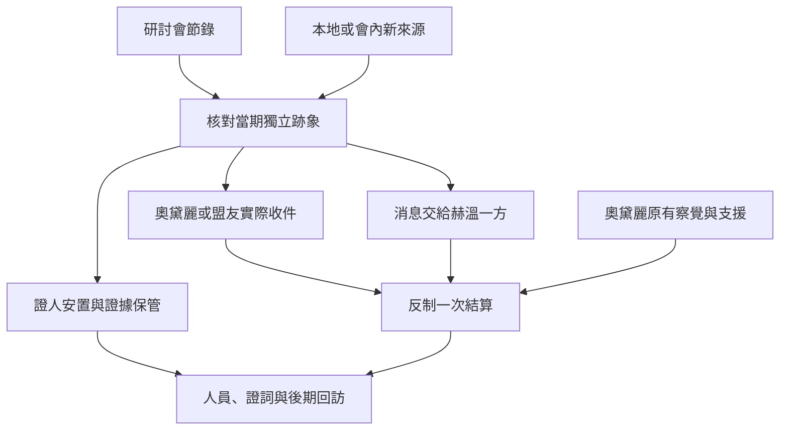

# 奧黛麗反制赫溫｜請妳再問一次

03 心理煉金會與 17 塔羅會的共用正文，接續[伊思蘭特研討會](backlund_islant_seminar_story_v1.md)及[塔羅會外部聯絡](backlund_fors_emlyn_tarot_contacts_story_v1.md)。依[《紅祭司》年表](../../lore/history/red_priest_v1.json)，原作中奧黛麗察覺赫溫以高階觀眾能力干涉心智，藉準備和塔羅會支援反制。第 1014–1097 章是傳記分段定位，精確日期待核。本章的家訪、信件、外圍證人與玩家選項為遊戲原創。事件按原作窗口獨立開啟。

## 第一場｜茶已經涼了

女僕送回一張已經改過的請帖。原訂的地點被一道很細的線畫掉，旁邊添了個新地址。她記得兩份請帖都經過自己的手，也記得奧黛麗第一次看完後請她收回。第二次來問時，奧黛麗卻已經知道該從哪道門進去。

「也許是我把日子記混了。」女僕說。她把兩個送件時間寫下來，問你能不能替她保管到明天。

有梅格同意的研討會節錄時，玩家可沿「誰親口確認、誰替他改寫」核對這次紀錄。沒走研討會，也能由已開放的霍爾家、會內或塔羅會外部接點，循當期請帖、見證人和可驗證的交接重新入線。兩份請帖或一段不一致的記憶只足以開啟查證。

- **先問女僕願意讓誰看。** 按同意範圍保存原話、時間和可交付對象。她若怕被問話，可依意願另約會面或請可信的人接應。
- **循會內管道查送件。** 查誰實際領取或改寫請帖。可向赫溫一方交付已掌握的查訪消息；對方能否趕在調查者之前接觸證人，按送達和自身能力判定。
- **先封存，等獨立跡象。** 分開已核實的改動和目前的猜測。可另找親見者核對時點。原件若由他人持有，須靠獲准副本或獨立來源查證。

## 第二場｜同一個問題

奧黛麗若答應赴約，會請玩家先照原順序把女僕的話念完。念到第二個時間時，她讓你停一下。

「我想再問一次。這個地址，是她聽我說的，還是她看見有人寫上去的？」

- **當面交付可查的內容。** 有可信引見且當事人能赴會時，可交獲准的原話和交接時間。她若願意，也可請蘇茜補充自己確實觀察到的事。蘇茜只提供當時在場的見聞。
- **走塔羅會外部聯絡。** 請實際能聯絡的成員轉交，對方須願意接件，且只轉達獲准的內容。只有奧黛麗或能協助的成員在窗口內實際收到，才會影響準備。聚會與代號沿獨立知情條件。
- **陪證人去安全處。** 安排本人同意、確實有人接應的地方。若還想傳訊，須另有人及時送達；人手不足時先完成已承諾的一件事。

若早先的抄本已外流，收件人依實際所知調整。奧黛麗也會按自己的察覺、已知消息與可用支援準備反制。玩家可提供可核實的差異，是否曾遭精神干預須另由當事人與有能力者查證。

## 第三場｜請妳自己決定

若奧黛麗已收到消息，她可以請玩家代為確認接應人是否在約定位置。玩家可照約守候、通知撤離，或交還最後一份待核資料。從會內調查的人也可替赫溫追查消息來源；是否找到人，依其實際掌握的位置、時點和接應判定。

等候的人把窗簾放下，留出一條能看見街口的縫。若女僕已經安全抵達，她會把最初的請帖從袖口取出。若她遲遲沒有到，接應者只記最後一次有人見到她的地方，先問誰能去查。

**IF｜失約後再確認。** [03-B](part_one_if_stories_01_05.md#03-b請帖換了收件人)使原接應中斷時，奧黛麗會先用已掌握的記號向原聯絡人查證。只有[17-B](part_one_if_stories_11_17.md#17-b回信送到另一位成員手上)的替代者能在有效時間到場，並能承擔原工作、避開已暴露的接頭，才恢復聯合反制。若她只剩自己的準備，改判撤離或獨自反制，赫溫依實際交鋒結算。

**一次反制結算。** 03、17 共用同一場反制。零介入時，奧黛麗沿原作察覺並取得塔羅會支援。玩家交付的情報只有可驗證、及時送達且有人能採用，才會改變準備。玩家可在外圍保護證人、保存紀錄或改變協助者到場時間。改變核心交鋒，須有足以作用於赫溫當時能力的準備與手段。結算記奧黛麗的實際處境、赫溫結果、證人是否能自主決定或安全作證、各副本及可用聯絡。

**事後。** 可依當事人意願封存或歸還資料。仍能聯絡的會內人可以按實際知情提出回訪；外部玩家可以維持地方查證。評議團與赫密斯的接觸另看後期窗口、案情和實際引介。第一部結算可讀取仍願合作的人、可靠證詞及曾經外流的知情範圍。[奧黛麗傳記](../../lore/characters/biographies/audrey-hall.v1.json) · [赫溫傳記](../../lore/characters/biographies/hvin-rambis.v1.json)

## 空想家途徑的回訪

- **讀心者 → 心理醫生。** 上次實際服藥約三至四個月後，可循外圍訪談或研討會回訪核對。需要能聯絡的教導者及適用的供應。
- **心理醫生 → 催眠師。** 暫排在上次服藥約四個月後，以赫溫事件前的獨立練習為首輪窗口。太晚才達條件時，可從事後回訪重約。當事人須同意練習，導師另查消化、材料與配方。
- **催眠師 → 夢境行者。** 以後期夢境委託為預定接點，暫排上次服藥約四個月後。須能找到可信導師並確認適用的儀式條件。奧黛麗的晉升另循原作年表。[第一部晉升時機表](part_one_advancement_schedule.md)

## 反制赫溫細圖

| 走法 | 結果 |
| --- | --- |
| 只保住梅格的早期節錄 | 可輔助核對流程。赫溫事件仍需當期跡象。 |
| 交件人按時抵達但只獲准給公開日期 | 奧黛麗只讀已收到的日期，另循自身來源核實。 |
| 玩家保護證人，未趕上反制 | 保存證人與證詞，交鋒依當時參與者結算。 |
| 全程未介入 | 奧黛麗依原作反制，玩家依自己實際收到的消息知情。 |

[第一部劇情總樹](part_one_story_tree.md)
