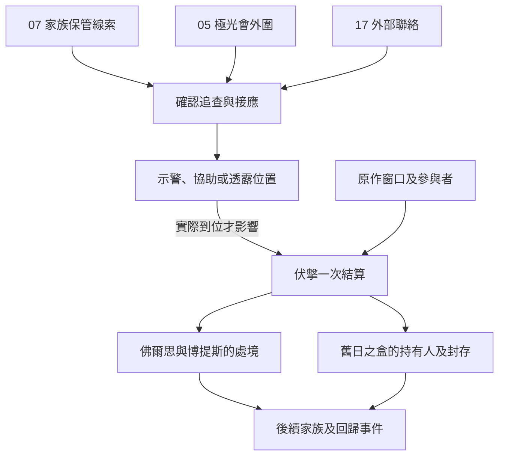

# 博提斯伏擊與舊日之盒｜等不到的回信

05 極光會、07 亞伯拉罕家族與 17 塔羅會的共用正文，承接[家族寄件與外部聯絡](backlund_fors_emlyn_tarot_contacts_story_v1.md)、[嘉德麗雅與未來號](future_cattleya_bernadette_story_v1.md)。依[博提斯傳記](../../lore/characters/biographies/botis.v1.json)，塔羅會以佛爾思為誘餌設局。博提斯用舊日之盒擄走佛爾思，嘉德麗雅與奧黛麗截擊，博提斯失控後被嘉德麗雅擊殺，盒子落入塔羅會手中。章節索引僅供定位。下列送信安排、接應地點及玩家對白為遊戲原創。伏擊依自身原作窗口切入。

## 第一場｜把回信送到書店

書店打烊以前，店員從門縫塞出一封信。收件人是你前些日子替多里安保管冊子時見過的一個名字。信封邊沿有一道折過的痕跡，落款日期卻是今天。

「有人提前來問能不能代領。」店員說，「他知道收件人的姓。先前約的那個記號，他說不出來。」

- **循家族保管紀錄。** 有多里安或佛爾思的可信接點時，可以核對收件人、保管處和原約。若已有地點外流，先通知當事人自己選擇是否改約。單憑假領回信，日誌只記有人打聽。
- **循極光會的舊接應。** 仍可聯絡的熟客能查誰在找某位門途徑的非凡者。玩家可沿實際回條核實，也可把查到的警訊交給博提斯一方。對方若真的收到，會依知道的範圍和剩餘時間安排人手。
- **走塔羅會外部聯絡。** 可把獲准的證據交給已能聯絡的佛爾思、嘉德麗雅或奧黛麗。收件人只讀確實收到的內容，是否知悉伏擊依其實際參與與許可判定。玩家也可只替書店處理代領問題。

## 第二場｜燈滅後再走

若佛爾思願意委託玩家，她會在信背畫一扇小門，提醒你要找的人待在街角亮著燈的屋裡。

「我出去後，你若還等不到回信，就先送店員離開。到了地方，讓他親口說他已經到了。」

玩家可接受外圍接應、請可信的人轉交警訊，或婉拒。這時能做的事取決於誰已經知道伏擊、是否能在會合前改路。早一步撤走店員，可降低他被尋問的機會；若他仍願意留在原處，可安排人接班。玩家只有實際觀察到的出入與時間可用於查證。

博提斯接近時，屋內的腳步聲忽然中斷。玩家若親見佛爾思在當場失去蹤影，先記下最後位置、目擊時刻與能核對的物件。只有取得可靠見聞或參與者的說明，才知道舊日之盒牽涉其中。外圍接應仍可按約傳訊、撤離或核對去向。進入交鋒須有當事人同意、確實可達的位置及能在高位交鋒中作用的手段。

## 第三場｜盒子跟誰走

在原作基準下，嘉德麗雅與奧黛麗截擊博提斯，佛爾思從遭擄的處境脫身。玩家若改動接應，世界先核對佛爾思是否按自己的計畫赴會、博提斯是否得手，以及嘉德麗雅和奧黛麗能否及時到場。外圍警告只有確實送達，才可能改變各方的準備；要改變交鋒結果，須有足以作用於當場的能力和時機。

- **先確認佛爾思的實際去向。** 可到約好的接應處等人。目擊者只看見離開原地時，先記最後確認的位置。脫身、仍被困及已抵達安全地各自判定。
- **替已取得盒子的人安排保管。** 先查對方確實持有盒子、願意交接且有可用的封存能力。接應者可運送其他人，盒子的實際交付另記。玩家只看到空封套時，仍須核實真正的持有人。
- **把可信位置交給追蹤者。** 已核實的位置可供有能力的人追查。若戰鬥已結束或盒子已轉移，按最後確認時點查證；只有完成新的交接、奪取或追回，才會改寫持有人。

**一次伏擊結算。** 05、07、17 共用佛爾思實際去向、博提斯狀態、舊日之盒最後一名已確認的持有人、封存能力與各方知情。零介入沿原作基準。盒子由塔羅會一方取得後，具體可由誰取用，要按當時保管與許可另查。若分歧使盒子仍由博提斯持有、改由第三方接收或失去可核實去向，後期按這些實際條件追查。家族傳承、目擊證詞及可用的空間接應另外保存，供伯特利回歸及第一部結算使用。

## 晉升回訪

- **門途徑。** 戲法大師服用約三至四個月後，可循普利茲港或家族回訪接占星人。占星人服用約四個月後，於可核對的家族抄本交接約談記錄官。既有導師失聯時，可循佛爾思或其他真正可聯絡的家族人脈重約；伏擊前後各自查證供應。
- **倒吊人途徑。** 隱修士服用約四個月後，可從 X 先生後續查證接薔薇主教。薔薇主教服用約四個月後，以伏擊後仍能聯絡的極光會供應者為牧羊人的暫定窗口。各階仍依實際消化、配方、材料及適用條件判定。[第一部晉升時機表](part_one_advancement_schedule.md)

## 伏擊與舊日之盒細圖

| 走法 | 結果 |
| --- | --- |
| 只送書店店員撤離 | 記實際安置及可用證詞。伏擊依各參與者條件結算。 |
| 把位置交給極光會，博提斯收到時已晚 | 保留消息流向。當場只讀實際來得及作用的情報。 |
| 佛爾思已脫身，盒子另被轉移 | 分別記她的去向與物件持有人。後續依實際接觸重查。 |
| 沒有取得出場窗口 | 世界沿原作。玩家按日後可靠來源得知結果。 |

[第一部劇情總樹](part_one_story_tree.md)
