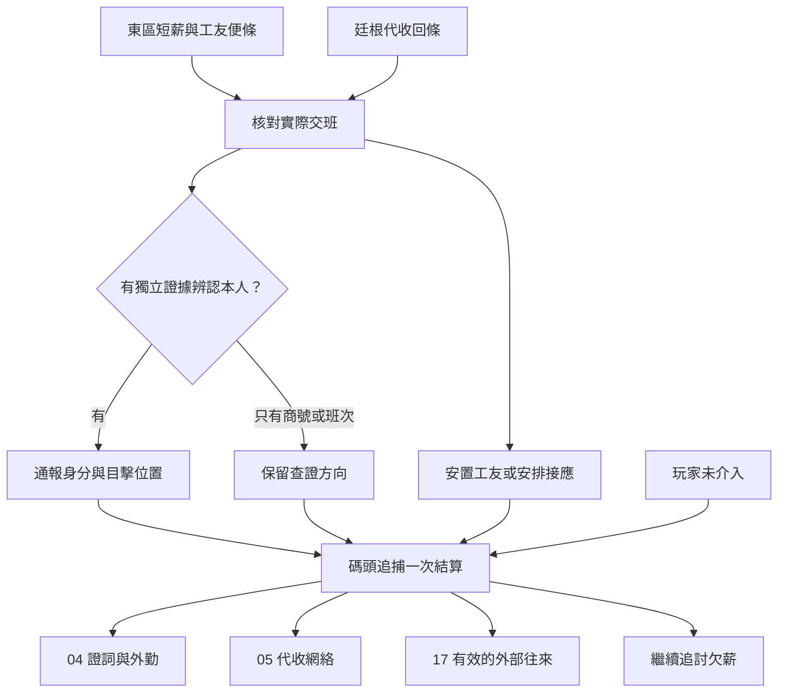

# 貝克蘭德東區與碼頭｜晚班名冊上的空行

接續[廷根事後與貝克蘭德入口](tingen_aftermath_backlund_entry_v1.md)。這一批串起東區短薪、05 極光會的代收商號、04 值夜者的跨城追查，以及 17 的條件式情報交接。瑪妲與短薪案沿用[開局事件](opening_sidequests_v1.md)；工棚、借用的工牌、原創證人、台詞和外圍分歧均為遊戲原創。

**原作基準。** [夏洛克篇年表](../../lore/history/backlund_sherlock_1349_v1.json)把東區生活調查與蘭爾烏斯追捕列為各自的事件。邁克、老科勒和夏洛克依年表調查；蘭爾烏斯藏在碼頭區，克萊恩透過塔羅會人脈找到他、通報教會，最後在下水道追上並殺死他。兩案的確切日期待核。玩家的短薪調查是另一個入口，可在現有事件窗口內提供證人與外圍情報。

## 第一場｜少算的一班

**觸發。** 玩家已在貝克蘭德，瑪妲或她信得過的工友仍能接觸。若已完成《東區的短薪名冊》前置，直接讀取名冊、補薪和證詞許可；工頭若早已收走原簿，玩家可從仍有權查看的便條與已結算的補薪單查起。

洗衣房還沒關門。瑪妲一手提著濕布，一手把四張便條依日期排在桌上。

「這四晚我都來了。工頭說第三晚我不在，可那晚是我替碼頭的人洗了兩件外套。」她把其中一張推到你面前，「我想把工錢討回來。你若要查他們送了什麼，先別在報紙上寫我的住處。」

- **對照工人的便條與實際交班。** 用已獲同意的記錄確認漏算班次。若有人願意作證，可另記他親眼見到的送貨人與時間。玩家可以只處理欠薪。
- **去找願意核對的搬運工。** 若原簿仍可閱，請他確認班次和借出工牌的記錄。若原簿已移走，從工友收存的回條或工頭先前承認的補薪紀錄查起。
- **先談補薪，暫停碼頭追查。** 可沿既有記者、互助會或和解路徑結算。欠薪是否補發獨立保存。玩家沒有另外問到的運送資料仍未知。

**輸出。** 短薪、補薪、證人許可和可能指向碼頭的日期各自記錄。工友可以證明某人沒上班；這件事本身還不足以辨認蘭爾烏斯。

## 第二場｜有人替他交回工牌

**觸發。** 玩家有一筆可複查的交班線索，或持廷根的代收收據並查到同一接收時段。兩個入口進同一個碼頭辦事房。若玩家晚到，該筆工牌可能已被收走，可先找原經手人或查值班副本。

辦事房的書記把幾張工牌倒在桌上。一張牌繫了兩道繩。

「領牌的那人我見過。送回來的，我只看見一頂帽子。」他伸手去找記錄簿，翻到半途才停下來，「工牌上沒寫他的真名。有人要你來找他的話，你可以先告訴我，是誰認得他。」

- **用兩條獨立線索核對。** 一條可來自廷根認購者的親見、已有可靠的查案描述，或當事人的合法辨認；另一條需對到貝克蘭德當下的班次、所在地或外觀。兩者可複查且相符時，才把目標身份與最後目擊點交給具備核驗能力的聯絡人。
- **只有商號、牌號或時段。** 先記為追查方向。可向書記問下次交班，也可請熟客核對寄件。現有證據只能定位一次運送或冒領行為。
- **先替書記保密。** 可留班次或號碼，隱去姓名與住處。若因此失去查證所需的聯絡方式，改約本人同意的見面，或請對方找另一位親見者。

**輸出。** 借牌人、歸還人、目擊時間與資料可信度各自保存。送貨跑腿和蘭爾烏斯分開記。若有先前傳入的不同說法，保存各自出處及最後核對時間。

## 第三場｜先說你站在哪裡

臨到交班，工棚門口的人換了位置。一名工友把窗簾往下一拉，低聲問你：「要是有人來查，能不能先讓裡頭沒上班的人走？今天有兩個孩子來等他們父親。」

已建立值夜者聯絡時，你可以向確實收得到消息的接應人說明。若另有在當時成立的塔羅會外部渠道，可以交給原有聯絡人核驗。這個管道仍讀取真實身分、信任與知情範圍；玩家不因此認出夏洛克或取得聚會席位。

- **及時通報可複查的目擊。** 值夜者收到且核實時，可安排外圍警戒、確認工棚人員或預留一處轉交位置。若塔羅會聯絡人先收到，只在實際轉交並送達時影響值夜者的準備。
- **先撤工友與家屬。** 玩家實際到場、有人願意跟隨且接應點仍可用時，能把他們帶走。若仍希望通報，須找能送達的傳訊人，或在撤離後再交件。
- **繼續看外圍接應。** 玩家可記下誰改了工棚交班或拿走回條。目標若離開視野，最後位置停在親見的地方。先前若答應接待家屬，需另有人實際到場才能同時履約。
- **保留手上資訊。** 工友和玩家按當時位置行動，教會與克萊恩仍依自己的線索追查。未及時核對的紀錄可留作事後調查。

## 第四場｜只剩半截濕繩

夜裡，工棚外的燈滅了兩盞。玩家若留在附近，可能看見人群退向另一個出口，或聽到外圍值守者請人別靠近。若當晚不在碼頭，只在後來真正接到消息時讀到相應的版本。

**單次結算。** 追捕依年表與現有能力發生。本章提供的外圍選項可改變通知順序、疏散、證物與地方接應人，核心追捕與蘭爾烏斯之死沿原作基準。玩家的親見、警方對外說法及授權簡報各自記錄。只取得回條的角色不會獲得下水道內部的敘述。

翌日，瑪妲把幾張便條重新疊在一起。

「昨天站在門口的人，有一個今早沒來。至於工錢，工頭還只補了兩班。你若還要查，先告訴我這回要問哪一件。」

- **續查短薪。** 回到已選的記者、互助會或和解入口。追捕消息只有在與薪冊確實有關時才併入。保護過的人可依意願繼續作證。
- **留存教會線索。** 04 只從實際接獲的證據續查。玩家若需要回信廷根，可交可公開的部分。已保全的證人與先前承諾依真實狀態延續。
- **續查代收網絡。** 05 可循仍在運作的商號查《只寫數目》。A 先生的聚會仍依獨立邀請條件。某個接應人已撤時，可從帳目追原網絡，或另尋當地熟客。
- **交給已建立的外部聯絡人。** 17 只讀取實際獲准轉交的證詞。可獲得後續協作，但是否入會照既有條件。錯過此追捕的玩家仍能在別的時段接觸相應勢力。

**成長交接。** 查班表、接應或解讀口供只有符合玩家既有途徑及實際使用方式時，才可成為後續成長的依據。首服與消化沿跨城紀錄保存。可用供應者若撤走，該窗口可能改地、延後或關閉。短薪案及追捕各自結算，領藥按既有途徑劇情開放。

## 東區與碼頭細圖

各出口依實際條件分別開放。沒有親自參與的人，仍可透過獨立的短薪路徑與地方委託行動。

| 推演 | 應得到的結果 |
| --- | --- |
| 新到城，先幫瑪妲討薪 | 可完成補薪協商或保留原有追討。碼頭追捕可在背景發生，玩家沒有本人身份線索。 |
| 持廷根回條，及時核實本人 | 可通知能查證的接應方並改變外圍警戒。已授權的副本才能再交其他人。 |
| 只有商號，先帶家屬離開 | 只確認商號與已安全抵達的人。蘭爾烏斯本人仍須其他證據，值夜者照自身線索行動。 |
| 透過 17 傳達，但收件人來不及聯絡教會 | 17 保留已取得的線索與往來結果，教會當晚依自身情報，沒有因未送達的訊息提前布置。 |

[第一部劇情總樹](part_one_story_tree.md)
