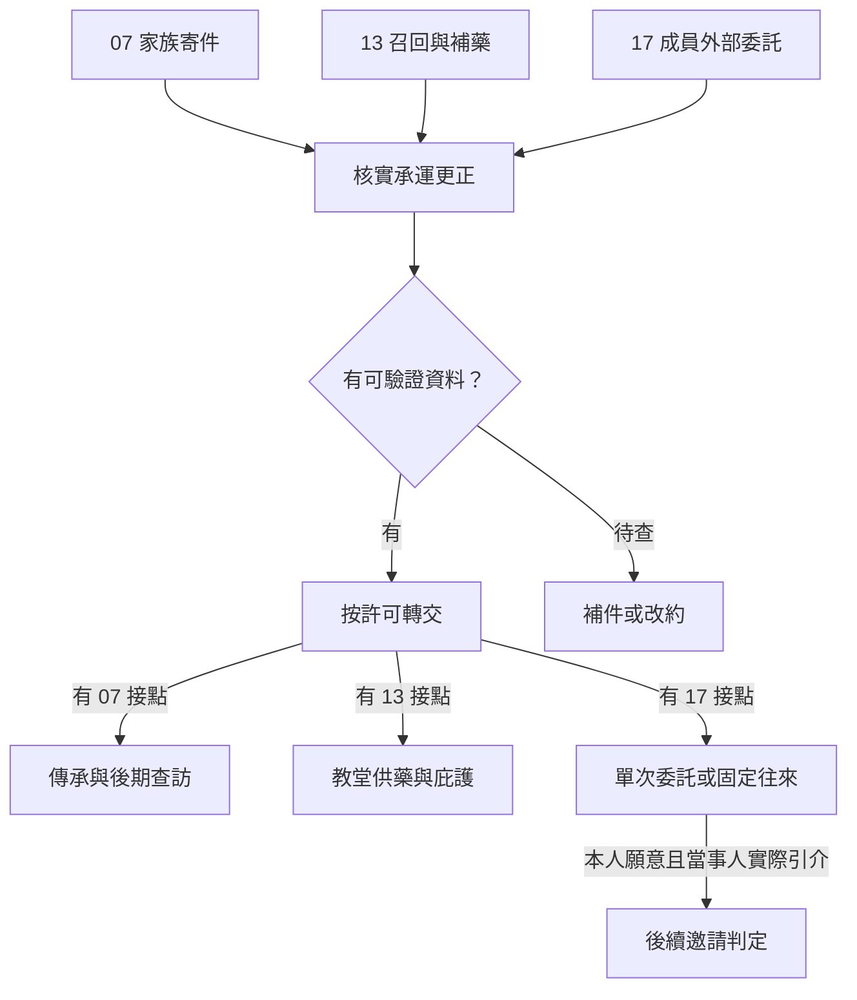

# 貝克蘭德外部聯絡｜兩個收件人

07 亞伯拉罕家族、13 血族與豐收教堂、17 塔羅會的前段正文。承接[十五條前置](part_one_sidequest_prologues.md)與[首份魔藥](backlund_pathway_acquisition_v1.md)。玩家可各自進入三條線。佛爾思能聯絡多里安後才開放家族委託；豐收教堂的送藥依埃姆林實際處境開放；17 的轉託要等相應成員已入會、有可用管道且願意出面。各窗口按週分開判定。本稿的送貨事故、帳證、選項與對白為遊戲原創。

## 第一場｜早班的火車

雨下進書店門檻時，佛爾思正拿一本退稿壓住兩張收據。她問你，去普利茲港的早班車還有沒有位置。若玩家此前替多里安保管過冊子，她先請你把已完成交付的那張收據找出來。若玩家只守住書店回條，則請你去公開櫃檯核對今天的寄件。

「老師會自己決定帶什麼。」她把椅子朝火爐挪了半步，「我只答應告訴他，誰還能準時把東西送到。」

公開櫃檯聲稱本週有兩次停運。牆上的告示是新釘的，日期倒比玩家手中的收據早了一日。櫃檯員伸手想把收據接過去，問寄件人平常住在哪。

- **只核對日期和路線。** 可請櫃檯員出示停運登記，或找公開的交班簿驗證。若已有多里安同意，可另約他核對回條。交付按實際收件人記錄。
- **封存收據，先給多里安示警。** 若玩家知道可信的聯絡方式，可建議暫緩交接。必須等本人回覆才確定改期。即使告示後來證明是真的，已取消的車次仍要重新安排。
- **用寄件人資料換優先處理。** 櫃檯員若確有可調度的車，可以安排下一班。寄件人資料也會隨代辦紀錄交到經手人手上。佛爾思或多里安得知外流後，才會據此改變接應或暫停委託。

佛爾思與多里安的師徒關係沿既有基準，與勞倫斯遺物有關。若佛爾思主動提到滿月，玩家可替她保留發作時點或按約回訪。當事人的描述可供往後查證，先祖的身分、囈語來源和風險各須有獨立證據。[佛爾思傳記](../../lore/characters/biographies/fors-wall.v1.json) · [多里安傳記](../../lore/characters/biographies/dorian-gray-abraham.v1.json)

## 第二場｜藥瓶上的名字

豐收教堂的桌上排著四個空瓶。烏特拉夫斯基正把一張藥方念給等候的人聽。埃姆林用指甲刮下一角瓶籤，露出下面那一層。兩張標籤是同一家供應商印的，瓶子底下的批號卻不同。

「我可以告訴你哪一批要先收回來。」埃姆林把兩張標籤壓好，「門口那位太太的名字，留在她自己的藥袋上。」

- **先跑一趟召回。** 經教堂允許，按實際送藥紀錄通知領藥的人。只記下已取回、已通知和仍待尋的藥瓶。能否補發依當週存量、供應者和教堂人手。
- **請卡西米幫忙驗來源。** 有血族管道時，可轉達埃姆林願意交付的話及可外傳的批號。若卡西米核實來源，調查結果可依約回到教堂。對方也可另外邀玩家談血族委託，玩家可赴約、只繼續查本案或婉拒。
- **直接交出住戶名冊求快。** 只有實際持有名冊的玩家能這麼做。取得名單的人可以更快找上門；住戶是否願意開門、教堂何時發現、以後誰還允許玩家查閱資料，各按實際後果結算。

玩家若在埃姆林仍被留在教堂的階段接觸此線，只能循當時可用的教堂管道，送藥場景要等他實際能參與才開。只跟烏特拉夫斯基合作，也能以送藥紀錄完成回訪。延續照護的玩家可談耕種者引介；血族驗貨另循藥師供應者。資格、配製與首服沿[魔藥取得稿](backlund_pathway_acquisition_v1.md)。[埃姆林傳記](../../lore/characters/biographies/emlyn-white.v1.json) · [烏特拉夫斯基傳記](../../lore/characters/biographies/utralavsky.v1.json)

## 第三場｜代收的人只留到六點

先前核對過出港告示的玩家可接到佛爾思的新委託。此前沒參與的玩家，可依[前置](part_one_sidequest_prologues.md)從公開告示開始。若埃姆林已加入塔羅會，且願意透過自己的管道問話，玩家也可由他委託查問近期的承運異常。

值班員下班前拿來一份更正。出港告示抄錯了碼頭，班次仍在。兩份單子若要對照，只需日期和公開班號。他將夾在後面的私人送件簿翻到背面。

「下週還是我值班。這兩頁讓你抄，後面那冊我要收回去。」

- **交能驗證的更正。** 抄下公開班號、實際碼頭和可核對來源。如果家族寄件或教堂補藥確實使用該班次，且當事人允許，便另行通知改走的碼頭。只碰過其中一案的玩家只會收到那一案的後續。
- **先保住提供者，再延後交件。** 對方若撤回署名同意，可換用公開櫃檯的更正紀錄。找不到替代證據時，本週情報以待查交回，委託人依自己的渠道另作處理。補件按實際送達時間結算。
- **先把私人送件資料交給買家。** 玩家只能轉手實際取得的資料。買家若循資料去找人，知道這件事的聯絡人才會改用別的中間人。玩家仍能靠獨立的公開證據查班次，私人聯絡須重新建立。

若玩家按約完成委託，出面者可邀請他繼續做外部聯絡。玩家可只接單次委託、接受固定往來、請當事人代問引介，或拒絕。引介須由當事人實際轉達；灰霧聚會及入會仍依愚者的邀請與玩家決定。佛爾思轉述一條消息時，只帶她獲准轉述的部分。埃姆林即使在另一條線上認識玩家，也要透過實際聯絡才會得知此事。[貝克蘭德年表](../../lore/history/backlund_sherlock_1349_v1.json)

## 共用結算與後續

承運異常只建立一份查證結果，記原告示、已核實的更正、版本持有人及交付時間。07 記冊子與回條的實際去向，13 記召回與補發，17 記外部委託與聯絡層級。改碼頭時，只有收到通知且來得及改約的人才能改線。已錯過班次的交付照各自狀態收束。任一方婉拒，其他人仍可循可用渠道繼續。

- **07** 保留已守住的傳承、可聯絡的人及實際暴露的地址，供日後海上查訪與博提斯事件使用。
- **13** 保留能供藥的人、藥品和照護承諾，供後來教堂庇護與戰時調度使用。
- **17** 保留各成員各自認可的聯絡方式與可轉交的資料，供跨港消息與後續合作使用。這些承諾會進入第一部結算。

| 測試走法 | 預期結果 |
| --- | --- |
| 只跟教堂合作，埃姆林尚未入會 | 可召回與補發。只更新教堂人脈及實際收到的消息。 |
| 曾為佛爾思跑腿，主動拒絕引介 | 委託照實結算，可保留願意繼續的外部聯絡。 |
| 家族與教堂碰到同一班次 | 只核實一次；兩邊須各自收到更正，才能改約。 |
| 逾期抵達或全程留在外地 | 各人物照世界基準行動。事後可從公開更正或目前可聯絡的人重新入線。 |

[第一部劇情總樹](part_one_story_tree.md)
