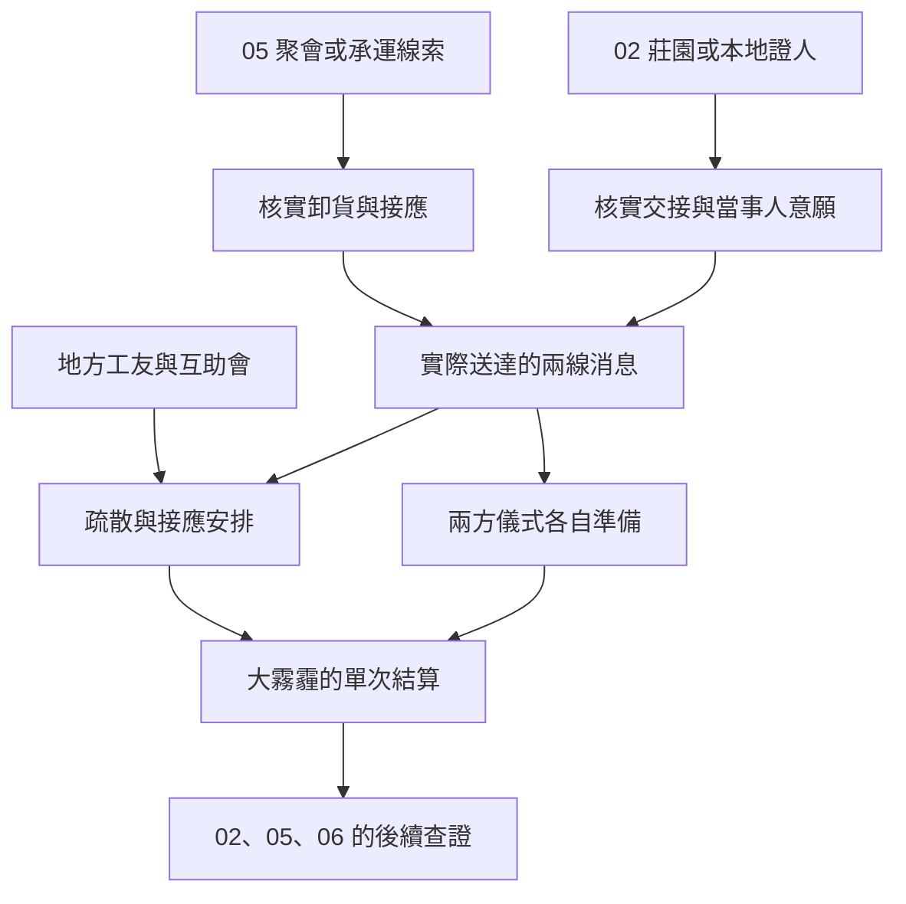

# A 先生與紅薔薇莊園｜兩處尚未送達的消息

承接[東區與碼頭調查](backlund_docks_lanevus_story_v1.md)及[勇敢者酒吧](backlund_rose_pursuit_story_v1.md)。05 的聚會、02 的紅薔薇莊園與 06 的王室外圍各有入口。本篇寫到大霧霾前的準備，將實際送達的預警、人員與物資交給同一次危機結算。貨物標籤、莊園雜役、接應人、台詞及可玩的外圍行動均為遊戲原創。

**年表依據。** [貝克蘭德年表](../../lore/history/backlund_sherlock_1349_v1.json)把塔利姆的死亡列在莊園相關調查之前，將 A 先生的計畫與莊園事件分別接到大霧霾。[長支線綱要](long_sidequests_part_one.md)分開記錄潘娜蒂亞一方的獻祭與 A 先生一方的降臨。兩線可在一週內先後接觸，精確日曆與個別章次仍待核。人物只依實際取得的消息行動。

## 第一場｜散場以後再念

**觸發。** A 先生的聚會仍運作。玩家須有 05 的有效邀請，例如在碼頭核實代收線索後由熟客引介，或依既有前置走完當地交接。只有酒吧人脈的玩家可以請人查找熟客；錯過當次聚會，可在外圍查帳或等仍可用的下次接點。

聚會散場時，有人把一盞燈從桌上搬到門邊。原本攤在桌上的物品都收走了，只剩兩張搬貨單。

「前一張寫在後門卸貨。」熟客說，「後一張少了門號，倒多了一行『等街上沒人再搬』。你若肯走一趟，替我問搬運的人到底聽誰的。」

玩家若先前聽過會內打聽某個稱號，只能按實際聽到的字句記錄；17 的身分、聯絡方式與聚會地點都須另有來源。

- **替熟客查清交接。** 玩家實地核對貨號、卸貨門與接應人，再決定交回哪些內容。完整且及時的回報可能讓會方先備人手。若接續既有[祕祈人供應](aurora_and_royal_pathway_acquisition_v1.md)，讀取這一次真實履約與備料，已完成同一趟交接者沿用原紀錄。
- **只問清搬運人願不願再來。** 可協助失約者離開，留下他同意公開的時段。若能補出可驗證的交接，熟客仍可能安排別的差事；若只有人沒到，會方須自己核對。
- **把可證實的卸貨線索交給外部接應。** 玩家只可交出持有且獲准的紀錄。當地教會或可信調查者須能收到、核對及動身。熟客若實際察覺外流，可能換門或中止供應。
- **散場即走。** 交易、入會和接受外勤各自判定。玩家沒有目擊的後續由當事人自行行動。

## 第二場｜莊園不收回信

**觸發。** 莊園調查窗口已開。玩家經 02 的府邸回條或本地證人、06 的外圍委託取得接點。塔利姆之死與夏洛克收到的委託各依年表。玩家若只從酒館得知有人過世，先只能查到公開消息與確實能問的人。

莊園的雜役拿一個空籃子出來。他將籃子擱在圍欄上，沒有把門打開。

「這封是今天第三封退回去的。裡頭的人沒說不要，只說不能讓送信的知道她會從哪道門出來。」

若玩家已透過可靠介紹見過特莉絲，這次可由她或其實際授權的人確認交付範圍。她說：「要是有人問我去哪，你先問他，這個答案要交給誰。」她的行蹤、意願與是否能離開各依她當時的處境處理。

- **確認她是否願意接受接應。** 先提出一個實際有人等候的外圍地點，只告知接應者必要的時間。當事人同意、接應者到場且路線仍可通行時，才記外圍協助成功。玩家保有一條可能的後續聯絡。
- **保留莊園交接紀錄，向 06 查驗。** 可交運送時間、門牌或獲准的抄件；王室車次與莊園人物的去向各自核對。軍情九處或其他有權核查的接應只能使用真正拿到的資料。
- **把可查證的時段交給教派外圍。** 若對方先得到消息，可能換接應或去查舊門。玩家若把真實行蹤也交出，依收件人是否有能力到場決定是否有人被追上。
- **只把信還給本人。** 保留原有承諾，不另傳地址。若信件未確實交到本人手裡，該線只能以實際收件者結算。

## 第三場｜門號寫在不同的地方

東區的互助會在打烊前把一張小地圖攤到桌上。聽完你說的兩個地點，記錄員用炭筆畫了兩個圈。

「一張寫箱子去哪，一張寫誰能出門。若我只來得及叫醒一處的人，你能不能先告訴我，你親眼見過哪一處？」

這場可由此前保護過的工友、仍可聯絡的地方教會接應或可信的外勤管道開啟。玩家若沒有合適的聯絡人，可直接通知眼前可接觸的住戶，或保留證物待事後查核。兩份資料可能在不同時段才到手。

| 行動 | 危機前的有效結果 |
| --- | --- |
| 將經核對的卸貨位置交給能行動的人 | 收件者若及時到場，可盯住、延後或切斷一處 A 先生的外圍交接。會方若已移貨，須先找到實際去處。 |
| 確認莊園外圍出入與可聯絡的證人 | 可保留一條回訪和王室調查的線索。只有來源確實對上教派的準備，才可用來針對該處預警。 |
| 提前通知能聯絡的住戶 | 記實際收到通知、能離開且已抵達接應處的人。只留下一張沒人看過的告示，保留為未送達。 |
| 拆分傳訊與引路 | 玩家只能親自做一處。另一處須有可信且來得及抵達的人接手；收到警告的人依自己的理由決定是否動身。 |
| 兩條線都不介入 | 各勢力依自身已知資訊籌備，危機照年表進入。 |

## 第四場｜給下一班的人

有一張告示被貼在兩戶門牌之間。抄寫的人把「已送到」寫了兩遍，第二遍只寫到一半。

玩家可把真正送達的通知記上去，或問最後一位傳訊人在哪裡停了腳。接應者若仍在等人，請他只報已到的名字。若玩家自己已離開東區，待後來確實收到回信才補記，不能從這張告示得知當晚情況。

**交給大霧霾正文。** 05 寫入卸貨地點、實際送達物資、接應人和各方收到的時間。02 寫入莊園回條、特莉絲所知與她實際接受的外圍協助。居民安置另記已通知、已出發、已抵達。06 只讀取已獲准且可核對的證據。這一批尚未結算獻祭、降臨、埃德薩克的最終處境或全區傷亡。

## 分支細圖

傳出去的消息也可能讓其中一方更早布置或改道。兩個圈只代表兩條待查線索。玩家用實際可支援的人、可查證據與到場時間決定能干預哪一處。

| 推演 | 交接結果 |
| --- | --- |
| 只切斷 A 先生的一處交貨 | 05 記實際物資與延誤。潘娜蒂亞一方依自身條件行動，居民疏散另算。 |
| 只保住莊園證人 | 02 和 06 取得獲准的回訪入口，不能推定 A 先生的地點或物資。 |
| 兩邊都查到，另有接手人 | 訊息與安置可同時送達，逐一核對誰到了哪裡。玩家本人仍只能在一處。 |
| 追捕後聯絡中斷，或完全錯過聚會 | 改循帳目、居民和已知的地方接應查證；大霧霾仍按世界時間推進。 |

[第一部劇情總樹](part_one_story_tree.md)

[下一批正文｜貝克蘭德大霧霾](backlund_great_smog_story_v1.md)讀取本篇實際送達的預警、到場的接應人、出入紀錄和物資。
