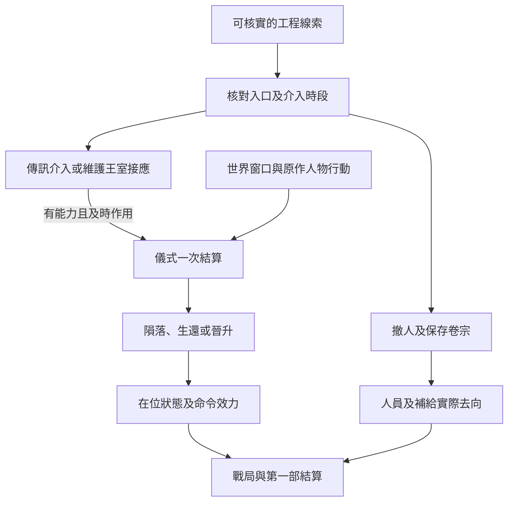

# 喬治三世與黑皇帝儀式｜最後一班工車

06 黃昏隱士會與黑皇帝儀式的後段正文。接續[尼根公爵遇刺與王室工程](backlund_negan_and_royal_works_story_v1.md)及[戰時通行與豐收教堂](wartime_passage_harvest_church_story_v1.md)。喬治三世祕密籌備陵寢與晉升，克萊恩等人在關鍵時刻阻止儀式，國王隕落。原作先後依[《紅祭司》年表](../../lore/history/red_priest_v1.json)、[《逐光者》年表](../../lore/history/lightseeker_v1.json)及[喬治三世傳記](../../lore/characters/biographies/george-augustus-iii.v1.json)；精確章次仍待核。下列工車、回條、接應人和對話為遊戲原創。儀式依世界時點開啟，玩家可從既有調查、王室差事或本地新證據入線。

## 第一場｜回程沒有填

戰時的檢查哨換了一批人。上一輪查訪的承運人帶來一張已過期的借道單，請你看看右下角。去程的車牌、到站和承辦人都填滿了，回程那欄只有一個鉛筆點。

「這班車載過工人。」他說，「我哥那天上了車。他那筆工錢，到現在還是別人替他領。」

玩家可沿舊車次重新驗真，或循 02 莊園證詞、軍情九處案卷、目前仍可查的承運資料入線。任何副本都按現持有人和允許出示的範圍核對。舊證詞可指向一處卸貨地；定位陵寢還需要能辨認當期入口的資料，例如已核實的現場路標或出入紀錄。儀式的用途、時間與可介入的環節各須另查。

- **追工人的去向。** 可找本人、家屬或願意出示交班簿的人，確認哪些是代領、哪些已回家。若有人要求保密，先記允許交付的內容。
- **從工程差事留在現場。** 王室外圍若仍願意用你，可接承運、核章或警戒的差事，並按權限確認哪個入口在用。已受核發方撤銷或限制的通行證須重新取得許可。
- **請調查方驗證。** 可按已建立的管道請休或其他有權查案的人核實。她只按當時職務、行程及實際收到的內容行動。若時點或入口仍待查，可先傳訊或安排外圍接應。

## 第二場｜這張圖給誰

會面安排在一間已經搬空的工房。桌上只有一盞燈、一張裝過圖的信封。若玩家已核實入口和有效時段，聯絡人才會問你打算讓哪個人先看到。

「你畫的這條路，車能走。到了後面那道門，得問拿著圖的人進不進得去。」

- **把可驗證的入口交給介入者。** 先確定有人肯接件、能趕到，也有能力作用於已確認的儀式環節。圖紙晚到時，仍可用於事後核對。玩家可以協助找引路人、確認出入口，或把工人撤到可接收的地方。
- **維護王室接應。** 可照實回報施工、調開外圍車輛或另行保管路線。王室收到並能採用的消息，才可能改變守備與運輸。若玩家也曾答應幫調查方接應，先按實際傳過的消息和當事人所知處理。
- **把車留給撤離的人。** 只載實際同意且能上車的人。車位、核准站點、去向和接收人沿戰時運輸結算。也可提前請教堂、地方接頭或其他有空位的接應者照看。工人能否離場按當時的路況和保護安排判定。

## 第三場｜散場之後

外頭的車鈴響了幾次，接應者在原定地方等到天黑。有人先送來一張告示，說王室另有公告。他把告示反扣在桌上，問你有沒有親眼看到那輛工車出去。

**一次儀式結算。** 世界在儀式窗口讀取已成立的陵寢、參與者、當場對抗及仍可運作的儀式環節。玩家只保住人員、案卷或運輸時，對應結果照實更新。玩家若成功讓有能力的介入者在期限內抵達，或有效改變關鍵環節，再按實際變化判定核心結果。零介入沿克萊恩等人阻止晉升、喬治三世隕落的原作基準。已展開行動的原作人物仍依自己實際掌握的條件推進。

- **儀式失敗，國王隕落。** 戰時命令依後續有權的人員接手。居民可循公告得知死訊。陵寢、儀式與參與者的內情按實際證據揭露。
- **儀式受阻，國王生還。** 遊戲分歧須有實際阻斷及獨立保命條件。記其位置、能否行使職權及誰仍服從命令，據此重判後續通行與調度。
- **晉升成立。** 遊戲分歧須同時滿足適用儀式條件，且能左右結果的阻止行動實際失效。權柄、王室指揮與各勢力反應按新的世界狀態結算。地方接應仍依該地站點的許可與實際人手使用。

工人的簽收簿、案卷與各方通報各有持有人。結算記已撤離者、仍待尋者、舊命令在哪些站點仍有效，以及哪些倉庫和庇護處能繼續接人。能確認核心結果的角色按各自證據更新知情。後續可接王室交接、地方照護和戰局，並將仍有效的承諾帶入第一部結局。

## 兩條途徑的回訪

- **黑皇帝。** 律師首服後約三至四個月，可循工程帳目回訪找私人供應者接野蠻人；野蠻人服用約三至四個月後，可用可核對的改道紀錄談賄賂者。腐化男爵暫排在服用賄賂者約四個月後的戰時調度回訪。原中間人失聯時，依仍可驗真的帳目和可信替代師承重約。
- **審判者。** 仲裁人首服後約三至四個月可循任職或第二輪查訪接治安官；上次服藥約三至四個月後，由核准案件的後續回訪接審訊者。法官暫排在審訊者服用約四個月後，於工程及戰時案件的獨立查證開窗。核發證件與供應的主管可各自核查。兩條途徑都依消化、配方、材料及實際授權處理。[第一部晉升時機表](part_one_advancement_schedule.md)

## 陵寢、儀式與戰時交接細圖

| 走法 | 結果 |
| --- | --- |
| 只把工人送到庇護處 | 記實際抵達人數。儀式由當場參與者與既有條件結算。 |
| 交出圖紙，聯絡人到場已晚 | 案卷可用於事後查證。當場只讀取及時到位的介入。 |
| 維護王室路線，另一處關鍵環節仍被阻斷 | 記該路線與守備的實際效果，再依整體儀式條件結算。 |
| 未介入工程與儀式 | 依原作結果。玩家可由公告或獲准案卷事後得知。 |

[第一部劇情總樹](part_one_story_tree.md)
