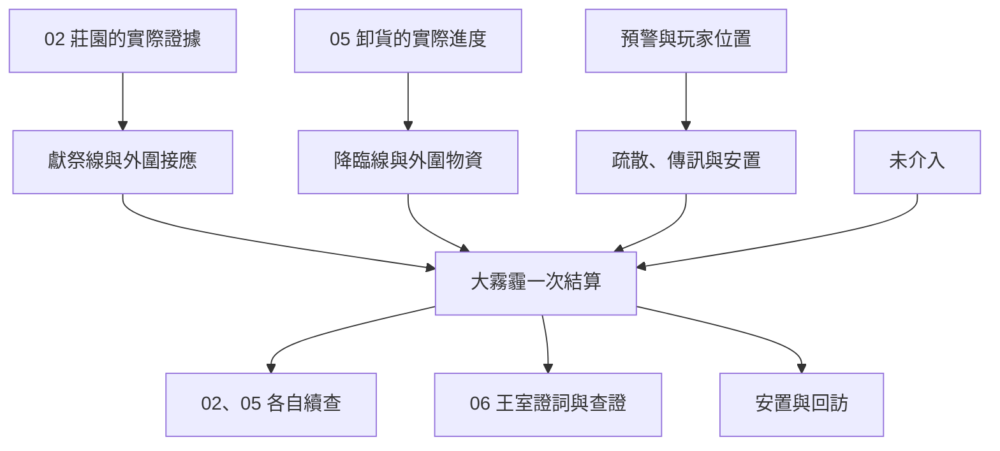

# 貝克蘭德大霧霾｜鐘聲傳不到的街

承接[聚會與莊園](backlund_gathering_and_manor_story_v1.md)。02 魔女教派、05 極光會與 06 王室調查共用本次大霧霾結算。獻祭、降臨及居民去向分開記錄。玩家所見的鐘樓、街坊、交接與對白是遊戲原創。[夏洛克篇年表](../../lore/history/backlund_sherlock_1349_v1.json)提供危機及原作核心結果的章節定位，確切日期仍待核。

## 第一場｜第三下鐘聲

**切入。** 危機照世界日曆發生。先讀取上一批送達的預警、可調用的接應人、實際送到的貨物與莊園當事人的狀態。玩家若不在貝克蘭德，不進入當地現場，只在可靠消息送達後閱讀可公開的部分。

霧先從貼著屋腳的地方過來。路口那家店把門開著，老闆伸出一隻手，想把門牌擦乾淨。擦過之後，只看得見自己的指印。

鐘敲了兩下。第三下隔了很久。你看見敲鐘的人還在拉繩，這一頭卻聽不見聲音了。

瑪妲如果仍能聯絡，會從洗衣房拿一條乾布給你。「上次說好等在井旁的那兩家，還不知道今天要改在哪裡等。」

- **循已查證的接應點去找住戶。** 有人能帶路、住戶願意走且路線仍可通行時，更新為已出發。等接應地點確認，才記為已抵達。
- **先通知眼前的人。** 沒有前置的玩家也能勸仍能聽見自己的人往近處避開危險。可救助的範圍取決於當前位置、能見度及接應處剩餘容量。
- **先赴原定交接。** 從卸貨點或莊園線進入。玩家若答應照顧另一處住戶，須先由能到場的人接手，才可能同時履約。
- **離開危險處。** 已派出的人照各自收到的消息行動。事後可查詢失聯與安置結果。

## 第二場｜第一扇門關了

這裡依玩家所在地與可靠傳訊呈現其中一側。兩方的準備都在世界上推進。

### 05｜地下交接

卸貨門已經關上了。門前留著一輛小車，車上三個箱位只剩一道繩印。值守的人從袖子裡抽出一張改過的貨單。

「有人說箱子送走了。我只看見一輛空車。」他把單子遞過來，「你若知道另一扇門，現在去叫能查的人。再晚，這裡只剩一張紙。」

- **把確實見到的狀況傳給接應。** 收件人若能趕到正確地點，可確認外圍交接、攔下尚未送達的一批物資，或帶已授權的調查者走安全通道。
- **替原先的委託方交付。** 手上確實有物資、路線仍可用且交接人到場時，才記送達。已被查扣或已離開的物資須另找去向。
- **保存貨單後離開。** 記原件、實際見聞與看不到的部分。事後可追供應網絡。

**結算範圍。** 以上分歧改變外圍交接。A 先生的核心降臨依既有年表未成，克萊恩與 A 先生的內部交鋒只從可知來源揭露。若要另寫能改變儀式核心的分歧，需補齊能抵達現場並阻斷具體環節的前因。

### 02｜莊園外圍與獻祭

若玩家仍能聯絡莊園雜役，會看到他提著上一回那只空籃子走到路邊。「裡面沒讓我再回去。你答應的那個人還在等嗎？」

玩家若曾答應替特莉絲安排接應，須確認她是否已同意、接應者是否到場。只有當事人實際收到的指示才影響她的外圍選擇。若從教派外圍接觸，可查一處外圍門口或通報已核實的時段。玩家直接看見的是門、傳訊者與出入的人，獻祭的內情仍須有可靠來源。

- **維持已成立的接應。** 依可走的路和當事人意願安排外圍會面。若沒有見到特莉絲，只記接應等候與最後可靠位置。
- **保存可查證的莊園紀錄。** 可封存、轉交 06 有資格查驗的人，或先保護持有人。對方得知的內容照實際轉交保存。
- **向有能力的接應通報教派外圍。** 確認是同一處、訊息確實到達且有人能行動時，才影響局部布置。沒有這些條件時，可轉去救助眼前的人。

**結算範圍。** 潘娜蒂亞一方的獻祭及東區大霧霾依既有基準。埃德薩克在莊園的核心結果亦沿年表。特莉絲、雜役、回條和外圍接應依本章與前篇的實際行動交接。此線的預警不會自行查出極光會的地下位置。

## 第三場｜借來的桌子

接應處用兩張門板架起一張桌子。有人問，為什麼帳上寫著七個人，進門的只有五個。

瑪妲若在這裡，會伸手將一張紙翻過來。「這邊是出門時點的。你要找後面兩個，先看看他們有沒有改去另一處。」

玩家可逐一確認重複名字、實際收容與仍未抵達的人；也可先找車或人手補送。若已安排多處接應，只有各地確實回報才能合併名冊。同一人只記一次實際去向。誰先收到通知、誰願意離開、誰已抵達各自保留。失聯的人先保留最後確認位置，等日後查證。

**單次危機結算。** 大霧霾發生一次。結算同時讀取兩方各自的外圍進度、可用接應、各地住戶的實際去向及證物交付。玩家的選項可改變局部疏散和外圍行動；核心儀式與原作人物的核心結果沿本稿既有基準。

## 第四場｜報紙還沒印出來

有個人坐在救濟處門口等報紙。他說自己只想找一個名字，等報紙印出來再回家。若玩家有在場者的同意，可告訴他哪間接應處已點過名，也可以陪他去找仍願意核對的人。

- **02 的後續。** 有獲准的莊園紀錄或仍可聯絡的外圍證人，可續查特莉絲及教派人脈。潘娜蒂亞在危機後的去向只在取得證據時開放。
- **05 的後續。** 貨單、接應人和實際到貨狀態保留給後續聚會或地下委託。聚會是否仍有可用入口，依時點與熟客處境重判。
- **06 的後續。** 莊園紀錄、證詞與相關貨運可交給可信的調查渠道。玩家有接觸證物的權限，才可攜帶原件或核對副本。這些線索要另行查證，才接得上[王室工程](backlund_negan_and_royal_works_story_v1.md)。
- **居民與信任。** 保住的接應處、願意再合作的人和未完的尋人承諾可以留給後續調查。玩家只參與救援也能留下這些結果。首服與消化照原紀錄，未到場的供應者可能在事後改期或失聯。

## 大霧霾細圖

| 走法 | 結算差異 |
| --- | --- |
| 只攔下極光會的一批貨 | 05 記外圍物資與延誤。02 的獻祭按自身狀態進行。 |
| 優先撤離，另外有人實際傳訊 | 居民與調查方可各有結果。收到消息的人未及時抵達時，只保留其收件及後續查證。 |
| 只拿到莊園回條 | 06 可核實回條及證人，地下交接位置仍須獨立取得。 |
| 晚到或玩家在外地 | 危機照世界狀態發生；依可靠消息接到回訪，沒有現場目擊。 |

[第一部劇情總樹](part_one_story_tree.md)
