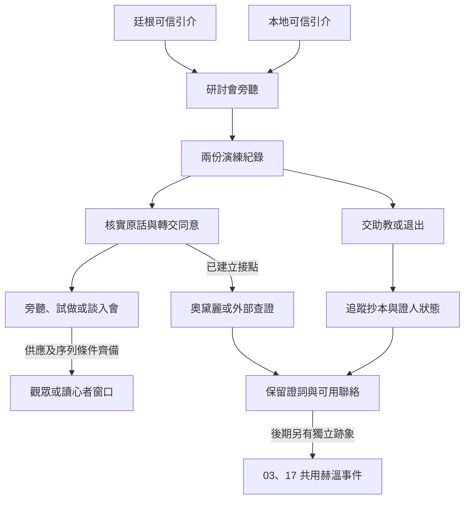

# 伊思蘭特的研討會｜請把你的話留到明天

03 心理煉金會的貝克蘭德正文，承接[胡德案](tingen_hood_and_lanevus_story_v1.md)與[支線前置](part_one_sidequest_prologues.md)。原作基準沿[伊思蘭特](../../lore/characters/biographies/islant.v1.json)和[奧黛麗](../../lore/characters/biographies/audrey-hall.v1.json)傳記。黛拉夫人推薦伊思蘭特到霍爾家授課，奧黛麗其後應邀參加研討會，接觸斯蒂芬·漢普雷斯等人，並掩飾自己先前已知道的內容。本稿的副場、志願者、抄本及玩家差事皆為遊戲原創。研討會按人物活動窗口切入，無須先完成大霧霾或上一批正文。

## 第一場｜椅子留在門邊

樓梯上傳來兩次敲門聲。伊思蘭特走過來，把原本靠在牆角的椅子拖到門邊。

「有人聽到第二聲，會以為第一聲是自己記錯了。今天可以先練習把兩聲都寫下來。」

若達克斯特仍能替你引介，他的便條會先送到。帶來胡德案資料的玩家，只能使用仍持有且獲准外傳的部分。若原件已交黑荊棘，達克斯特可依自己知情說明交接，玩家可帶一份獲准的節錄，或空手赴約。若玩家從貝克蘭德本地入線，需有可信的圈內人引介，可先核對兩份匿名的演練記錄，再由引介人安排旁聽。已暴露的病房證人若拒絕聯絡，當天可以只談通用方法。

伊思蘭特請你把桌上的紙翻到空白處。你可以說明自己怎麼分辨親見與轉述、詢問入會要承擔的工作，或聽完公開部分便離開。若當週無法赴會，保留仍有效的引介，下次按地點和人員重新排期。

## 第二場｜請她自己念

練習開始前，志願者梅格說她只願意讓別人記錄自己念錯的字。伊思蘭特請一位助教帶她到屏風後，先讀一小段，再由在座的人寫下所見。梅格念完，助教遞給她一張改寫過的記錄，要她簽名。她把紙推回去。

「那句『我希望再做一次』，我沒說。我想明天再答覆。」

桌上有兩份紙。一份寫她念錯的字，另一份寫她同意再做一次。後一張已經蓋了助教的印，落款還空著。

- **先問梅格要怎麼處理。** 她願意的話，可把原話寫回去，請她確認能給誰看。若她要離開，先讓她自行選擇是否需要陪同。助教若已把抄本送出，後續須查清誰收了副本。
- **按助教的要求送件。** 可照實標記第二張尚未簽署，也可把它當成已同意的文件交上去。後者可能讓助教願意再給你一件差事，但收件人也可能據此排定第二次練習。只有梅格實際作出的同意，才算她同意再赴會。
- **先封存自己獲准保留的節錄，再找外部聯絡人。** 可循達克斯特、黑荊棘的既有接點，或日後能接觸的本地人核對流程。無授權時可交公開的日期與地點，留待獨立查訪。梅格未親自核對前，報告只記抄本的差異。

散場時，梅格若願意留下聯絡方式，會請你把見面時間寫在便條上。「你想再問什麼，下次先念給我聽。」這次演練的紀錄可以證明文件遭改寫。梅格當時的感受與有無非凡手段介入，各自需要進一步查證。

## 第三場｜奧黛麗只問了一句

若奧黛麗當週確實在場，且有可信的引見，她會等其他人離開才問你。

「這兩張紙，哪一張是她親口確認過的？」

你可以把梅格同意轉交的部分給她，也可以只告訴她場次與簽名欄的差異。若兩人未曾見面，可由當事人允許的中間人轉交；中間人遲到或選擇不接時，奧黛麗便照她自己所見行動。若你反過來向會方交出訪查資料，則照實記錄收件人與可見範圍。有人因此開始留意梅格時，她會依實際收到的消息決定是否改約。

奧黛麗可以請當事人或持有人同意出示私人報告。玩家能否循她的渠道與 17 合作，要看彼此的信任、她實際轉達的內容及後續邀請。若玩家從前一批建立了佛爾思或埃姆林的外部聯絡，仍要先問該人是否願意轉交，並保留原提供者的許可範圍。想只做外部查證或拒絕引介，都可在這裡收束。

## 第四場｜下一張請帖

伊思蘭特若願意再談，會請玩家選擇旁聽、接一次試做、談會方身分，或拒絕。她會按自己確實看過的表現安排下一步。外部路線仍可沿達克斯特或已建立的可信供應者聯絡，來源中斷便等下一次有效窗口。

- **尚未首服。** 沿用[既有觀眾供應規則](tingen_pathway_acquisition_v1.md)，由仍能聯絡的配藥人安排；人若在廷根，須等實際交接。會方邀請、配方、材料、配製與首服依序確認。
- **已是觀眾。** 可用一次獲准的訪談或回訪延續練習。讀心者的首輪引介仍按[胡德案](tingen_hood_and_lanevus_story_v1.md)約首服後三至四個月的暫排窗口，並查消化、供應與導師是否可用。到時間時若條件不足，本週可以只接查證。
- **退出或離城。** 已做的委託、仍可聯絡的人與已交出的資料依原去向保留。尚未領取的供應要等可用的聯絡重開。

赫溫的實際干預留到後期原作窗口。這一週可帶走的是梅格願否作證、誰持有哪份抄本、已核對的原話與誰能及時聯絡。後來若取得當事人在赫溫事件中的獨立跡象，才可把這些早期材料用作對照，循 03 或 17 安排示警。後期依有效情報、接應能力及實際抵達時間結算；零介入時，奧黛麗仍沿既有基準察覺並反制。[後期年表](../../lore/history/red_priest_v1.json) · [赫溫傳記](../../lore/characters/biographies/hvin-rambis.v1.json)

## 研討會細圖

| 走法 | 結果 |
| --- | --- |
| 胡德案原件已交出 | 可循達克斯特引介或本地人赴會；原件由現持有人決定是否出示。 |
| 保住梅格的證詞，卻沒約到奧黛麗 | 保留證詞與現有接點。她只讀自己實際取得的消息。 |
| 赴會、交給助教一份未簽記錄 | 實際收件者可據此行動；當事人是否願意再來另行記錄。 |
| 錯過研討會或未能取得讀心者引介 | 各人物沿基準行動。玩家保留實際序列，後期仍可憑當時證據入線。 |

[第一部劇情總樹](part_one_story_tree.md)
