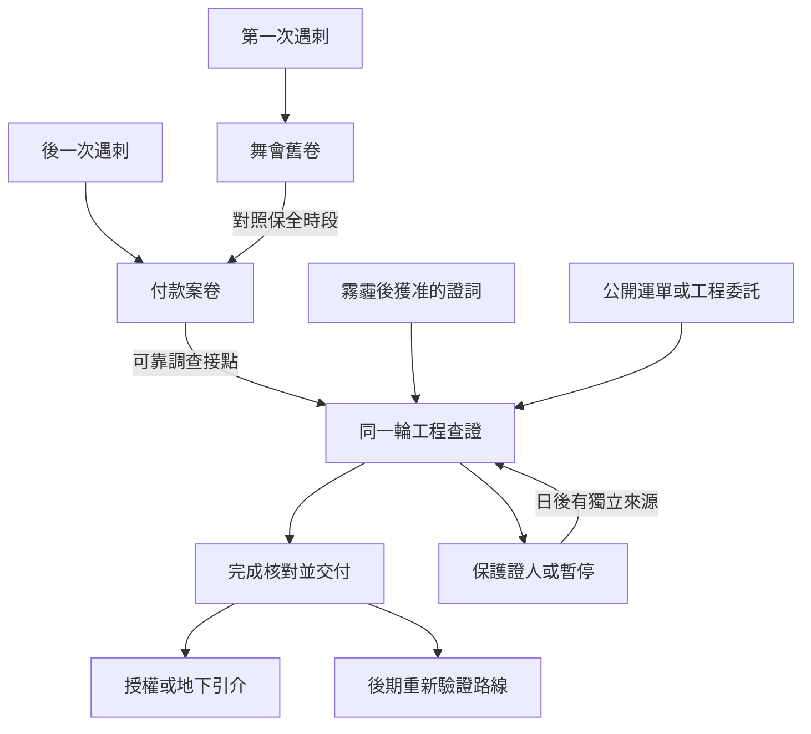

# 尼根公爵遇刺與王室工程｜借道單上的空格

06 黃昏隱士會與黑皇帝儀式的前段正文，接續[支線前置](part_one_sidequest_prologues.md)與[大霧霾](backlund_great_smog_story_v1.md)。尼根公爵兩次遇刺各自發生在霧霾前。本稿可在早期窗口分段觸發，也可從事後工程調查回查兩份舊卷。回查只提供當時留存且目前可讀的資料。文書員、借道單、承運差事與下列對白為遊戲原創。

## 第一場｜還回去的外套

舞會散場後，一名侍者把一件外套拿到衣帽間。主人已走了，口袋裡卻還有一張回程車票。隔著門，他聽見有人說，今晚的車全得從正門走，側門要留給風暴教會的人。

「我記得誰把衣服放在這裡。」侍者抓著外套袖口，「我想先知道，你打算把我的話告訴誰。」

- **問過本人，再把交接時刻交給教會。** 若玩家在舞會後有教會接點，可協助核對侍者的說法與側門交班。證人同意留名時，日後可請他確認原卷。若他只同意留下時間，案卷只收時間。
- **記下報紙日期，離開衣帽間。** 日後可循公開消息查到當時保全加強的時段。若沒有其他來源，玩家對舞會的認識止於公開版本。
- **等到事後才回查。** 議會或教會的聯絡人按權限出示舊卷。可讀資料依此前保存情況與玩家的身分，侍者若已離開，須另尋接點。

原作基準沿[尼根公爵傳記](../../lore/characters/biographies/pallas-negan.v1.json)。奧黛麗察覺異常，公爵躲過齊林格斯的行動。玩家在本稿能保存的是事後的證詞、出入口紀錄及可複查的人脈。

## 第二場｜撤回的車

公爵的死訊登報後，議員家的文書員請你在送報車走遠後再進門。他從《濟貧法》草案下抽出兩張收據。兩張都由同一名車伕簽收，一張寫護送，另一張寫補貼停駛。

「我那天去問車。他說，錢給得比出車還多。只要待在家裡。」

窗外有人卸下另一家的訃告。文書員把收據翻過來，背面有帳房用來對款的流水號。他說他能證明自己抄過這個號，還得靠別人證明是哪間帳房付的錢。

- **查付款。** 在可讀的帳簿中核對流水號、日期與付款人。查到中間經手者後，可請調查方依自身權限續查。只有拿到能核對委託來源的證據，才可把黃昏隱士會列為後一次刺殺的出資者。
- **先安置文書員。** 問他願意去哪裡、允許哪位聯絡人知道。實際送達才算安置成功。帳簿若在這段時間撤走，保留當時持有的收據及後續尋找經手者的機會。
- **歸還收據，接受工程差事。** 由王室聯絡人收回原件，玩家可按[前置](part_one_sidequest_prologues.md)赴約。手上還有多少可核對資訊，依先前獲准保留的紀錄而定。

後一次遇刺由欲望使徒得手。此時的報紙、坊間指控及調查結果各有來源。玩家若只接觸公開報導，介面會顯示報紙的說法。舞會舊卷可供對照保全變動，兩次遇刺各有自己的證據鏈。

## 第三場｜「我只看見那輛車」

霧霾過後，接應處借來的桌子還靠在牆邊。若玩家保住了可聯絡的莊園外圍證人，而且對方願意赴約，他會把一張折過兩次的回條攤平。

「我只看見那輛車。蓋章的人在門裡。我可以說車從哪兒來。至於誰讓它來的，你得問別人。」

- **走證人查訪。** 依同意的用途、收件人和範圍轉交。只准查車次時，將人名與住處留在原持有人處。證人可在轉交前收回同意。已交出的資料依實際收件及副本紀錄追蹤。
- **走公開運單。** 如果沒有可用的證人，可經公開承運紀錄或王室差事核對車次。只有抄件時先問出具者是否能驗真。能核實車次與卸貨地，才足以約下一次現場查驗。
- **依軍情九處邀約交件。** 已有可靠調查接點才可赴約。經休引介時，讀取她當週可用的聯絡管道。交件後可接受查訪、只留聯絡方式，或退出。接差事、任職與領藥分別記錄。

玩家若帶來 05 的卸貨紀錄，先驗日期、車號和承運交接。兩張紙只出現同一家車行時，聯絡人會請玩家找能確認同一趟貨的人。02 的莊園回條也只能證明它實際記載的交接。

## 第四場｜簽名留在路上

工程代理人把圖摺到只露出兩扇門，請你在借道單上簽名。簽名格下方寫的是「確認車已到達」。你親眼看過有一輛車進門，另一輛到換班時還在路上。

- **照實登記，保留差事。** 按實見車次填單。若代理人仍願續約，可繼續接觸外圍承包人。允許見到的路段依後續委託。玩家仍可拒絕入職。
- **帶著可核對的差異交件。** 有查證管道時，可約人看原件或提供獲准的副本。唯一原件交出後，其他人只能靠持有人出示、驗真的副本或獨立來源。若先向地下供應者透露卸貨路線，下一週先查承運人是否真的改道，再判定能否按舊約查訪。
- **留下空格，回去保護證人。** 可以停止追查，或安排對方安全離開再補件。先前交出去的副本仍在收件者手中。往後若再有可靠的承運資料，可另約查訪。

**序列接點。** 可複查的報告通往[軍情九處仲裁人授權](aurora_and_royal_pathway_acquisition_v1.md)。保有合法可用的帳目和地下引介，可談[律師配方交易](aurora_and_royal_pathway_acquisition_v1.md)。兩者沿各自的供應與首服規則。本章會開放後續條件，調查紀錄本身不增加序列。

**收束。** 保存案卷原件與副本的持有人、證人的安全與同意範圍、車次最後一次核實時間，以及誰願意接續追查。若確認工程的承運差異，可在[喬治三世與黑皇帝儀式正文](backlund_george_black_emperor_ritual_story_v1.md)的後期窗口重新驗證路線。實地定位陵寢及辨認晉升儀式另有證據與時間條件。零介入時，兩次遇刺與大霧霾照世界基準結算，玩家在後期只從當時可用的渠道重新入線。第一部結算讀取實際保住的人與卷宗，及哪些盟友在後期確實收到可用情報。

## 兩次遇刺與工程調查細圖

| 走法 | 可帶往後段的結果 |
| --- | --- |
| 當時查過第一次遇刺，錯過第二次 | 可用舊卷對照保全時段。付款來源要另查。 |
| 只參與大霧霾救援 | 若實際保住證人並獲准轉交，可從證人進工程查證。 |
| 全程在外地，後來受僱核車 | 以當期可見的車次入線。兩案的情報依可讀舊卷取得。 |
| 兩邊都赴約，先交出唯一原件 | 按各方實際持有的資料核對，同一原件只有一名持有人。 |

[第一部劇情總樹](part_one_story_tree.md) · [後期籌備時間線](../../lore/history/red_priest_v1.json) · [儀式結果時間線](../../lore/history/lightseeker_v1.json)
