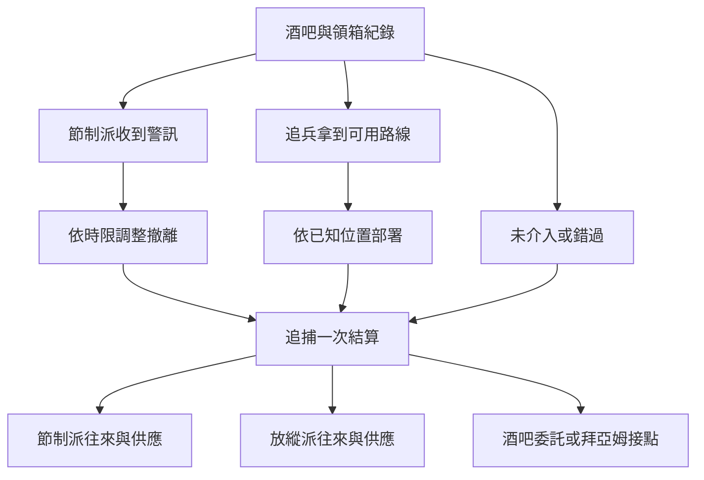

# 勇敢者酒吧與玫瑰學派｜後門只開一次

本篇承接[跨城入口](tingen_aftermath_backlund_entry_v1.md)與[東區和碼頭調查](backlund_docks_lanevus_story_v1.md)，展開 01 玫瑰學派在貝克蘭德的追捕。酒箱、守門少年、空屋、回執與新增對白是遊戲原創。零介入基準沿用[貝克蘭德年表](../../lore/history/backlund_sherlock_1349_v1.json)與[長支線 01](long_sidequests_part_one.md)：莎倫、馬里奇與夏洛克設局反擊，史蒂夫與傑森死亡，這次追捕瓦解。日曆日期與個別章次待核；玩家以實際抵達時間判定可用的窗口。

## 第一場｜空箱往哪裡送

**入口。** 可經《勇敢者酒吧的空酒箱》建立酒吧人脈，也可從已確認的地方承運人接觸。已演過[01 前置](part_one_sidequest_prologues.md)《酒箱裡的布》或《送到門內》的角色，直接接續實際交出的線索、少年去向和已收到的邀約。錯過卡斯帕斯能牽線的窗口，從事後回訪或拜亞姆重開。

卡斯帕斯把門邊那只空箱提起來，箱底滑出一塊濕布。他沒有急著去撿。

「來領的人問了三遍，這箱子能不能從後門搬出去。以前替我搬的人只問有多重。」他把箱子挪到自己腳邊，「你上次在碼頭查過交班。今天那張收據要是還在，替我看看誰簽了名。」

- **核對收據與實際交班。** 只使用有權查看的資料。碼頭先前的紀錄能比對時間或搬運人；蘭爾烏斯的身份線索仍留在原案。若同一碼頭人員另有親見這次領箱的過程，才可當成新證詞。
- **問清守門少年是否願意離開。** 卡斯帕斯可牽線給馬里奇。少年願意離開時，記下實際接手的人；已從前置撤離者沿用原結果。
- **接陌生買家的詢問。** 對方願意出錢買後門和樓梯的位置。玩家可只提供公開的搬運時段，也可核對並交出更完整的路線。對方依實際收到的內容行動。

## 第二場｜兩把鑰匙

**節制派入口。** 莎倫把鑰匙推給馬里奇，自己留下一張沒有住址的便條。

「搬走的人明晚才回來取東西。若他們今天就來，先請他們在街上等。」她看著你，「你有沒有跟別人說過這扇門？說過的話，告訴我們是哪一道。」

- **如實交代已分享的路線。** 莎倫若來得及核實，可換外圍接應點。若玩家此前向買家透露位置，這次提醒仍可能有效，已外流的路線仍可能被追兵使用。玩家可協助轉移等候的人。
- **只答應送人，保留其他承諾。** 接應者只拿到必要位置。人確實抵達後，可接[《空屋留著一盞燈》](rose_and_wartime_pathway_acquisition_v1.md)的節制派供應或維持外部協作。
- **不接委託。** 告知已知的風險後可離開。莎倫與馬里奇依各自的消息準備。

**放縱派外圍入口。** 買家把另一把鑰匙留在櫃上。「你說那道門能走。今晚若有人先把它鎖了，我要知道原來等在裡頭的人往哪裡去。箱子也可以查，價錢我們另外談。」

玩家可交已核實的撤離線、只查貨物，或退回鑰匙。若接下交易，回到[《退回一把鑰匙》](rose_and_wartime_pathway_acquisition_v1.md)結算供應。若暗中向節制派示警，只有確實送達的訊息會改變對方布置。兩把鑰匙、兩次約見和各自交付的資訊分開保存。

## 第三場｜門口沒有第二盞燈

**觸發。** 追捕進入當晚窗口。玩家只看得到其所在位置能接觸的人和消息。同一角色無法同時守酒吧、送人離開和查看追兵；其餘行動可託付給先前已約好且能到場的人。

原先靠窗的燈熄了。有人端著空杯站在街角，看到你才把杯子倒過來。杯底夾了一張紙，上面只寫：「後門有人，先帶小孩過街。」

若節制派收到警訊，原訂等候處已換。若追兵先拿到確實位置，巷口有人提早守著。兩件事可同時成立，是否相遇依到場與撤離時刻判定。

- **按實際可走的路帶人離開。** 先核對接應點還有沒有人，再帶願意跟隨者過街。若舊地已暴露，可沿另一條已確認的路送達，或就地等可靠接應。
- **追查原接應點。** 記下誰到了、誰先撤、是否親眼見過同一批人。已在別處送人的玩家只能從後續證詞還原這一段。
- **把外圍消息送出。** 可傳給仍能聯絡的馬里奇、卡斯帕斯或其他真正能採取行動的接應人。太晚收到的訊息只能用於後續查證。

**單次結算。** 本章改變外圍撤離、據點是否暴露、誰能再聯絡和誰取得資料。核心反擊沿原作基準。玩家未到場時，由能接觸到的目擊者或當事人說明其親見，地下圈的傳聞另外保存。

## 第四場｜先別把地址寫進去

次日，空箱還在原來的位置。卡斯帕斯把裡頭的濕布抽走，只留下箱蓋。

「誰去過後門，知道的人已經夠多了。」他問，「你要替誰留下一句話？」

- **聯絡節制派。** 少年或其他人若已安全抵達，可憑當事人證實的履約接續莎倫、馬里奇。可談囚犯的配方、師承或一次差事；是否加入由玩家決定。若地址已流出，當事人得知後可能改約。
- **續接放縱派外圍。** 尚能聯絡的接應人只回覆自己收到的部分。原約撤銷時，玩家可持可查的回條等到拜亞姆的窗口。斯厄阿與蕾妮特仍依後段行動和知情條件出場。
- **保留酒吧的人脈。** 可只替街坊保存獲准的回話，或回到本地酒箱與地下交易委託。若日後要接 05 聚會，另依熟客引介和場次開放；本案的酒吧聯絡只是可能的引介。
- **保護證人，延後追查。** 留下確實送達的警訊、當事人許可和聯絡途徑。日後 11 可從真實抵達拜亞姆的接應人獲知必要內容。沒有共同證物或實際聯絡時，各案分開推進。

**成長交接。** 囚犯的配方、備料、首服及師承各自保留。若已首服，仍使用原服用日期及消化狀態；追捕後是否還有可聯絡的導師，才決定能否在既有窗口接後續成長。

## 分支細圖

| 推演 | 接續結果 |
| --- | --- |
| 保護少年並及時示警 | 可保留安全抵達與交件結果，節制派依實際履約決定後續合作。 |
| 先告訴買家，再向莎倫示警 | 兩方各自得知的資訊都保留。先收到、能先行動的一方影響外圍部署；已交出的地址仍可能被追兵使用。 |
| 只查空箱或選擇離開 | 可維持地方委託，不會自動獲得配方或組織身分。 |
| 追捕結束後才抵達 | 事件背景照既有年表發生；玩家可查證事後消息，或待拜亞姆另有有效入口。 |

[第一部劇情總樹](part_one_story_tree.md)
