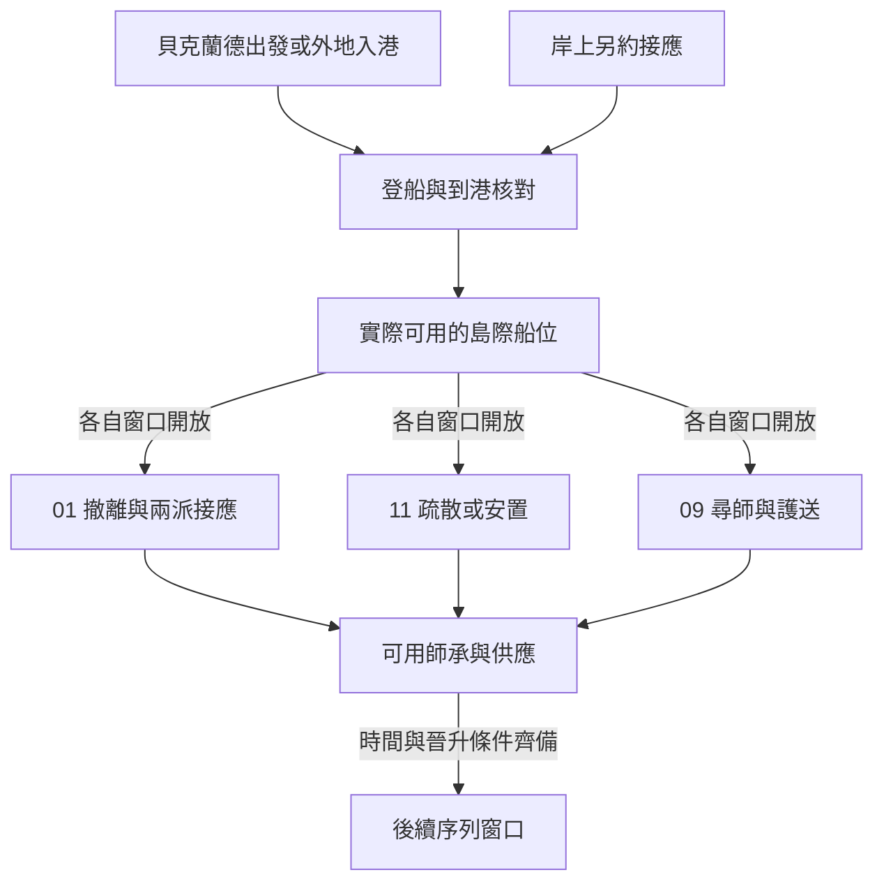

# 出海與拜亞姆接應｜最後一張票

接續[勇敢者酒吧與玫瑰學派追捕](backlund_rose_pursuit_story_v1.md)，開啟 01 玫瑰學派、09 生命學派與 11 羅思德海神線的港口窗口。格爾曼出海、與達尼茲相遇、卡維圖瓦海嘯及達克威爾護送各按[海上年表](../../lore/history/gehrman_voyager_v1.json)。本稿的船次、乘客、接頭與對話為遊戲原創。玩家可乘別艘船、留在貝克蘭德，或從其他可達路線進拜亞姆。

## 第一場｜上車之前

出城的早班車還沒放人上去，承運人先把一張揉皺的票根攤在行李箱上。若玩家之前答應替節制派送人，紙上只有約定的接應記號。若此前接觸過追兵，另一封信只在對方還能聯絡、也確實知道你要走時送來。

「你可以說這人是跟你一起的。」承運人看了一眼排隊的人，「但上船時，票是照人點的。」

- **帶願意走的人一同出發。** 確認各自船位與登船時點。若原接應點已外露，先問當事人是否同意改約。留下的警訊只有對方收到、能及時行動才算有效。
- **先去確認港口，在岸上接應。** 只帶獲准轉交的回條。可請可信的人另外帶路。兩人行程分開，接應成功須等對方實際抵達。
- **取消行程，或把位置交給追兵。** 取消後照原本可用的管道安排留城。若交出位置，依收件人掌握的範圍與時間調度追蹤；已有的保密承諾按消息實際外流的範圍記錄。

## 第二場｜交給下一班

開航前，船主收起通舖名冊。雨水已浸到其中兩個名字。甲板工把未用的票收進鐵盒，告訴你最後一個可轉讓的位子只保留到點名。

這時可能有三種需求。01 想把一名撤離者送往仍能接人的碼頭。11 想替待安置的居民保留通路。09 要等達克威爾已到尋師及準備護送的窗口，才會需要拜亞姆至奧拉維的備用船位。從貝克蘭德出發的船和日後島際船各用自己的名冊。只有需求確實落在同一班船時，才出現搶位。

- **兌現一項承諾，再安排後班。** 指定這個座位給誰。找得到替代船且趕得上截止時間，另一方也能成行。趕不上時，仍可改派岸上接應或傳回改期通知。
- **先找船主核對可用的空位。** 若有人退票，核對後才釋出。與船主商量的保留位要等實際登船才寫入到港名單。
- **放棄出航，留港等人。** 其他人的行程按已確認的票根推進。玩家可安排接頭、搬運或安置，效力依實際所在與到達時間判定。

若主線人物恰好搭乘同航程，玩家只能接觸實際在場、可被接觸的部分。未搭船的玩家照樣可由到港消息開始下一段。

## 第三場｜到岸先點名

拜亞姆的接應者沒有拿著接頭牌。他坐在卸貨棚底下補一張名冊。船還在港外時，已有人送來一張紙，說船上的人全到了。他把紙摺好，擱在空白的「抵達」一欄旁。

「先讓我見到人。要是他換了船，告訴我該去哪裡等。」

- **01｜分別確認兩派接應。** 節制派依警訊和撤離者的實際去向決定見面處。放縱派可沿取得的票根或已外流的路線追查。某人沒到時，留最後確認的碼頭，再問是否允許協尋。玩家可各自接案、改走外部合作或拒絕。
- **11｜把實際到港的資訊交給願意接手的人。** 卡拉特與代罰者各自核對自己收到的資料。可協助找落腳處、安排撤離預備，或只交公開的港口資訊。海嘯按世界年表另開，事前的名冊能幫助日後找人。
- **09｜等待尋師窗口。** 達克威爾有實際委託時，可把已驗真的承運管道用在護送或岸上接應。提早到港可先找船主，護送結束前依[既有供應劇情](bayam_pathway_acquisition_v1.md)處理。骰子的保管與交付另讀 09 航程結果。

全程未介入時，格爾曼的航程、後續海嘯及達克威爾的護送照各自原作基準。玩家回訪只讀可核對的消息。渡船的乘客、出發與抵達只寫一份，01、09、11 各自讀取相關人員、證物與承諾。

## 晉升安排

三條路線各有自己的導師及任務。同一場港口工作可讓導師認識玩家，正式開放仍讀取現序列、服藥時間、消化和供應。

| 路線 | 序列 8 的首輪窗口 | 序列 7 的後續場景 |
| --- | --- | --- |
| 被縛者 | 囚犯首服約滿三個月，拜亞姆接頭完成後，可由仍信任玩家的一派約談瘋子。接應失聯時，延至可信的地方人重新接頭。 | 瘋子服用約三至四個月後，在後續木乃伊交接前後確認狼人供應。見到蕾妮特或斯厄阿仍沿各自原有出場條件。 |
| 命運之輪 | 怪物首服約滿四個月，在奧拉維交接之後的回訪中約談機器。當場剛首服的玩家先保留師承。 | 機器服用約三至四個月後，由生命學派的後續分歧或查證恩佐的地方支線開幸運者窗口。 |
| 暴君 | 水手首服約滿三個月，海嘯後的港口值勤或復航調度可接暴怒之民。海嘯後才首服者以後續值勤開窗。 | 暴怒之民服用約三至四個月後，完成一段實際航路的查驗，由代罰者或可信地方供應者確認航海家。 |

完整的跨途徑排程見[第一部晉升時機表](part_one_advancement_schedule.md)。

[第一部劇情總樹](part_one_story_tree.md)
