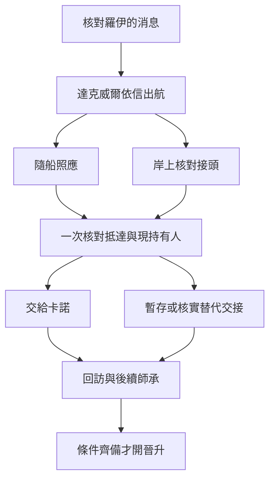

# 達克威爾與概率之骰｜鐘還沒有響

09 生命學派的拜亞姆至奧拉維正文，接續[支線前置](part_one_sidequest_prologues.md)與[航程與拜亞姆接應](backlund_voyage_and_bayam_arrival_story_v1.md)。[海上年表](../../lore/history/gehrman_voyager_v1.json)和[達克威爾傳記](../../lore/characters/biographies/darkwill.v1.json)是本批的原作基準。克萊恩帶回羅伊·金遭軍方扣押的消息。達克威爾依老師留下的信赴奧拉維，僱格爾曼護送，最終將骰子交給敲鐘人卡諾。下列配貨、船班、事故與對話是遊戲原創。尋師、出航及交接各自有窗口，可與同一週的其他海上事件交錯。

## 第一場｜改過地址的藥

達克威爾把一只已經封好的藥包拆開，從底下抽出一張配貨單。收件處被改過兩次。第一個地址仍可辨認，第二個只剩一條沾了油的墨線。

「若找到替他簽收的人，先問他那天等了多久。」他把藥包原樣摺回去，「別一開口就問羅伊在哪。」

玩家可用先前的港口人脈找收貨人，也可沿配貨商號或軍方可用的查訪管道入線。若錯過這週，達克威爾仍會依年表與可用聯絡繼續尋師。

- **核對改送地址。** 收貨人能證實送藥改過路。要確認羅伊被扣押，還須有可信的軍方紀錄或獨立消息。先把已確定的部分交給達克威爾，他可以按自己手上的消息調整會面。
- **走軍方查訪。** 先選擇要透露哪個商號、是否提及誰在尋人。若軍方確實拿到可追查的訊息，可改變後續查問；達克威爾依自己得知的內容決定繼續合作或改約。
- **只替他傳訊。** 可承諾把可靠回覆送到指定地點。只有達克威爾在窗口內收到，才有機會用於出航安排。羅伊留下的信由達克威爾實際取得並依內容行動，外部尋人結果可補上情報。

## 第二場｜船票先交給誰

達克威爾請你把備用票放到桌上。他自己那張票已折進錢袋，袋口卻還張著。

「我已經請了護送的人。你若能到對岸等，先告訴我誰會替你開門。」

此處接[《備用船票的另一半》](bayam_pathway_acquisition_v1.md)。上船的玩家可承擔照應或傳訊。走岸上線的玩家須提前核對卡諾的會面管道、抵達時刻與可信的替代接應。玩家若先答應替 11 安置居民，且兩邊確實需要同一班船，就在開航前把實際剩餘船位分給其中一方，再為另一方找能趕上的替代班次。達克威爾原定主船票有自己的持有人；失去備用票會減少後路，主班是否仍能走另查。臨時找到的人要確實答應且能到場，才計入接應。

## 第三場｜同一枚楔子

離岸後，一枚鬆脫的楔子沿著船身滾了兩次。第一次停在一名水手靴邊。第二次，他低頭去撿，頭頂的木箱就在那一刻滑過來。達克威爾先去看自己的行李，又看了一眼樓梯。

船上的玩家可先扶開水手、請有權調度的船員固定貨物，或去找達克威爾和格爾曼。若玩家此時只看到貨箱滑動，日誌記下事故和時點。骰子是否牽涉其中，要由在場的知情者或可靠證據補上。提前安排岸上接應的玩家可在收到改泊通知後換地點，或留下原接點供下一班傳訊。

- **先處理船上的人。** 人手足夠才可兼顧照看傷者與傳訊。帶得走的證物和當事人的實際去向分別記錄。
- **按委託協助保管。** 由當前持有人與玩家約定接觸或交接。能否安全接手，另查已掌握的保管方式與可用人員。只有真正完成移交才更改持有人。
- **通知別人來截貨。** 只會交出玩家手上已查明的內容。截貨方必須能趕到、有能力完成交接；達克威爾與格爾曼會依察覺的風險和當時能力應對。一次失敗的攔截留下暴露、延誤與各方知情，骰子仍由當前持有人保管。

事故會按船上實際援助結算。轉移人員或換泊可能減少損失，骰子的具體運作依後續核實的原作規則處理。

## 第四場｜鐘還沒有響

奧拉維的接應者站在兩盞還沒點亮的燈中間。若原定時刻已過，他請你重新確認約定。若卡諾仍在，且辨認與交接都成功，達克威爾會親手把骰子交出去。玩家若事先保住第二條聯絡，便可在改泊後請對方另定時刻。

- **完成原定交接。** 記卡諾實際收件的時間、當場知情者和保管承諾。玩家即使只在岸上，也可以用到港與接頭回條證明自己履約。
- **延後或改交保管。** 卡諾尚未到場時，先按當前持有人的意願保管。另有盟友願接手時，要確認他能保管、能到達且實際完成交接。達克威爾和格爾曼只會依所得消息決定追查或接受替代安排。
- **只做善後。** 玩家若在船後到港，仍可回訪傷者、送還已核實的證詞或詢問學派合作。錯過的船上場景依實際知情補記。

**一次交接結算。** 記錄羅伊的拘押消息由誰核實、實際航程與抵達的人、骰子最後的持有人與保管條件，以及後續仍可聯絡的接應者。零介入沿達克威爾與格爾曼原有航程，骰子交給卡諾。恩佐後續由 09、01 的可靠人脈另行查證，04 只讀實際傳到的情報。威爾與烏洛琉斯的行動另循當時的條件。第一部結算可讀取已保全的接應、可信證據與保管承諾。

## 回訪與晉升

- **未首服。** 履約後達克威爾可按[既有取得稿](bayam_pathway_acquisition_v1.md)引介怪物的供應。岸上接應也可獲引介；領取配方、配製和首服各自確認。
- **怪物 → 機器。** 首服約滿四個月後，在奧拉維回訪核對一次改泊和岸上交接。學派導師須能核實玩家處理的部分、消化與供應。回訪時條件尚未齊，先保留可驗證的交接紀錄，下次循能聯絡的導師重約。
- **機器 → 幸運者。** 上次實際服用後約三至四個月，待學派分歧或恩佐地方支線出現，由可信導師另約一次查證。玩家可拒絕透露消息來源，另找能接受獨立證據的供應者。後續災禍教士在恩佐調查的較晚窗口另排。[第一部晉升時機表](part_one_advancement_schedule.md)

## 尋師、航程與交接細圖

| 走法 | 結果 |
| --- | --- |
| 把唯一備用位留給待安置居民 | 11 記實際抵達。09 的備用安排可能落空，原定航班另查。 |
| 玩家在岸上照約接頭 | 可獲引介。船上事故只依親見者的可核實消息得知。 |
| 第三方到港卻沒有完成交接 | 保存消息外流與追查。骰子仍由當前持有人保管。 |
| 船晚到且卡諾已離開 | 記實際到港，先按現持有人與可信聯絡決定如何保管及改約。 |

[第一部劇情總樹](part_one_story_tree.md)
