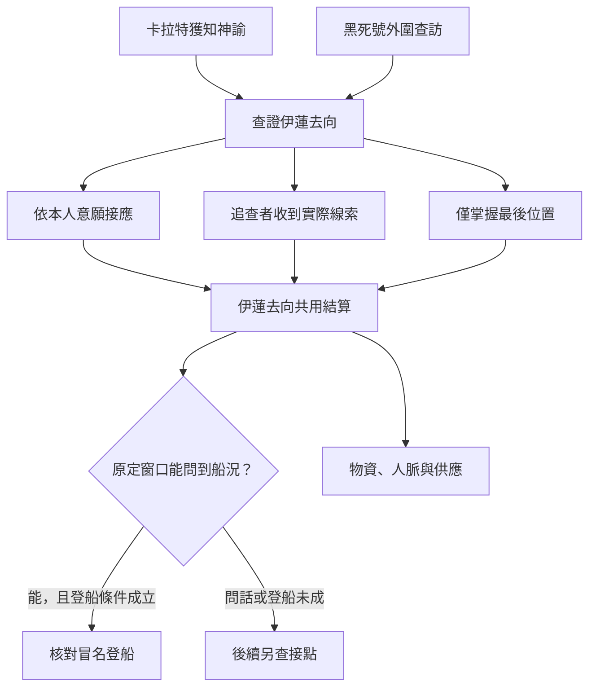

# 紅髮伊蓮與黑死號｜船單上只寫貨物

02 魔女教派與 11 羅思德海神線的共用正文，接續[拜亞姆海嘯與海神權杖](bayam_kalvetua_sea_god_story_v1.md)。原作基準沿[伊蓮](../../lore/characters/biographies/elaine.v1.json)、[卡拉特](../../lore/characters/biographies/kalat.v1.json)及[特雷茜](../../lore/characters/biographies/tracy.v1.json)的傳記。伊蓮逃離特雷茜，卡拉特依神諭尋找並保護她。克萊恩從伊蓮口中問到船上的事，以無面人能力冒充她，由米索爾帶上黑死號。下列碼頭、物資回條、接應路線與對白為遊戲原創。達尼茲的物資委託、卡拉特收到神諭與黑死號查訪依各自時點觸發。

## 第一場｜一袋少了半袋

倉房裡堆著上一次賑濟剩下的麻袋。卡拉特把一張卸貨回條翻過來，沿著背面的摺痕壓平。若達尼茲已送到這批物資，且卡拉特仍能聯絡，玩家可替他核對哪幾箱進了倉，哪幾箱已經送到住戶手上。原先負責接頭的人若在海嘯後失聯，先按上一次點名找仍在港的人。

「這批貨照舊送。」卡拉特說。等最後一名搬運工走出門，他才問：「有人說，昨天看見一個紅頭髮的女人獨自來買船票。你願意先去問她需不需要幫忙嗎？」

- **接下尋人。** 卡拉特確實收到神諭、又願意信任玩家時，才會提出這個請託。他能交代自己收到的指示。玩家只在另有證據時得知回應者的身分。
- **只交物資。** 依實際到貨核對收件人、存量和分送去向。地方住戶若仍願意往來，可留給後續安置與合作。卡拉特可另找人尋訪。
- **循船隊查訪。** 有黑死號外圍的引介時，可從追查者出示的貨運單或問話入線。對方願意出示船牌，代表他此刻能接頭；船隊要找誰、原先是什麼關係，須另查。

## 第二場｜先問她要去哪裡

賣票的人說，那位客人問的第一件事是船何時開。第二件事是誰能翻看乘客名冊。他只記得她把定金數了兩遍。隔著幾扇關起的窗，你看見紅髮女人正在廊下修一只箱扣。她留意到你先看了出口。

「你替誰來問？」她說，「若你已經把地址給他們了，就先告訴我。我要算我還剩多少時間。」

只有在玩家核實她就是伊蓮、到達時間仍有效時，才切入會面。若她已離開，留下最後確認的地點和時間。傳聞中的紅髮乘客只算線索。

- **依她同意的去向安排接應。** 可以替她確認船期、安排可信的人接頭，或陪她去她選的地點。留在岸上可把公開船期交給卡拉特；確切住處、假名與下一段行程須依她同意的範圍轉告。
- **保住去向，請她另約問話。** 她願意時，可讓她自己決定向誰說明黑死號的船上情形。若確有可信聯絡，且對方在窗口內抵達，可安排會面。玩家離開後只收到自己有權核對的結果。
- **把已查明的去向交給追查者。** 對方可依到手的地點、船班和剩餘時間採取行動。若人已離開，追查者拿到的是舊線索；若能追上，伊蓮可依自己知道的風險與可用接應改路。追查者要實際抵達並完成攔截，才會改變她的去向。
- **讓她自己離開。** 可把約定交還給她，保留她願意留下的聯絡方式。若她選擇切斷聯絡，玩家在之後只能從可靠新消息得知行蹤。

## 第三場｜兩次報到

天黑後，有跑腿的人聲稱紅髮女人已回到黑死號。他只說自己看見米索爾領了一個人上船。另一名船員記得那人穿了什麼，卻沒同他說過話。

玩家可確認上船時間、問證人親眼看見什麼，或把消息依原樣交回聯絡人。若伊蓮曾允許玩家保有接應管道，可按約向岸上核實她最後的位置。兩邊的時間或地點出現矛盾時，可以提出「船上身分待查」，另找有能力核實的人。克萊恩的外貌變化、目的和船上經過依各自的知情條件揭露。

**黑死號的世界結算。** 零介入沿克萊恩問話並冒充伊蓮、由米索爾帶上船的基準。玩家若改動接應，先查伊蓮與克萊恩有沒有實際會面，或可信消息是否如期到達，並在原定窗口檢查登船安排。條件未成時，記錄該次接觸或登船落空，後續須由實際可用的新線索重開。伊蓮本人與冒名登船者各有自己的位置；兩條支線都讀同一份伊蓮去向。

## 第四場｜回條上沒有名字

回到卸貨棚時，上一批物資已有人來領。接頭人把空白回條推過桌面，問你打算把哪件事寫在上面。

- **向卡拉特回報她已收到協助。** 可交已完成的接應結果，以及獲准分享的消息。若人沒抵達，按最後確認時間另找願意查訪的人。安置物資照實際收件結算，日後可用於居民照護。
- **回到船隊談下一次引介。** 追查者或外圍承運人若仍願意往來，可安排船隊差事、查證舊運單或引介地方供應者。玩家可以要求先談條件、只接一次工作，或退出。曾把伊蓮的去向交給追兵，依她實際得知的內容影響以後是否願意再聯絡。
- **保留證物給後續調查。** 雪倫案與莊園的舊回條只能沿已核對的來源轉交。船隊交件可為後段卡特琳娜及特莉絲線提供接觸機會，是否確有關聯須依後續取得的證據。地方接應、安置船位和仍可調度的物資進第一部結算。

### 魔女途徑的窗口

**刺客 → 教唆者。** 首服後約三至四個月，可循雪倫案後仍能聯絡的中間人或莊園外圍核驗。早期供應失聯者，在本章的船隊差事收束後可重新尋找可信供應。接頭人可從一份已完成的委託確認合作，伊蓮的住處並非交易所需的固定條件。

**教唆者 → 女巫。** 上次實際服藥後約三至四個月，若大霧霾後仍有教派外圍或海上引介，可在查訪回條結清後安排會面。導師須說明能確認的魔藥影響，再由玩家決定是否繼續。既有玩家序列與消化照記錄。若引介人因追查而改約，可等後續船隊回訪。**序列 6 歡愉**的窗口留在船隊調查後續，另看供應者與消化進度。[第一部晉升時機表](part_one_advancement_schedule.md)

## 伊蓮與黑死號細圖

| 走法 | 結果 |
| --- | --- |
| 只交物資 | 記到貨與去向。卡拉特按自身管道找人。 |
| 保護伊蓮且及時安排她同克萊恩會面 | 伊蓮可走自己的路，克萊恩另按可用條件準備登船。 |
| 出賣地址時她已登上別艘船 | 追查者收到舊地址。只有再核實並追上，才會改變她的處境。 |
| 只見米索爾領人上船 | 記一次登船目擊；原身去向與冒名者真實身分仍各自查證。 |

[第一部劇情總樹](part_one_story_tree.md)
