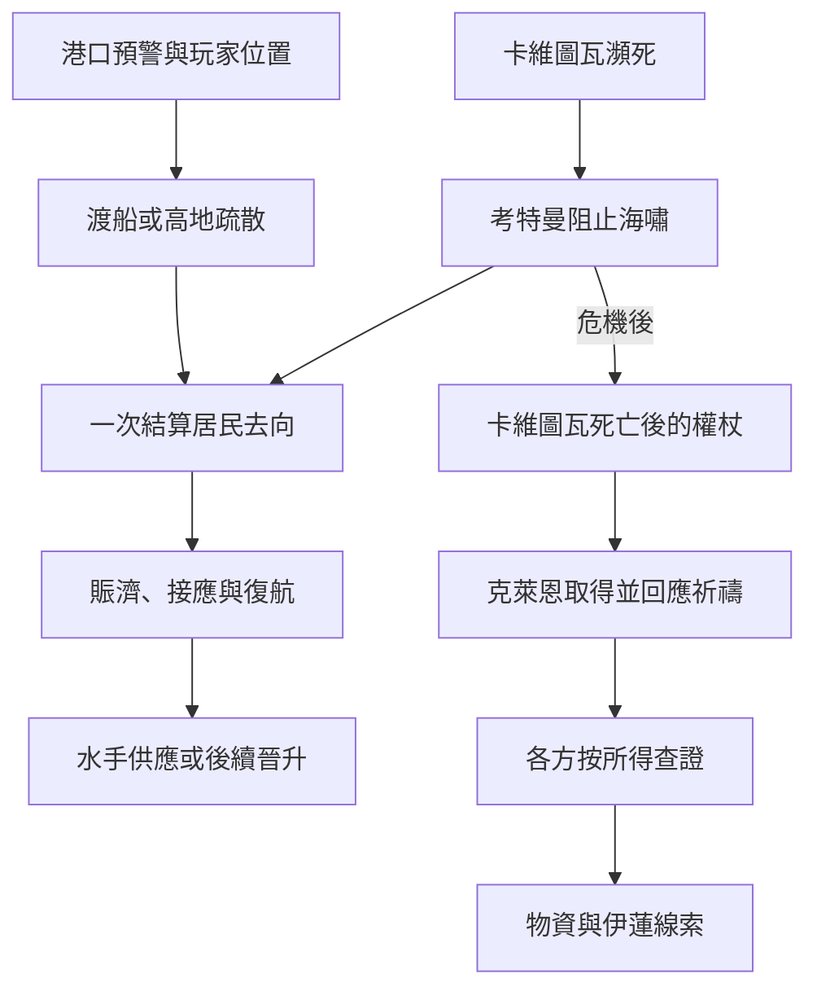

# 拜亞姆海嘯與海神權杖｜第三次鐘聲以前

11 羅思德群島與海神信仰的危機正文，接續[航程與拜亞姆接應](backlund_voyage_and_bayam_arrival_story_v1.md)。以[海上年表](../../lore/history/gehrman_voyager_v1.json)為基準，卡維圖瓦瀕死時企圖掀起海嘯，亞恩·考特曼出手阻止。卡維圖瓦死後，克萊恩取得權杖，後續藉它回應信徒。玩家的街坊、渡船、名冊、地方委託與對話均為遊戲原創。危機按世界日曆切入，當週尚未到港的玩家可從事後賑濟入線。

## 第一場｜誰替他買的票

漁婦把一張船位單塞進你手裡。上面的墨被海水洇開，還看得見她丈夫名字的最後兩個字。

「他走得慢。我買票時就講過。現在船主說，上頭那個名字是替我付錢的人。」

若玩家先前安排過到港接應，船主會拿出上次的名冊核對。只有能證實的船位可以使用。已承諾給別人的位子須先查對方的安排。若玩家初到碼頭，漁婦可以帶你去問當時在場的賣票人。遠處的鐘響過一聲，岸邊仍有人回屋取東西。

- **留在碼頭核對。** 將付款、實際乘船及需要陪同的人分欄記下。若此班船仍安全且船主同意，可更正名單或安排同去的人。只拿到票根時，先記待核。
- **先把異常報給代罰者。** 可以交港邊所見與確定地點。若另有人接手點名，兩件事都可推進。若無人接手，留下的住戶得等下一次核對。通報可供代罰者調度地方巡查。
- **找卡拉特確認岸上的路。** 若地方接頭仍有效，可請他核對哪條高處通道有人看守。玩家可交公開路況，或依許可轉交特定住戶的求助。反抗軍接應地址的流向依實際交件記錄。

## 第二場｜最後一趟渡船

卡拉特等在通往石階的岔路。他把能自己走的人劃到一欄，念到第三個名字時停了下來。

「這兩家還沒見到。你若帶得動一個，就先問他要往船上走，還是去上面那棟屋。」

若渡船仍經船主確認能走，玩家可依住戶意願帶人上船，並向目的地確認有誰能接。若渡船已停航，或有些人趕不上，可以由實際有人接應的高地路線送人。也可留下幫忙傳話，把哪條路已封和哪一戶尚未找到交給能行動的人。從代罰者接案的玩家遇到的是同一批住戶、同一班船；兩邊都找到同一個人時，以他實際選擇的去向結算。

第三聲鐘前，門框和鐵索在風裡一起響。站在能看見外海的位置，玩家才會看見原先逼近的浪勢受阻。走在高地石階上的人只會聽見後來的消息。**本批世界基準由考特曼阻止海嘯。** 玩家可影響局部預警、到港與安置。世界只結算一次危機，登船和抵達各自記時，失聯者記最後確認位置，待事後核實。警報解除後的補登可更正名冊與安排賑濟，無法回補當時的疏散行動。

## 第三場｜碎片還放在桌上

接應屋的桌面收過幾次，神像碎片仍在原處。卡拉特若已願意讓你靠近，會請你幫忙清出一塊乾的地方。若他尚未收到回應，他只說會再等一會兒。若祈禱已得到回應，且他願意轉述，他會說出自己真正聽到的那部分。

「他們問我明天還要不要來。我答應先把今天分出去的東西點清楚。」

- **繼續送物資，保留祈禱的私密。** 按實際交付收回回條。卡拉特若確實接到後續委託，可依既有往來讓你參與物資或查訪。玩家可接受差事、談長期合作或離開。
- **把可核實的異常交給代罰者。** 有接點才可提交。記清玩家親見的破損、轉述的回應和見聞時間；代罰者只依收到的內容追查。若交出可辨認的反抗軍接應處，接收方有可能查訪，卡拉特按實際知情決定是否換點。
- **留待交叉查證。** 若兩方都願意聯絡，可先核對時間與各自親見的跡象，再問哪些能轉交。能證明有人收到回應時，只更新這條見聞。辨認回應者還須有獨立證據與知情管道。

**世界狀態。** 海嘯受阻之後，克萊恩循獻祭找到卡維圖瓦的藏身處，取得由蛇牙與遺留特性凝成的權杖。其後的祈禱回應另按權杖實際持有人與能力結算。本批選項可影響誰保住可查的跡象、誰收到通報和誰仍肯合作。祈禱能否獲回應與玩家能否辨認回應者，分別記錄。[卡維圖瓦](../../lore/characters/biographies/kalvetua.v1.json) · [卡拉特](../../lore/characters/biographies/kalat.v1.json) · [考特曼](../../lore/characters/biographies/jahn-kottman.v1.json)

## 第四場｜復航前先還名冊

代罰者把借用的名冊送還碼頭。若玩家走卡拉特的管道，地方供應者會在修船棚重新核對回條。兩邊都會問同一件事。哪一個人由你親自接到，哪一個人是別處補登的？

- **未首服。** 可接[水手取得正文](bayam_pathway_acquisition_v1.md)的核准或地方配藥邀約，也可繼續外部協作。已走其他途徑者按自身序列處理。
- **水手至暴怒之民。** 首服約滿三個月，且有可用導師、消化及備料時，復航值勤可開一次核驗。可接下核對封航記錄與實際可走航段的差事；先前的疏散只提供可核實的工作經歷。按既有授權或地方供應完成配製，玩家可確認服用、延期或離開。海嘯後才首服者等後續值勤，沿用這個窗口。
- **暴怒之民至航海家。** 由上一次實際服用再過約三至四個月，安排一段實際航路查驗。當週風暴、航線未通或供應中斷時延至下一次可信航程。配方、材料及其他適用條件仍要核對。

**後續交接。** 01 讀取實際獲知的地方接應與撤離結果。09 只在達克威爾已開啟尋師及護送窗口時使用可用的島際船位。02 和 11 續見[紅髮伊蓮與黑死號正文](bayam_elaine_black_death_story_v1.md)，共用伊蓮實際去向及已通知的人。17 及阿爾傑日後的教會交接只讀可知的權杖及地方信仰資訊。仍可動用的船、人手與承諾寫入第一部結算。

## 海嘯與海神權杖細圖

| 走法 | 結果 |
| --- | --- |
| 改走高地、把船位留給別人 | 各自核對是否抵達；空位只有一次實際交付。 |
| 救到居民但未加入任何一方 | 保留居民去向與可信聯絡，任職和供應另依條件。 |
| 只聽卡拉特轉述祈禱 | 記轉述與時間；權杖持有人依獨立知情條件揭露。 |
| 危機後才到港 | 可查名冊、補給及失聯者。世界基準照常，未目擊的經過依可靠消息得知。 |

[第一部劇情總樹](part_one_story_tree.md) · [晉升時機表](part_one_advancement_schedule.md)
