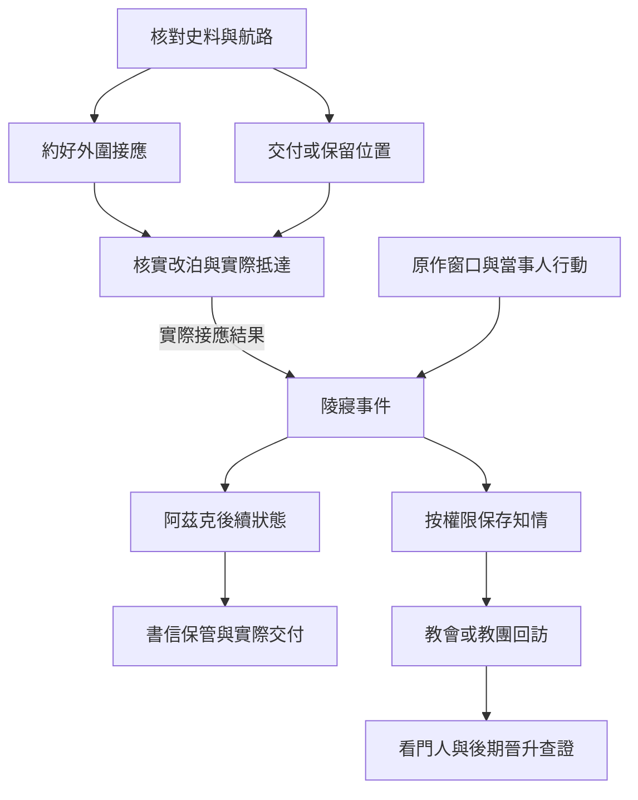

# 狂暴海陵寢｜給沒回信的人

10 靈教團與阿茲克線的續篇，承接[拜朗史料](south_azik_balam_spirit_guide_story_v1.md)。[《不死者》年表](../../lore/history/dantes_undying_v1.json)將狂暴海陵寢定位在第 887–924 章，早於因斯案的最後對抗。[《紅祭司》年表](../../lore/history/red_priest_v1.json)另收錄阿茲克的沉睡與書信階段，其章節區間用於定位後續狀態。玩家的候船處、地方通行、封存安排及對白為遊戲原創。

## 第一場｜兩張海圖

船主讓你把帶來的海圖攤在窗臺上。左邊那張標了出發地，右邊那張記著一處曾有人避風的小灣。兩處之間，有一道用墨線補畫過的航路。他用手蓋住墨線。

「這段是誰走過的？」

若玩家保有上批的拜朗史料，可拿獲准的年代或出處核對；若只持有墓地位置，須先查該資料與這次海路有無關係。曾將資料交給兩派時，各方只依自己持有的部分查訪。留在外地的玩家可找可驗真的航行紀錄或地方接應，能否趕上仍按當週交通與實際船期判定。

- **替阿茲克或克萊恩備妥外圍接應。** 須有可信聯絡且本人實際收到，才可約候船處與回程時間。接應人要確實答應，船主也須確認船能成行。
- **把可核實的航路交給一方。** 皇室派、人造死神派外圍及教會各要有可信收件人。玩家可先給公開的靠岸資訊，也可交自己掌握的具體位置。對方若據此出航，按時點、航路和能力判定能否抵達。
- **先撤回接應，保全沿岸的人。** 航線不足以查證時，可退回船位、先把已外流的消息轉告受影響的照看人，或只在岸上保管書信。這些結果可留到陵寢事件後使用。

## 第二場｜燈只亮到天明

風起後，接應者把燈往屋裡挪了一寸。兩人原約在破曉前到。到天快亮時，船沒出現，門下卻塞進來一張紙，寫著某處可以改靠岸。上面只有半枚印。

「若這真是他們的人，我們走了，舊地方就沒人了。」接應者問，「你要我在哪裡等？」

玩家可留一人守原處、帶人核實改泊點，或在船況危險時先讓岸上的人撤離。可用人手足夠才能兼顧兩處。若紙上的消息只能證明有人到過，日誌先記出現時間和信使身分待查。對手掌握了確切位置時，可依剩餘時間接近。原定接應與臨時改泊只按實際到達的人、船和消息各結算一次。

**陵寢的世界事件。** 零介入沿阿茲克與克萊恩查訪陵寢的原作基準。阿茲克在陵寢中面對與自身靈魂和過去有關的安排。玩家可保住回程接應、留存當事人自願交付的資料，或影響其他人能否抵達外圍。要進入陵寢，須有可驗真的航路、實際聯絡與能承擔風險的同行者。要改變陵寢內的高位結果，還須有在當時足以作用的準備和能力。外圍玩家只會知道自己親見或獲准查證的部分。[阿茲克傳記](../../lore/characters/biographies/azik-eggers.v1.json)

**IF｜退票。** [10-A](part_one_if_stories_06_10.md#10-a阿茲克請船主把票退回)使兩人取消當次航程時，先沿阿茲克留下的回郵地址延續約定；這趟陵寢遭遇與由此引發的沉睡、甦醒均略過。日後有新航路時，他仍可選擇再查自身過去。

## 第三場｜信寄到了

回到岸上後，信使把一封原先送往舊址的信帶回。封蠟是完整的。玩家若在事前和阿茲克約定過保管方式，就按他留下的安排處理。若只和克萊恩建立了聯絡，可以按許可請他轉交。沒有可靠收件人時，先問原寄件者是否同意改期。

- **照約封存。** 記收件日期、實際持有人和可以交付的對象。信件已送達接應人時，照實記下；要等阿茲克實際收到或閱讀，再更新相應狀態。
- **向可信盟友交代接應改動。** 可通知已獲授權的人，讓回程或後續書信換到安全處。被問起陵寢時，只交自己能驗真的部分。
- **以行蹤交換幫助。** 只有手中持有的資訊能交出。若對方後來找到接應者，依其實際查問和抵達時間處理。阿茲克的信任按他本人或代理人可核實的消息變動。

**沉睡及後續。** 零介入沿阿茲克沉睡、克萊恩持續寄信的基準。回信與聯絡狀態按各自時點更新。人造死神派的儀式與黑夜女神的介入另讀教團及教會的實際行動。從這次航程帶回的異常紀錄只提供查證入口。第一部末卷有阿茲克甦醒的定位。玩家此時能否把保管的信交給他，取決於接應、信件去向及他是否願意聯絡，見[愚者沉睡後的地方交接正文](fool_slumber_local_handover_story_v1.md)。[末卷年表](../../lore/history/fool_v1.json) · [黑夜女神傳記](../../lore/characters/biographies/evernight-goddess.v1.json)

## 回訪與晉升

- **死靈導師 → 看門人。** 暫排在死靈導師實際服用約四個月後。保留陵寢外圍交接的玩家，可循可信的教會轉介或靈教團導師約談。條件未齊時，可持已獲准的交接紀錄另約。陵寢內的材料與遺物依各自持有人及用途判定。
- **看門人 → 不死者。** 先記可用師承及後期教團調查窗口。到了該段，要核對消化、配方、材料與經確認的高序列儀式。只有可用條件都成立時才開正式晉升，外圍委託仍可獨立完成。[第一部晉升時機表](part_one_advancement_schedule.md)

**第一部結算。** 記實際航線與船位、外圍接應的存亡、誰握有陵寢線索、阿茲克的狀態和書信去向。若玩家保住家屬及接應者，可供後續提供落腳點、書信或人員撤離。04 與 10 共用舊證物，陵寢內情仍按各方實際所得判定。

## 陵寢與書信細圖

| 走法 | 結果 |
| --- | --- |
| 留在岸上守接應 | 記實際接到的人與回程。陵寢內情由可信來源補上。 |
| 提前交出已核實的航路 | 收件方有機會早到。能否抵達與能否進入陵寢各自判定。 |
| 保住回程，但信寄往舊址 | 人員到達照實結算。信件依最後持有人另行轉交。 |
| 陵寢事件後才入線 | 可查證航線、封存書信或接後續委託。阿茲克依當時狀態回覆。 |

[第一部劇情總樹](part_one_story_tree.md)
