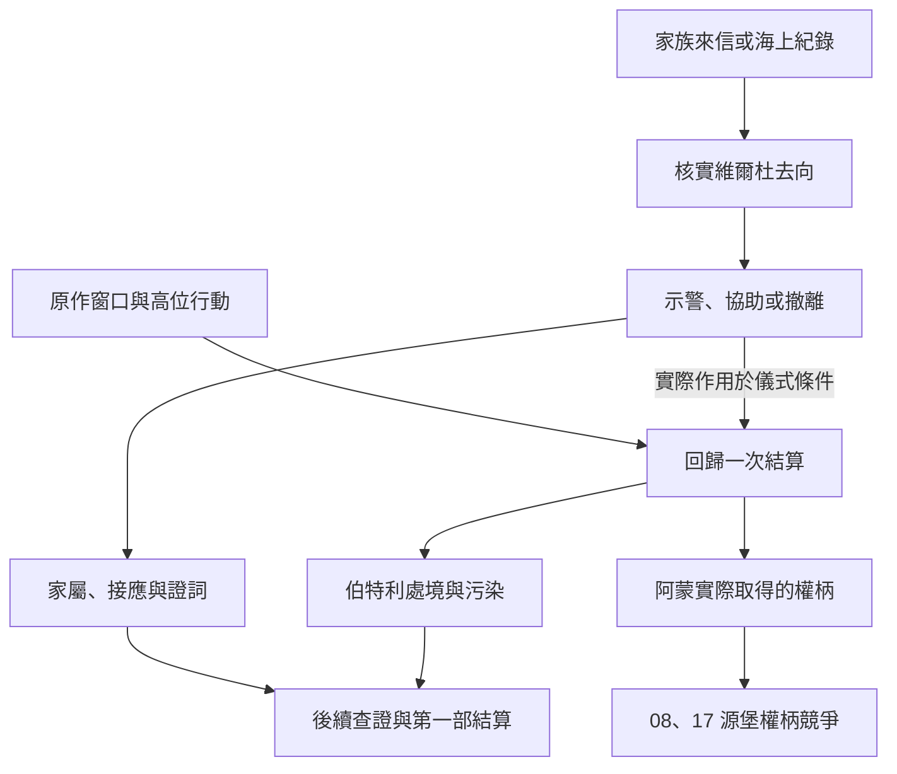

# 伯特利回歸與阿蒙介入｜不要把地址寫在信上

07 亞伯拉罕家族、08 末卷權柄競爭與 17 塔羅會的共用正文，承接[博提斯伏擊](backlund_botis_box_of_the_great_old_ones_story_v1.md)。依[維爾杜傳記](../../lore/characters/biographies/verdu-abraham.v1.json)及[《愚者》年表](../../lore/history/fool_v1.json)，維爾杜在藍山島呼喚伯特利回歸，阿蒙奪取儀式，伯特利隕落。第 1353 章定位回歸的關鍵事件。阿蒙成為錯誤之神的精確章次仍待核。下列信件、港口接應、可撤離的人和玩家行動為遊戲原創。

## 第一場｜一封寄往拜亞姆的信

信上寫著維爾杜·加西亞。若玩家以前替多里安保管過冊子，可能認得落款的筆跡。沒走過家族路線時，也可以從船主的原始載運紀錄或羅思德地方接頭核對。岸上的信使等你看完，才問：

「他上次回信說不必寄了。今天又有人來，要我把所有沒領的信送上船。我先聽誰的？」

- **核對信件和船期。** 分開記誰真的領過信、誰搭了哪班船。見過維爾杜離港只足以查航程；他曾去過班西港，也須有可驗證的紀錄或親見者。
- **把異常轉給多里安或佛爾思。** 有可信聯絡時才可傳訊。若過去已暴露家族地址，請當事人決定是否改約。只有收到消息並確實移動的人才改寫去向。
- **循海上聯絡交給阿爾傑。** 阿爾傑按原作已有監控安排。玩家可補上已核實的別名、班次或登岸時間。他只採用確實收到且能驗證的部分。玩家是否知道監控委託的來源，另依實際知情判定。

## 第二場｜讓船等到天亮

藍山島的接應人把兩條纜繩繫在不同木樁上。靠外的船可以先離岸，靠裡的船要等潮水。若玩家已核實哪一段船程與維爾杜有關，可以向他本人或仍在聯絡的接頭者問清楚。對方也可能只肯談誰要坐哪艘船。

「你若只想送人走，先問他願不願意上船。」接應人指著靠裡那條纜繩，「等到天亮，這條路就得重新算。」

- **安排外圍撤離。** 按當事人意願、可用船位和岸上接收者安排。若先前 11 的港口承諾仍有效，可以借人手或改用別的船期；同一船位只按實際登船的人結算。
- **向有能力介入者送出查證結果。** 位置、時間與實際儀式條件各要有證據。收件人須願意介入、有能力且趕得上。可先轉交一部分並約補件；補件晚到時照實記收件時間。
- **協助維爾杜，或交出接應位置。** 已取得他信任者可替他送信、保留船位或調整接頭。若將位置交給第三方，對方按真正掌握的資料行動。維爾杜的意願、已確認的儀式環節及高位介入各自判定。

## 第三場｜森林裡的回聲

守船的人聽見樹林裡傳來一陣響動。過了一會兒，原約帶人回來的接應者仍沒露面。若玩家只在岸邊等候，日誌記下實際聽見的聲音、未抵達的人與最後確認時間。若有人帶回異常見聞，可先保存證詞，再由有能力的人核對。

**回歸一次結算。** 世界按原作窗口讀取維爾杜是否完成召喚準備、伯特利的回歸與污染處境、阿蒙是否實際介入。零介入時，維爾杜在藍山島森林以三個相應途徑的怪物半神為祭品，儀式被阿蒙奪取，伯特利隕落。伯特利自身的意志與星空污染各自保留。玩家若改動外圍人手或路線，先更新撤離與消息去向。只有及時作用於實際儀式條件或高位介入，才重判回歸結果。

08、17 後續讀取阿蒙實際取得的位格與權柄。遇見的身影、已核實的分身與阿蒙本體各有知情條件。玩家即使親眼見到儀式異常，也要循可核實的證據才能辨認參與者與結果。[伯特利傳記](../../lore/characters/biographies/bethel-abraham.v1.json) · [阿蒙傳記](../../lore/characters/biographies/amon.v1.json)

## 第四場｜交給仍在等的人

佛爾思若仍能聯絡，可請她確認誰已離開原接應地、哪些家族資料應送還持有人。若此前有人試著移交舊日之盒，按[伏擊結算](backlund_botis_box_of_the_great_old_ones_story_v1.md)查盒子實際在誰手中。要用於接應，還須有人願意交付、能安全使用，並確實送到。盒子的去向與家族傳承各自記錄。

能保住家族成員的玩家，可以只回報已抵達的人數，或按各人同意的範圍告知下一位接應者。失聯時保存最後位置。家族接應、污染的可驗證跡象及各方得知的結果，供[霍納奇斯查證](utopia_zaratul_hornacis_story_v1.md)、源堡交鋒與第一部結算讀取。

## 門途徑的回訪

**記錄官 → 旅行家。** 暫排在上次服藥約四個月後，以家族已完成的跨城接應為窗口。玩家可憑實際到達、交接及可信回報請佛爾思或可用的家族導師核驗。原地失聯時，先循可驗真的資料重開聯絡，再查消化、材料、配方與適用條件。後續祕法師須另有可行的高序列儀式與師承。伯特利的原作位格與玩家晉升各自判定。[第一部晉升時機表](part_one_advancement_schedule.md)

## 回歸與家族接應細圖

| 走法 | 結果 |
| --- | --- |
| 只撤離外圍接應人 | 記實際登船及抵達。儀式由當場條件結算。 |
| 警訊晚到，對方只得知舊泊位 | 記收件時點與內容。可事後查證，當場照有效情報推進。 |
| 有能力的盟友及時影響關鍵環節 | 重判回歸與阿蒙介入，再交付實際權柄結果。 |
| 盒子下落未經核實 | 仍可循其他路線接應。需要盒子的選項等持有人及能力核實後開放。 |

[第一部劇情總樹](part_one_story_tree.md)
