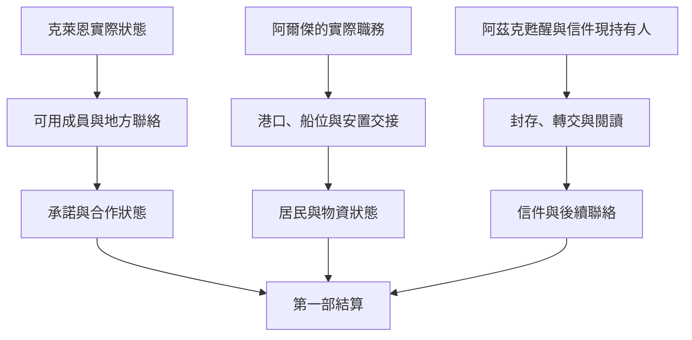

# 愚者沉睡之後｜回信晚一點也可以

17 塔羅會、11 羅思德群島、12 新白銀城及 10 阿茲克書信的末卷正文。承接[源堡交鋒](hornacis_fool_sefirah_finale_story_v1.md)、[白銀城安置](silver_city_expedition_and_resettlement_story_v1.md)及[狂暴海陵寢](berserk_sea_azik_tomb_story_v1.md)。依[《愚者》年表](../../lore/history/fool_v1.json)，克萊恩為抵抗天尊意志而沉睡，塔羅會與愚者信仰在外界延續；阿爾傑在末卷離開風暴教會並承擔海神教會職責；阿茲克甦醒與新的旅程以第 1394 章定位。三件事各按原作窗口與前段實際結果開啟。下列交件地點、地方差事及對話均為遊戲原創。

## 第一場｜下一封送給誰

一封委託信回到了原來的收件處。背面加了一行字，請你下次附上可以到場的日期。信使等了半天，也沒等到第二封。他把自己那份回執取出來，問你願不願意替他保留一個新的地址。

「我還是會來。只要有人確定在這裡等。」

若玩家已與佛爾思、埃姆林、嘉德麗雅或其他成員建立往來，可向真正能聯絡到的人確認未完差事。若仍有人知道你的舊地址，可把改約交給願意接手的信使。只做過一次委託的人可沿該次收件人回訪；未入會也能完成自己答應的工作。消息沿各成員實際接受的聯絡傳遞，代號、身分、聚會及沉睡原因依各自知情條件揭露。

- **接手一件未完委託。** 先問原委託人是否仍希望完成，以及誰可以收件。保留舊回條與新的交付紀錄；兩次承諾若落在同一地點，可由一位已答應到場的人接手。
- **改用地方聯絡。** 原管道失效時，可請可信的成員介紹替代收件人。只給對方獲准的內容；若還未找到人，消息留在現持有人處。當事人仍能獨立使用自己的管道。
- **把信封回去。** 可依授權歸還資料、封存，或向委託人交代自己無法繼續。已外流的副本及公開消息依各方實際所得保留。

克萊恩確實沉睡時，玩家在地方完成的合作照實更新。祈禱能否得到回應、是否能辨認回應者、是否收到成員親自回信，各自核驗。若源堡的分歧使克萊恩維持清醒或處於其他狀態，改由當下可用的聯絡方式接續。玩家的外部合作或正式入會仍依實際邀請與選擇。

## 第二場｜哪一艘能借

羅思德的接應人搬來一塊舊木板，上面寫著兩艘船的名字。他說一艘已答應接下一批居民，另一艘的船主還沒回來。阿爾傑若已承接海神教會的事務，並在此時願意和玩家合作，可以請你核對先前的港口承諾。

「我想知道，明早誰能真的把船開出來。那張名單，等他點頭再添。」

- **按原約接收居民。** 若 12 的通路已開，按實際抵達者補上船位、住處與照護。船期撞上當地賑濟時，找可核實的替代班次或按各方同意調整。新白銀城的接收能力讀取當時仍在的住處、物資和負責人。
- **協助交接地方事務。** 可把貨簿、仍有效的收貨授權與未履行的承諾交給實際有權接收者。阿爾傑的新職務須確實成立；玩家可繼續和任何仍願合作的地方人往來。教職、舊有通行許可、塔羅會身分和海神權杖的去向各自核對。
- **把貨留給原先答應的人。** 可照現有約定送藥、送糧或維持安置。若有人提出新用途，先核對原承諾能否改期，並通知實際會受影響的人。

零介入時，阿爾傑沿原作離開風暴教會並承擔新職責，戴里克及新白銀城按先前結果繼續。玩家介入時，地方安排由交付、接收和人員實際同意決定。[阿爾傑傳記](../../lore/characters/biographies/alger-wilson.v1.json)

## 第三場｜他已經醒了

有一天，保管信件的人來找你。他說約定的收件人已經出現，請你確認哪一封可以交出去。紙上的筆跡已褪色，還看得出最後一行寫的是一個日期。

若玩家在阿茲克沉睡期間保管過信件，先核對原寄件人留下的交付方式。可以依約親手交信、委託獲准的接應人轉交，或在找不到可信收件人時繼續封存。只走塔羅會或港口線的玩家，可在取得授權後協助傳訊。原作中克萊恩與阿茲克的往來沿年表推進。

- **交到本人手上。** 先確認阿茲克已甦醒、確實在場且願意收信。交付當下只更新收到；讀過內容、同意回覆或留下新聯絡方式，依他的實際行動更新。
- **只交送達的回條。** 若信已由可信接應人代收，可按原約告知寄件人或留在封存紀錄裡。到達接應處與到達阿茲克本人各有時間。
- **照原約留待下次。** 若持有人離港、對方還未出現，或同意範圍已變，可另約或歸還。玩家依已核實的去向決定如何保管。

若阿茲克親自收下遊戲新增的信，他會先把信封上的日期看過一遍。「我會讀。你下次有話想寄，照上次那個地址就好。」這句話只在他仍願意往來且地址實際可用時出現。[阿茲克傳記](../../lore/characters/biographies/azik-eggers.v1.json)

**第一部結算交接。** 讀取克萊恩的實際狀態、玩家仍可聯絡的成員及承諾；讀取阿爾傑在位職責、港口與新白銀城各自可用的人手及補給；讀取阿茲克甦醒、信件保管、送達與閱讀。三線可各自完成。玩家離城、拒絕或錯過的差事依當時仍在行動的人結算。

## 沉睡後的地方聯絡細圖

| 走法 | 結果 |
| --- | --- |
| 只和一位成員有外部往來 | 可接續該人的有效差事。入會與各角色身分依獨立條件。 |
| 幫阿爾傑接手物資，船仍被占用 | 已到貨可入庫，下一批居民另核對可用船位。 |
| 阿茲克已甦醒，信仍在代收人手上 | 記甦醒及保管狀態，等實際送達再更新。 |
| 全程零介入 | 各人物沿原作窗口行動，玩家只從可核實的消息得知。 |

[第一部劇情總樹](part_one_story_tree.md)
