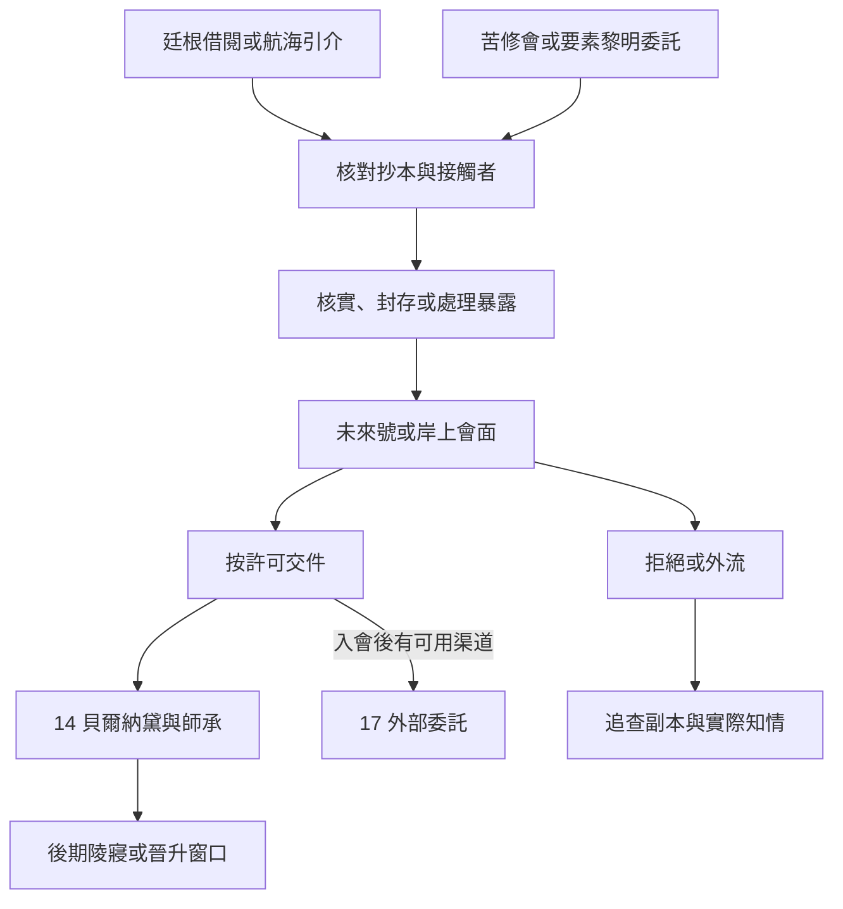

# 嘉德麗雅與未來號｜留白的一行

14 摩斯苦修會與要素黎明、17 塔羅會的海上交會。接續[跨城抄本與魔藥](death_and_hermit_pathway_acquisition_v1.md)及[外部聯絡](backlund_fors_emlyn_tarot_contacts_story_v1.md)。[海上年表](../../lore/history/gehrman_voyager_v1.json)和[嘉德麗雅](../../lore/characters/biographies/cattleya.v1.json)、[貝爾納黛](../../lore/characters/biographies/bernadette-gustav.v1.json)傳記提供原作基準。未來號由嘉德麗雅統領；她與貝爾納黛的師徒、養育關係及塔羅會義務各有自己的時點。本章的抄本、見證人、停泊差事及對話是遊戲原創。先按船期開放未來號委託，待嘉德麗雅已入會且有可用渠道，才判定 17 的轉託。

## 第一場｜買的是目錄

碼頭的書商拿來一包用漆布裹住的紙，堅持收兩次運費。一次是昨夜把紙從船上接下來，另一次是明早把它送回去。他打開外層，讓你看見一張目錄。每件抄本下面都有抄寫人的記號，只有最後一欄留白。

「你問那欄？抄紙的人說他忘了。前天他也這麼說，位置一模一樣。」

若玩家保有老尼爾案的借閱紀錄，可比對來源標記與已核實的抄寫途徑。有未來號航海引介的玩家，也可從一張待收貨的船單開始。從苦修會入線時，地方聯絡人會要求確認抄者和流散份數；要素黎明的外圍聯絡人則可委託玩家找仍能封存的副本。已有一方的委託，可按原約只交可核對的內容，也可同時查訪兩邊。已交出的原件仍由實際持有人保管。

- **核對目錄與封條。** 抄下可公開的編號、查明誰最後接觸過包裹，並記下見證人准許轉交的話。先前只拿到借閱號的玩家，也能在這裡找獨立來源。
- **拆閱內頁。** 依玩家實際看見的內容及可用防護處理。若出現異常，先記接觸過的人、暴露時點和實際症狀。相同的記號或相似的不適可供比對，污染來源仍須查證。
- **按原約退回或先封存。** 有權處理包裹時，可以請書商確認新封條並留下收條。可信保管人須實際接到包裹才算移交；其他可能已流通的副本各自追查。

## 第二場｜甲板上的空凳

未來號只開放一處驗貨的舷梯。若玩家已有接洽，值勤船員會核對誰約了你、何時應到。舷梯沒開或玩家未獲准登船時，可信的收件人仍可在岸上按約見面。

嘉德麗雅讓船員搬來一張空凳，把包裹擱在凳上。她先讀目錄，拇指停在留白的那一欄。

「上一次拿到這份目錄的人，之後還能替自己說話嗎？」

若能聯絡抄寫人，玩家可問他是否願意回憶空白欄，並安排他選擇的安全會面。若他拒絕或失聯，查其原始收貨紀錄，交出可核實的片段。先前拆閱出現異常的玩家，可交代自己看過多少，請有能力的接應者檢查風險。嘉德麗雅依實際收到的證詞、封條與症狀決定是否接手。玩家可以接受一次船務、談長期合作，或到此收束。接受船長的差事只更新與未來號的合作。

船離港前，船員再來問最後一件事。若岸上的人回了信，你想讓他們交到哪一站？已掌握的班次只可分給實際能出發的船或信使。若玩家留在岸上，可完成接頭與補件，船上的經過則依收到的回報得知。

## 第三場｜要寄往哪裡

嘉德麗雅收到能核對來源的船冊抄件後，問你願意把哪一頁交給下一位查訪者。若已取得羅塞爾資料的可靠來源，她也可能請你替神秘女王的聯絡人留一份索引。她把空白信封留在桌上，等你自己寫收件人。

- **給貝爾納黛的管道。** 玩家須有有效引介，或請嘉德麗雅代問。可交獲准分享的出處、年代與手稿線索。解讀日記另須找具備能力的人。貝爾納黛會按實際收到的材料決定是否查訪。她是否與玩家見面，取決於她的行程和意願。
- **接 17 的外部委託。** 嘉德麗雅已入會並能接洽時，可請玩家查證可公開的船務或資料來源。若先前曾和佛爾思、埃姆林等人合作，只有在聯絡人確實引介時才知道彼此的工作。嘉德麗雅可依許可轉交查證結果。代號、聚會內容與其他成員身分依獨立知情條件揭露，正式邀請仍由愚者發出。
- **把獲知的秘密轉賣。** 買家只收到實際交出的資料。嘉德麗雅若從可查證的管道發現資料外流，可撤回引介；貝爾納黛也會依自己收到的部分判斷。若外流的是未查清的危險內容，接觸及後續症狀依實際傳播另記。
- **只留下索引。** 未經允許的姓名與航程仍由原持有人保管。可只登記已封存的份數和可驗真的來源，並拒絕其他委託。

**一次資料交接結算。** 原件、各副本與索引分別記持有人、授權範圍和接觸時點。14 讀取抄本、查證及暴露，17 讀取嘉德麗雅實際答應的轉介和保密承諾。零介入時，未來號的航程、嘉德麗雅入會及貝爾納黛的追查沿各自原作基準。玩家保全的船務聯絡、受影響者和材料可供後期查羅塞爾陵寢或安排外圍接應。神燈及陵寢事件各有自己的窗口。

## 隱者途徑｜交完這一站

- **未首服。** 沿[既有窺祕人供應](death_and_hermit_pathway_acquisition_v1.md)處理。完成查證可獲苦修會或要素黎明外圍配藥人的引介，玩家可維持單次合作。
- **窺祕人 → 格鬥學者。** 首服後約三至四個月，優先循老尼爾案後仍可聯絡的教導者。早期錯過或離城時，可在未來號貨件收束後重找可信師承，由實際可用的導師核對準備與供應。
- **格鬥學者 → 巫師。** 上次服藥後約三至四個月，跨城抄本查證完成、且有人能繼續教導時，可約第二次核驗。若原供應者已失聯或不接受原件的轉交方式，可持可驗真的索引另找供應。
- **巫師 → 卷軸教授。** 以後續海上知識委託為窗口，暫排在巫師實際服用約四個月後。先核對消化、配方、材料與適用條件。能確認的由導師交代，另有未核明的條件時保留後續查證。[第一部晉升時機表](part_one_advancement_schedule.md)

## 未來號、抄本與外部聯絡細圖

| 走法 | 結果 |
| --- | --- |
| 在岸上封存資料，未登船 | 可按交接收條取得引介，未來號上的見聞依實際回報。 |
| 只交同意外傳的羅塞爾索引 | 貝爾納黛可依索引另行查證，已保留的其他資料照原權限保存。 |
| 船務合作時嘉德麗雅尚未入會 | 只寫船務與 14 的實際委託；17 待獨立窗口。 |
| 把未確認的頁面傳給第三方 | 依誰真正接觸頁面結算暴露，原件的去向另記。 |

[第一部劇情總樹](part_one_story_tree.md)
