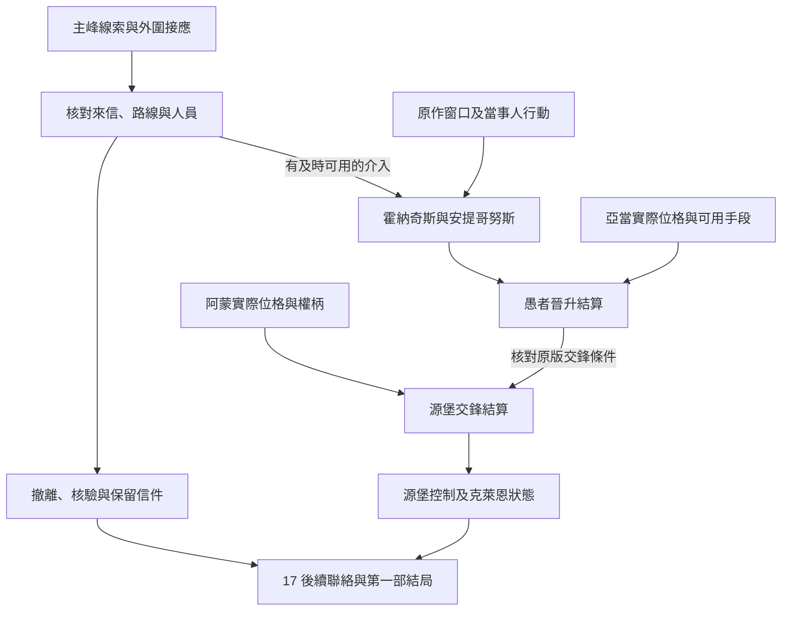

# 霍納奇斯與源堡之戰｜把燈留給回來的人

08 密修會與查拉圖、17 塔羅會的末卷共用正文，承接[烏托邦與主峰查證](utopia_zaratul_hornacis_story_v1.md)及[伯特利回歸](blue_mountain_bethel_return_story_v1.md)。原作基準依[《愚者》年表](../../lore/history/fool_v1.json)與[安提哥努斯](../../lore/characters/biographies/antigonus.v1.json)、[克萊恩](../../lore/characters/biographies/klein-moretti.v1.json)、[阿蒙](../../lore/characters/biographies/amon.v1.json)傳記。霍納奇斯主峰涉及安提哥努斯與愚者唯一性；克萊恩晉升後與阿蒙在源堡交鋒，後續為抵抗天尊意志而進入沉睡。年表章節區間用於定位，精確時點仍待核。本稿的山腳接應、信件、對話及玩家分歧為遊戲原創。

## 第一場｜山腳的兩封信

山腳的接應者把兩封信放在燈下。一封照你們約好的折法封著，另一封叫他立刻換一處落腳。兩封信都說是同一個人送的。他沒拆第二封，只問你一句。

「上次說要改地方，是誰來告訴我們的？」

若玩家保有廷根舊筆記、烏托邦的核驗人或另有可信主峰證據，可按各自實際持有的部分核對位置和聯絡。現存的主峰線索可獨立入線。伯特利回歸後的消息只讀已獲知的部分，阿蒙是否親自出現須另有證據。

- **核對兩封信的交付。** 問實際送信人、比對交接時間及當事人允許使用的記號。可信渠道能確認其中一封時，可通知接應者照原約或改約。證據不足時，先留下兩份信的實際來源。
- **守住人與資料。** 依本人同意安排撤離或輪值。主峰的相關證物由現持有人決定授權。若先前曾將位置交給第三方，可提醒接應者；對方是否採用仍依實際收到的內容。
- **只傳能核實的部分。** 向確實可聯絡的克萊恩或塔羅會成員交付時間、位置或可驗證的異常。玩家可在別處完成轉達，交件要以收件方真正收到為準。

## 第二場｜山上傳下來的話

約好的時間到了，接應人把剩下的燈油倒進同一個罐子。他說今晚有兩件事能做。一件是等回信，另一件是把已經來到這裡的人送到能歇腳的地方。

**霍納奇斯結算。** 安提哥努斯曾容納愚者唯一性，其過去位格、封印與當時實際狀態分別判定。原作人物在自身窗口推進。玩家可核對外圍位置、保管撤離所需資料或傳訊；進入高位事件須有可達性、實際聯絡和能承擔當場威脅的手段。舊筆記及囈語可供查證，接觸唯一性的資格另查。

**愚者晉升結算。** 在適用窗口讀取克萊恩已取得的材料、權柄、準備和當時的干涉。原作基準下，亞當在與真實造物主部分融合的狀態下借混沌海介入，克萊恩取得愚者神位。玩家送到的線索可供有能力者採用；只有在儀式時限內作用於實際要件或介入者，才重判結果。低序列的有效行動包括保護核驗人、守住通路和按約傳訊。若確有足以使晉升中止或改變的分歧，記實際位格與權柄，再由源堡事件讀取。[《愚者》年表](../../lore/history/fool_v1.json)

**廷根的後果。** 原作基準中，亞當在因斯覆滅時取得 0-08，其中的特性是他完成空想家晉升的一項前提。若 [04-A](part_one_if_stories_01_05.md#04-a因斯沒能離開廷根)關閉該場對抗，亞當無法循原事件取得特性。0-08 仍封存或下落未明時，跳過原版空想家晉升，末段只計亞當已實際具備的位格、融合進度與能使用的手段；涉及混沌海的原版介入須重新驗證。任何另一次取得都須有獨立事件及結果。克萊恩若失去原版介入，依自己的準備與當場其他阻力判定晉升。章節定位參考[亞當取得 0-08 與晉升索引](https://lordofthemysteries.fandom.com/wiki/Adam)。

## 第三場｜等不到第二聲

信使在外面敲了一聲。你們原先說過，若還有一聲就開門；這一次等了很久，只有他離開的腳步。玩家可以查誰安排了這次傳訊，也可以照已約定的方式把門留給核驗通過的人。

**源堡交鋒。** 原作基準按克萊恩與阿蒙對源堡及途徑權柄的交鋒推進，克萊恩其後為抵抗天尊意志而沉睡。若 08-C 令當次晉升中止，跳過以愚者神位為前提的原版交鋒；07-C 阻止回歸時，阿蒙缺少該次取得的權柄。兩者可同時成立，任何新交鋒依實際權柄、進入條件與各自意圖另開。阿蒙在藍山島事件中實際取得的權柄、克萊恩實際晉升結果、可用的高位行動者與進入源堡的條件，都由前段結果帶入。外圍玩家只能依可驗證的回應或知情者提供的消息得知經過。若真正能影響交鋒的條件已改變，另行判定源堡控制、途徑權柄及參與者狀態，接入對應結局。

- **照原約把人送出去。** 按已確認的道路和接應能力送人。若消息失聯，保留最後核實的時間與去向。
- **維持聯絡，保存信件。** 先核對誰能接收及哪些內容可轉交。收到短暫回應時，記下回應者身分是否能核實，及本次訊息實際到達誰手上。
- **把資料交給別方。** 依持有人權限和玩家選擇交出；收件方可用它尋人或查證，接應者只依自己得知的消息改約。

**結算交接。** 世界分別保存安提哥努斯狀態、愚者晉升、源堡交鋒、實際權柄及克萊恩的清醒或沉睡狀態。08、17 共用結果。地方另記可用的接應者、封存的信件、仍可核驗的身分與能繼續履行的承諾。沉睡後的塔羅會與地方聯絡依實際狀態接續，見[愚者沉睡後的地方交接正文](fool_slumber_local_handover_story_v1.md)。

## 高序列回訪

**祕偶大師 → 詭法師。** 暫排在上次服藥約四個月後，由已建立的高序列師承與獨立儀式事件共同開窗。主峰外圍的身分核驗可供回訪，配方、材料、消化與有效儀式仍須齊備。古代學者及更高位階須依各自適用條件另定事件。玩家晉升與克萊恩的原作晉升各自結算。[第一部晉升時機表](part_one_advancement_schedule.md)

## 主峰、源堡與沉睡交接細圖

| 走法 | 結果 |
| --- | --- |
| 只保住外圍接應人 | 保留當事人去向與聯絡。高位事件按各自條件推進。 |
| 訊息在晉升後才送達 | 晉升照已成立結果；訊息能否供下一場使用，依實際收件與窗口。 |
| 阿蒙在回歸事件的取得結果改變 | 源堡交鋒讀取實際位格、權柄與可用手段。 |
| 全程零介入 | 依原作經過，克萊恩晉升並經源堡交鋒，之後進入沉睡。 |

[第一部劇情總樹](part_one_story_tree.md)
