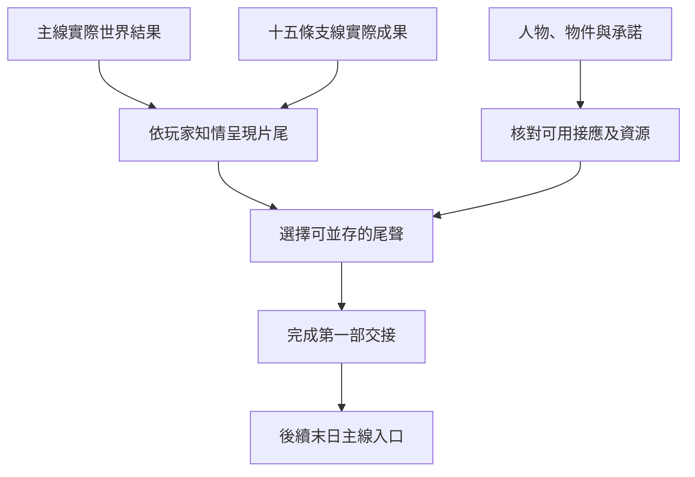

# 第一部結局｜仍有人在等

第一部主線與 01–14、17 共十五條長支線的結算稿，承接[霍納奇斯與源堡之戰](hornacis_fool_sefirah_finale_story_v1.md)、[愚者沉睡後的地方交接](fool_slumber_local_handover_story_v1.md)與[長支線總綱](part_one_sidequest_master_outline.md)。下列尾聲均為遊戲原創。世界基準沿[第一部年表](../../lore/history/README.md)。全遊戲約五十種結局的規劃仍沿[工作計畫](part_one_writing_plan.md)；本章負責第一部的主線結果、地方尾聲與後續承接。

## 片尾｜有人還記得這個地址

廷根的郵差把一封退信擱在櫃上。信上寫著一個已經換過門牌的地址，寄件人欄卻還留著你當年寫的字。若你仍在廷根，郵差會問要不要改寄。若你在別處，這封信只有經已建立的回郵渠道才能到你手中；沒有收信渠道時，片尾改由玩家所在地開場。

在貝克蘭德，照護者在領藥桌上留下明日的時段。城裡的教堂若已分流，門上只留下可以公開的領藥處。在羅思德，有人把未到岸的乘客留在原名冊上，在旁邊添了一行可供問路的碼頭。這些地方片段只在玩家親歷或有人依約送來消息時出現。

玩家可以回覆一項仍可履行的承諾、將資料按原約留存，或結束目前的差事。這個片尾選擇只更新眼前實際完成的交接和新承諾；先前的事件結果照既有紀錄。

## 主線世界結果

每個事件使用已結算的結果。同一角色在同一時點只有一個已成立的狀態。同一份原件或唯一性只依實際持有人處理。玩家知情不完整時，畫面只顯示親見、收到的回報或尚待查證的部分。

| 事件 | 零介入基準 | 結局讀取與互斥條件 |
| --- | --- | --- |
| 廷根之變與因斯案 | 值夜者阻止降臨，鄧恩犧牲，克萊恩復生離開廷根，因斯取得骨灰；其後因斯在南大陸覆滅。 | 先讀廷根的傷亡、骨灰與案卷，再讀南大陸追查。若前案已改變，後案只召集實際能到的人。因斯的生死以最後確認的世界結果為準。 |
| 大霧霾 | 沿大霧霾正文的原作核心結果。 | 疏散、潘娜蒂亞一方和 A 先生一方各讀實際結果。保住同一居民只計一次；阻斷一方的接應時，另一方按自身條件推進。 |
| 喬治三世的儀式 | 克萊恩等人阻止晉升，喬治三世隕落。 | 已隕落、儀式受阻後生還、晉升成立依該次結果選一條。戰時命令按實際有權的人接手，通行證仍須由當地站點驗證。 |
| 白銀城的出路 | 科林與洛薇雅犧牲，戴里克等人打開出路，其後韋特接任首席。 | 通路開通、延後或中止按遠征結果。兩位探索者的存亡各自保存。只有通路實際可用，才核對撤離與外界安置。 |
| 藍山島回歸 | 阿蒙奪取儀式，伯特利隕落。 | 讀取伯特利的處境、儀式條件及阿蒙實際取得的位格與權柄。玩家對污染的認知另依證據。 |
| 愚者晉升、源堡交鋒與沉睡 | 克萊恩取得愚者神位，與阿蒙交鋒，其後為抵抗天尊意志沉睡。 | 依先前成立的晉升與交鋒結果保存位格、源堡控制及克萊恩狀態。清醒、沉睡或其他已成立的狀態各自對應後續聯絡。只有正文寫明且實際作用於高位環節的分歧，才可改判。 |

## 十五條長支線尾聲

尾聲條件成立即可與其他線並存。無介入、拒絕合作或資料缺失時，仍保留世界結果，玩家畫面採已知的公開消息或略過該幕。尾聲中的人名和祕密須通過玩家知情條件。

| 支線 | 尾聲與顯示條件 | 留給後續的狀態 |
| --- | --- | --- |
| 01 玫瑰學派 | **門換了一扇。** 有撤離者確實抵達時，接應人送來獲准的新約；若玩家向追兵交過路線，追查依實際收到的消息進行。 | 可用的莎倫、馬里奇或兩派地方接應；木乃伊依[玫瑰學派拜亞姆與木乃伊正文](rose_bayam_mummy_handover_story_v1.md)的實際交接記持有人或待查去向。 |
| 02 魔女教派 | **屋裡有人應門。** 已安置的居民可由其接應者回報。伊蓮與特莉絲各按最後確認的處境延續聯絡。 | 莊園證詞、救援、船隊人脈與確實獲准的查訪路線。 |
| 03 心理煉金會 | **這是我自己的話。** 保住的證人若願意作證，可確認紀錄或收回許可。 | 證詞來源、當事人自主狀態、可聯絡的導師及實際知情的會內人。 |
| 04 值夜者 | **舊卷有人簽收。** 玩家若獲准接觸舊案，可收到仍任職的聯絡人回覆，已確認的逝者由證詞或紀念交代。 | 存活的隊員、案卷持有人、骨灰去向及可調動的教會聯絡。 |
| 05 極光會 | **接頭人還認得你。** 保住原接應可接到查證或合作；已暴露的接頭依其實際去向調整。 | 降臨證據、實際可用的供應與伏擊結果。 |
| 06 黃昏隱士會與王室 | **舊印還能在哪裡用。** 有往來的承運人可回報新命令與可用站點。 | 儀式結果、證人、案卷與按地點仍生效的許可。 |
| 07 亞伯拉罕家族 | **把冊子送還。** 家屬或導師仍可聯絡時，依其同意安排回訪。 | 家族傳承、污染證據、實際可達的空間接應與盒子保管狀態。 |
| 08 密修會 | **有人回到車站。** 烏托邦訪客實際抵達才可見面；所見查拉圖身影依證據判定。 | 舊筆記及抄件、可核驗人員、主峰證據和實際權柄結果。 |
| 09 生命學派 | **鐘響過後。** 卡諾或替代接應人若仍可聯絡，可按實際結果回報交接。 | 概率之骰目前的持有人或待查去向、有效保管、人脈及恩佐或威爾的可用線索。 |
| 10 靈教團 | **信已交到。** 只在阿茲克本人確實收件時顯示；由接應者代收時，尾聲顯示仍在保管。 | 拜朗史料、可用落腳處、書信持有人與閱讀狀態。 |
| 11 羅思德 | **船主點了頭。** 只確認實際可動用的船和已同意的差事。 | 船位、港口協議、阿爾傑的職責及海神權杖的實際狀態。 |
| 12 白銀城 | **這一行留給明天。** 依實際抵達者補上名冊；通路未開時可見仍有效的備援。 | 通路、首席、居民去向、實際照護能力與地方同意。 |
| 13 血族與大地母神教會 | **明天照這個時段。** 只在照護者、人手或替代領藥點已確認時顯示。 | 神父的處境、藥品、血族聯絡及實際可收容的人數。 |
| 14 摩斯苦修會與要素黎明 | **索引留在這裡。** 已安全封存或獲准交接時，由實際收件者確認。 | 危險抄本各份持有人、暴露者及貝爾納黛、嘉德麗雅的可用渠道。 |
| 17 塔羅會 | **回信寄到這裡。** 有成員或外部收件者實際同意才留下地址。 | 玩家身分、可用聯絡、未完承諾與經授權的情報；克萊恩狀態讀取主線結果。 |

## 末日主線承接

- **動員。** 逐一核對存活、意願、權限、可達性和時間。玩家曾獲邀或結識某人，須等對方實際應諾才派人。相同船位、房間與人手依同一時段分配；已用於其他承諾時先確認替代。
- **查證與處置。** 原件、副本、祕密的知情者及已外流範圍各自保留。需要舊日之盒、概率之骰或海神權杖時，須按該物件的實際持有人、使用或保管條件及交付時間判定。
- **玩家成長。** 保留實際途徑、序列、消化、供應及已成立的師承。片尾只寫入完成的交接、經核實的情報和新承諾。後續晉升仍在相應事件窗判定。
- **接續入口。** 有撤離人脈時可從地方救援開始；只有可核實的資料時可從查證開始；聯絡散失時可由公開消息及仍可接觸的本地人重建。三種情況都依已成立的世界結果接續。

| 交叉走法 | 預期結算 |
| --- | --- |
| 完全零介入 | 世界照基準，玩家只看到實際知道的消息。 |
| 救援大霧霾居民、維持教堂、替白銀城備船 | 三幕可並存。相同人員與物資照實際分配使用。 |
| 白銀城出路未通，港口已有船 | 船位可依約保留，撤離和安置依實際通路與抵達判定。 |
| 喬治三世生還但晉升受阻 | 只顯示該結果，另核對在位與有效命令。 |
| 舊日之盒已換手，阿茲克的信只到接應人 | 盒子按新持有人保管，信件標為代收。可同時顯示。 |
| 只完成塔羅會外部委託 | 可延續原收件者的往來，入會依實際邀請及玩家選擇。 |

[第一部劇情總樹](part_one_story_tree.md)
