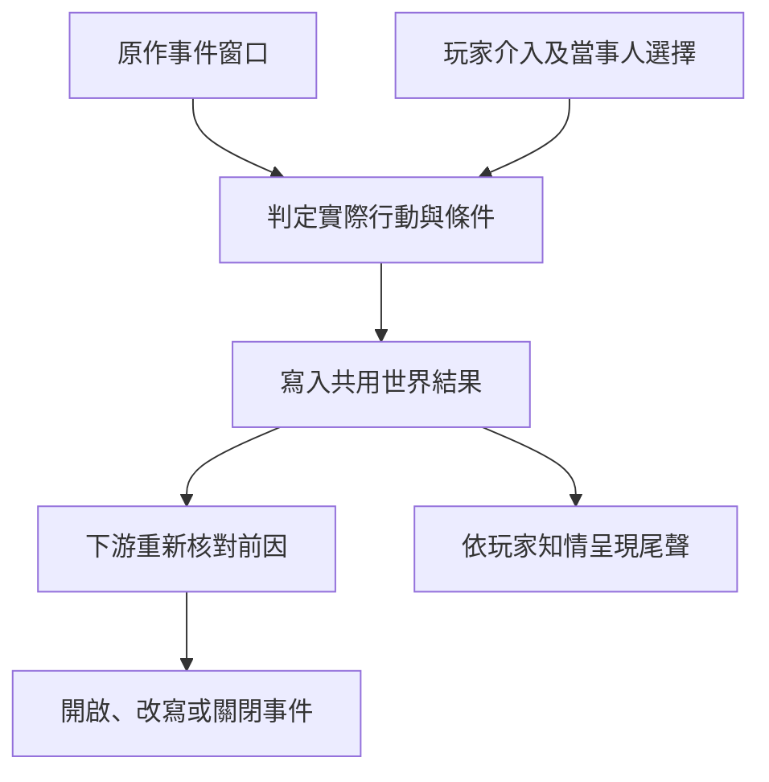

# 第一部｜45 幕 IF 劇情總索引

第一部 01–14、17 共十五條長支線，每條三幕。每幕含觸發、可直接進入正文的場景與對話、以及之後哪些事件開啟、改寫或關閉。原作是零介入的世界走向。改寫須由玩家介入、當事人選擇和當場能力共同成立。各幕的觸發及改寫是遊戲設計，未確認的原作時點沿[年表](../../lore/history/README.md)與[長支線設計](long_sidequests_part_one.md)。

| 支線 | 三幕 IF | 全文 |
| --- | --- | --- |
| 01 玫瑰學派內鬥 | 酒吧後門開了兩次／沒人往那片水域去／搬運人空手回來 | [正文](part_one_if_stories_01_05.md) |
| 02 魔女教派與大霧霾 | 那批人沒有上車／莊園的證人先去作證／黑死號上的座位空著 | [正文](part_one_if_stories_01_05.md) |
| 03 心理煉金會 | 胡德自己走出病房／請帖換了收件人／證人在門外等候 | [正文](part_one_if_stories_01_05.md) |
| 04 值夜者與廷根之變 | 因斯沒能離開廷根／側門守衛換了班／鄧恩走出內室 | [正文](part_one_if_stories_01_05.md) |
| 05 極光會的降臨計畫 | 地下室的貨少了一箱／熟客沒有收到邀請／博提斯來晚了一步 | [正文](part_one_if_stories_01_05.md) |
| 06 黃昏隱士會與黑皇帝儀式 | 公爵的車還在等／儀式中止，國王仍活著／回條送到已經太晚 | [正文](part_one_if_stories_06_10.md) |
| 07 亞伯拉罕家族與門先生 | 家族的門牌先撤了／佛爾思收回了那封約信／藍山島的第三個空位 | [正文](part_one_if_stories_06_10.md) |
| 08 密修會與查拉圖 | 屋裡的囈語停了半拍／車站先收到了停靠通知／主峰的準備被迫改期 | [正文](part_one_if_stories_06_10.md) |
| 09 生命學派與概率之骰 | 敲鐘人空手離開／恩佐沒有踏進西拜朗的約地／只留一個人知道回信往哪裡寄 | [正文](part_one_if_stories_06_10.md) |
| 10 靈教團與南大陸 | 阿茲克請船主把票退回／家屬先搬走了原件／收件處撤了那張名冊 | [正文](part_one_if_stories_06_10.md) |
| 11 羅思德群島與海神信仰 | 權杖先被收進封存箱／兩艘船都留在港內／港口簿還在舊人手上 | [正文](part_one_if_stories_11_17.md) |
| 12 白銀城的出路 | 科林先把隊伍帶回城裡／首席回來了，門也開了／第一批船沒有靠在原岸 | [正文](part_one_if_stories_11_17.md) |
| 13 血族與大地母神教會 | 埃姆林要求把話再說一次／獵手只找到一副空窗框／神父在約定的住處收藥 | [正文](part_one_if_stories_11_17.md) |
| 14 摩斯苦修會與要素黎明 | 那一頁在寄出前被封住／貝爾納黛先退回了索引／神燈沒有交到原先的人手上 | [正文](part_one_if_stories_11_17.md) |
| 17 塔羅會 | 這一次的邀請收回了／回信送到另一位成員手上／再沒有人替那封信轉寄 | [正文](part_one_if_stories_11_17.md) |

## 跨線結算

- **先判前因。** 到場、收件、持有、權限與能力分別判定。玩家做到其中一項時，照實保存；其餘仍由當事人實際行動決定。死亡確認後關閉該角色日後親身參與的橋段。祕偶、歷史投影或他人的接手，須另有成立的事件。
- **同案共用一次結算。** 同一件物品在同一時點只有一名已確認持有人，或標記待查。依賴該物的支線在觸發時重查。未發生的交鋒不寫傷亡、目擊或掉落。同一船位只依實際登船人計入後續。角色知情依真實收到的消息分開保存。
- **可疊加的幕照因果排序。** 04-A、04-B 可以同時作用於廷根之變，分別決定因斯、0-08 與骨灰。04-C 可與側門兩幕並存，但內外場支援只能計入各自實際到場的人。因斯已死時，04-B 可查尚有證據的接應者，原追逃和亞當在該場取得 0-08 的結果一併關閉。06-B 與 06-C 是同一儀式的互斥核心結果；12-A、12-B 是同次遠征的不同結果。共用結果由事件判定一次，其他線只讀取。
- **知情和尾聲。** [第一部尾聲](part_one_ending_and_epilogues_v1.md)讀取當局真實結果，玩家只看到親見或實際取得的版本。身份、供應、可動用的人手與物資照實保存。全遊戲的結局數量另按整體設計；這 45 幕是事件分歧，可在同一局依前因並存。

| 交叉驗收 | 必須成立 |
| --- | --- |
| 04-A 因斯死亡，0-08 封存或下落未明 | 關閉因斯的追逃、附身、西拜朗對抗與該場戰利品。0-08 保留封存或失聯；亞當少了原版取得特性的途徑，後段晉升和介入讀取實際位格。 |
| 04-A、04-B、04-C 同時成立 | 死亡、拒交與生還可同時保留；核對是否有足夠人手，並單獨判定克萊恩與 0-08。 |
| 02-A 攔下獻祭環節，05-A 未成立 | 潘娜蒂亞一方重算；A 先生照自己的準備結算。兩線共用居民去向。 |
| 03-B 攔截接應，17-B 嘗試補位 | 僅在替代者避開已暴露的入口、按時到場且能完成原工作時，恢復聯合反制。 |
| 05-C 盒子被扣，07-B 的條件再檢查 | 07-B 要求盒子仍在博提斯手上，因此該版本不開。三條支線讀同一場伏擊和物件持有人。 |
| 07-C 阻止當次回歸，08-C 晉升也受阻 | 17 讀取兩次結果，不能套用原版成神後的源堡與沉睡橋段。 |
| 09-B 恩佐這次未成為祕偶 | 04 缺該次祕偶援助；12 另查當期可召喚的歷史，不能讀取從未成立的祕偶狀態。 |
| 10-A 取消航程，阿茲克保持清醒 | 略過這趟陵寢遭遇導致的沉睡與甦醒，沿他實際可收信的路線處理。 |
| 11-A 權杖封存，02-C 伊蓮先行離港 | 卡拉特的神諭入口與克萊恩該次冒名登船各自關閉；可回查伊蓮實際船次。 |
| 12-A 遠征折返，11-B 已備船 | 備船承諾照實保存；本次外界安置不開。另有通路成立後才分配實際乘客。 |
| 17-A 邀請撤回 | 保留已成立的地方委託；玩家的成員限定場景及知情關閉。 |

以上是正文與分歧條件。遊戲實作依各幕逐條接入；[廷根試玩](tingen_playtest_rules.md)已有 04-B 的可玩版本。後續驗收先跑零介入，再跑有效介入和錯過窗口，檢查下游可用選項。
