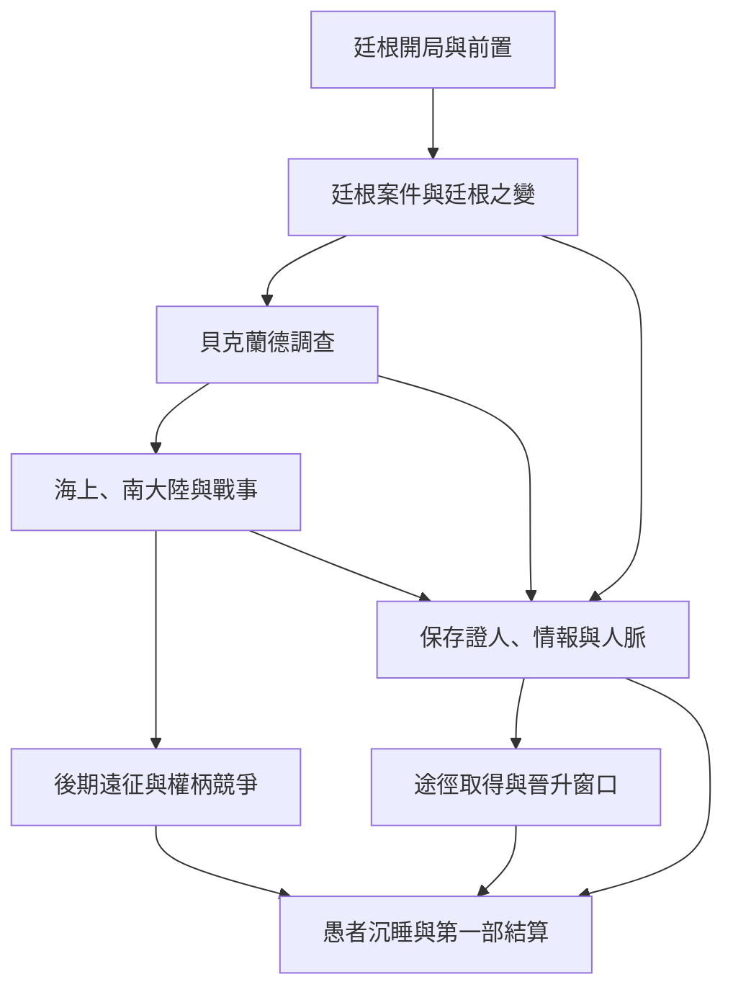
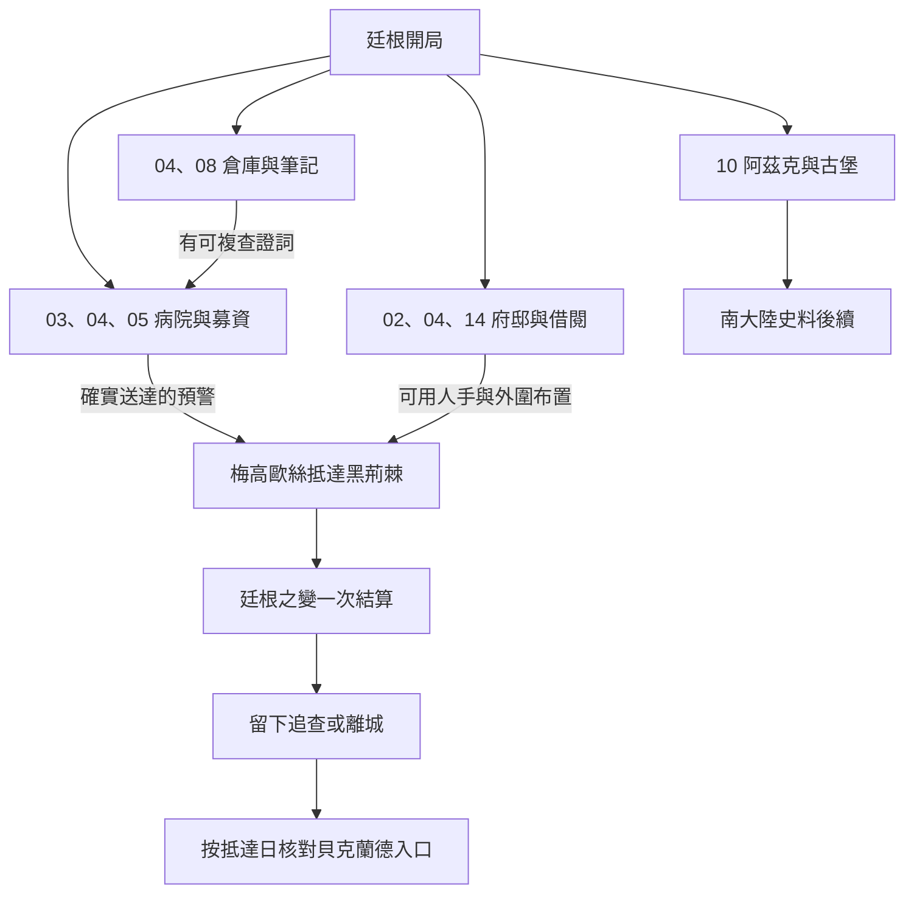
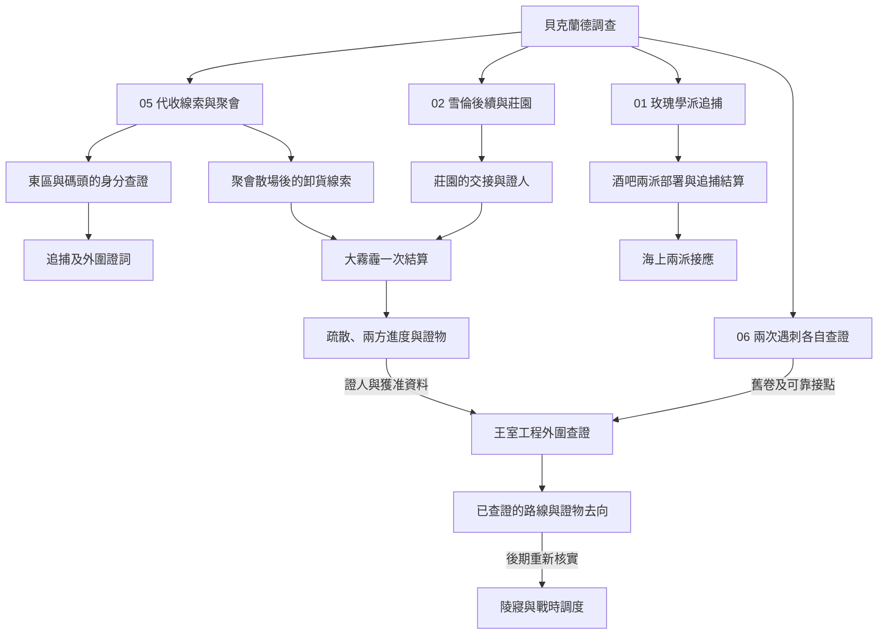
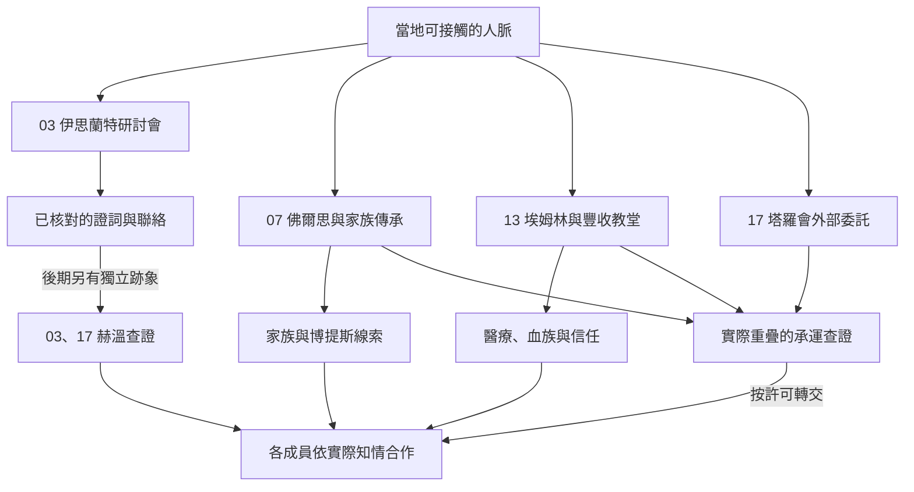
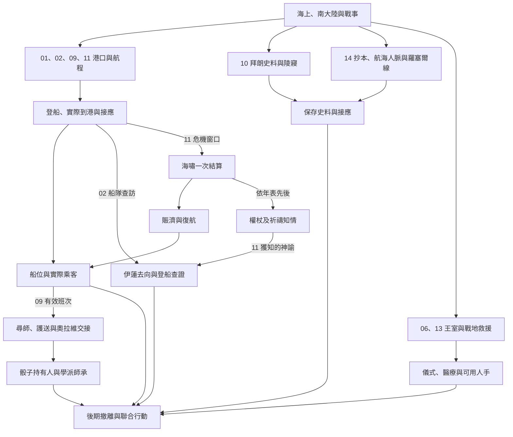
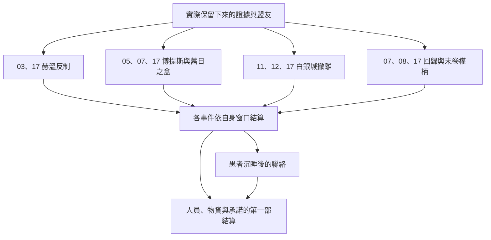
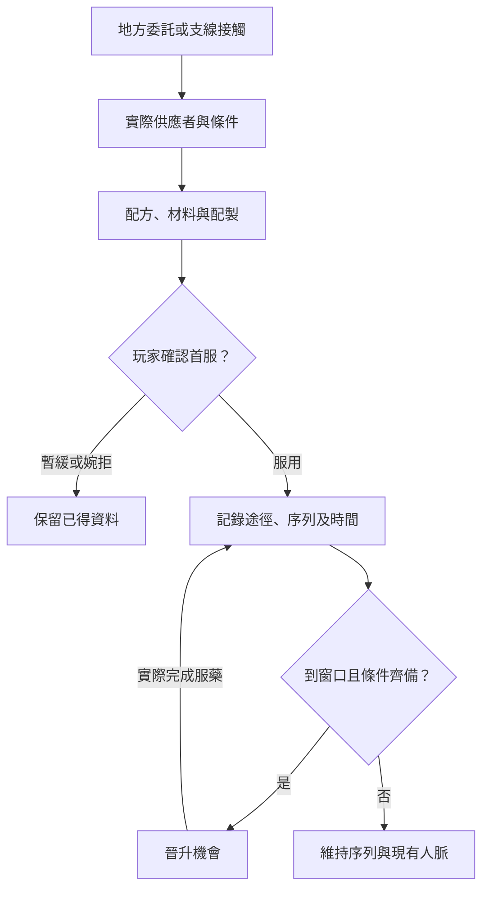

# 第一部｜劇情總樹

從[第一部八卷年表](../../lore/history/README.md)和[十五條長支線總綱](part_one_sidequest_master_outline.md)進入。各圖在同一世界時間線上，階段和地區可重疊。箭頭表示能銜接的事件、情報或狀態；玩家必須符合實際地點、時間和知情條件。圖中合流的地方採用同一次事件結果。已有正文的細節見對應劇本，其餘保留為大綱。第二部的 15、16 暫緩。

## 先看整部怎麼走

玩家留城或錯過支線時，世界事件仍按年表推進。首服與晉升可在符合條件的各地插入。結算讀取實際序列、可用人員、保存的證物及未完承諾。

## 廷根篇｜通報與人手在危機會合

已寫正文：[倉庫案](tingen_warehouse_story_v1.md)、[胡德與蘭爾烏斯](tingen_hood_and_lanevus_story_v1.md)、[老尼爾與雪倫](tingen_neil_and_sharon_story_v1.md)、[廷根之變](tingen_crisis_story_v1.md)。各案內的選擇與序列 8 機會見[廷根詳細分支圖](tingen_branch_map.md)。03 研討會、05 聚會、02 莊園等後續各自讀取仍可驗證的線索。

## 跨城｜廷根事後到貝克蘭德

[跨城正文與細圖](tingen_aftermath_backlund_entry_v1.md)展開留城回訪、當下離城與延後出發。攜帶 02／05 線索的玩家可在抵達後核對，保留 04 回信方式的玩家可續查廷根，也可以從承運、短薪或酒箱等本地委託開始。已關閉的入口改由留存資料或後段接點處理，首服時間與消化沿用原紀錄。

## 貝克蘭德｜共用危機與各自取得的線索

[東區與碼頭正文及細圖](backlund_docks_lanevus_story_v1.md)已接通短薪、代收線索和追捕。[勇敢者酒吧與玫瑰學派細圖](backlund_rose_pursuit_story_v1.md)接續兩派的警訊、外圍撤離及後續海上人脈。[A 先生與紅薔薇莊園正文及細圖](backlund_gathering_and_manor_story_v1.md)記錄兩處預警和實際到位的接應。[大霧霾正文及細圖](backlund_great_smog_story_v1.md)已接通兩方外圍進度、居民疏散與王室調查的事後入口。[尼根公爵遇刺與王室工程正文及細圖](backlund_negan_and_royal_works_story_v1.md)接通兩次遇刺的分別查證、霧霾後證詞及工程外圍。[佛爾思、埃姆林與塔羅會外部聯絡正文](backlund_fors_emlyn_tarot_contacts_story_v1.md)及細圖記錄 07、13、17 的獨立窗口與承運證據。[伊思蘭特研討會正文](backlund_islant_seminar_story_v1.md)及細圖記錄引介、證詞流向及奧黛麗實際知情，後期另查赫溫事件。第二張圖的合流表示資料可透過已建立的管道交流，正式入會及聚會仍有各自條件。階段細節見[長支線總綱](part_one_sidequest_master_outline.md)與[十五條前置正文](part_one_sidequest_prologues.md)。

## 海上、南大陸與戰事｜接應與運力

[出海與拜亞姆接應正文](backlund_voyage_and_bayam_arrival_story_v1.md)及細圖接通 01、09、11 的航程。[拜亞姆海嘯與海神權杖正文](bayam_kalvetua_sea_god_story_v1.md)接通危機、賑濟及權杖後續。[紅髮伊蓮與黑死號正文](bayam_elaine_black_death_story_v1.md)接通 02、11 共用的伊蓮去向與物資往來。[達克威爾與概率之骰正文](bayam_darkwill_probability_dice_story_v1.md)接通 09 的航程、接頭與保管。船位可被不同任務使用，實際乘客與抵達時間只記一次。海神權杖、概率之骰、陵寢資料及其他物件各有持有人。教會戰局和物資接應會改變後期誰能出手。

## 第一部後期｜遠征、儀式與結算

白銀城的外界安置在實際通路打開後發生。伯特利回歸、愚者晉升與沉睡各有年表節點。各地只沿已成立的聯絡讀取能知道的結果。其餘各線也將實際人物狀態、持有物和承諾帶入第一部結算，詳見[逐線大綱](part_one_sidequest_master_outline.md)。

## 途徑如何插進劇情

[第一部晉升時機表](part_one_advancement_schedule.md)按實際服藥時間、場景窗口和供應條件串接後續序列。

| 劇情入口 | 涵蓋的途徑 | 細圖對照的正文 |
| --- | --- | --- |
| 廷根 02、03、04、08 | 愚者、隱者、死神、黑暗、空想家、魔女 | [廷根](tingen_pathway_acquisition_v1.md) |
| 南大陸與航海人脈 10、14 | 死神、隱者 | [跨城傳承](death_and_hermit_pathway_acquisition_v1.md) |
| 拜亞姆 09、11 | 命運之輪、暴君 | [拜亞姆](bayam_pathway_acquisition_v1.md) |
| 貝克蘭德 07、13 | 門、月亮、母親 | [家族與教會](backlund_pathway_acquisition_v1.md) |
| 極光會與王室外圍 05、06 | 倒吊人、審判者、黑皇帝 | [聚會與工程](aurora_and_royal_pathway_acquisition_v1.md) |
| 玫瑰學派與戰時 | 被縛者、紅祭司、黃昏巨人 | [追捕與戰地](rose_and_wartime_pathway_acquisition_v1.md) |
| 前期教會、後期白銀城外界接應 | 太陽、白塔、完美者 | [教會與技術人脈](church_and_craft_pathway_acquisition_v1.md) |
| 貝克蘭德寄存與地下調查 | 錯誤、深淵 | [兩條獨立調查](error_and_abyss_pathway_acquisition_v1.md) |

**維護方式。** 每次新增正文，同步補上該段細圖。細圖指出前置、選擇、共用結果及去向。若涉及其他地區、晉升或結局，同步在總樹更新連接。總樹的後期節點目前是大綱，分歧條件隨正文逐批細化。
