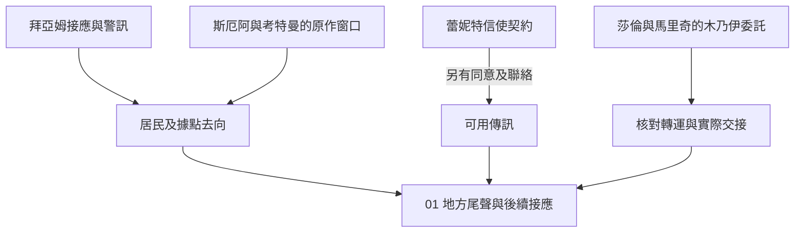

# 玫瑰學派的拜亞姆接應與法老木乃伊｜退潮前的約定

01 的兩段正文，承接[勇敢者酒吧追捕](backlund_rose_pursuit_story_v1.md)與[拜亞姆接應](backlund_voyage_and_bayam_arrival_story_v1.md)。蕾妮特與克萊恩建立信使契約，斯厄阿隔空介入拜亞姆交鋒，考特曼等人出手；莎倫與馬里奇另請克萊恩協助取得圖坦西斯二世木乃伊。三個事件各按原作窗口出現。下列接頭、車船、見聞及對白為遊戲原創。木乃伊與陵寢之戰的精確銜接仍待核。[蕾妮特傳記](../../lore/characters/biographies/reinette-tinekerr.v1.json) · [斯厄阿傳記](../../lore/characters/biographies/suah.v1.json) · [《不死者》年表](../../lore/history/dantes_undying_v1.json)

## 第一場｜不要在門口喊名字

拜亞姆的接應人把濕透的票根貼在窗上曬。他問你上次送走的人後來到了哪裡。若玩家只替對方保留了船位，可以先請他核對到港簿。若以前把地址交給追兵，接應者只會就自己知道的外流決定是否換門。

- **通知莎倫或馬里奇。** 須仍有可靠的節制派聯絡。把能核實的來人、地點及時間交給對方；可照約接人，或先徵詢當事人是否願意改道。若對方有可信的轉達方式，可以把消息交給蕾妮特。她按實際收到的內容、自身狀態及意願行動。
- **從放縱派外圍接案。** 有實際接點時，可提供已核實的路線、查證空屋，或反過來示警。接頭人若拿到有效位置，可安排追查；斯厄阿的出場由原作窗口和高位局勢決定。
- **只替地方居民找出口。** 按可用船位、抵達時間與當事人同意結算。若能聯絡代罰者，可交實際觀察到的異常供地方調度。居民及船位由 01 和 11 共用。

## 第二場｜水面上的影子

若玩家在交鋒時確實能看見事發方向，會看到水上的亮光突然被一片形狀不規則的影子截斷。若在另一處接人，玩家只知道有人帶著急促的回報來，說原來那個出口走不通了。

零介入時，斯厄阿在拜亞姆交鋒中隔空出手，考特曼等力量介入。玩家可以照實通報、換外圍接應、帶人離開。目擊的異常與辨認出斯厄阿各須有自己的證據。蕾妮特與克萊恩的信使契約按原作窗口獨立成立，玩家要借她傳訊須經實際可用的聯絡、取得同意並履行相應約定。單次合作只按她真正答應的事項結算。

**IF｜船主撤回接應。** [01-B](part_one_if_stories_01_05.md#01-b沒人往那片水域去)中，節制派在收到改約並確認安全出口後轉向。先查雙方是否仍在其他水域碰面；原交鋒未發生時，略過斯厄阿的隔空介入和考特曼的當場處置。木乃伊另有運送窗口，照實際接應開場。

## 第三場｜船單上少一只箱

木乃伊委託開啟後，莎倫或馬里奇若願意接觸玩家，會拿來一張只寫交接時段的回條。船單上的箱數曾被改過一次。馬里奇問你，若接貨的人遲到，你會先等他，還是先把船上的其他人送走。

- **替節制派核對交接。** 先確認搬運人、可走路線與原定收件者。玩家可赴外圍接貨、替同行者換安全去處，或只把已驗真的差異傳給莎倫。委託物的去向由實際接手的人更新。
- **替放縱派查出轉運時點。** 可以交自己確實掌握的船次，或私下示警。收件方只有在趕得上、有能力且完成攔截或交接時，才會改變物件去向。
- **只保住人員。** 搬運人可自行選擇是否留下；需要撤離時，沿實際可用的地方接應處理。看見裝箱或收到貨單只算線索，木乃伊的位置待核。

**結算。** 莎倫與馬里奇請克萊恩協助取得圖坦西斯二世木乃伊，按既有世界事件推進。若 01-C 使放縱派截到棺箱，莎倫與馬里奇優先查棺箱與搬運人的去向；需用木乃伊的後段行動先等追回或符合條件的替代物。遊戲新增的轉運交接讀取實際到位的人、已查明的物件與最後確認持有人。若玩家只收到貨單或未能驗明物件，記待查；若已實際移交，依現持有人和保管條件開後續。蕾妮特的合作、斯厄阿一方的接應、兩派各自知道的消息，以及 01 的撤離承諾各自保存。被縛者的狼人窗口仍須核對上次服藥時間、供應與消化。[晉升時機表](part_one_advancement_schedule.md) · [第一部尾聲](part_one_ending_and_epilogues_v1.md)

[第一部劇情總樹](part_one_story_tree.md)
