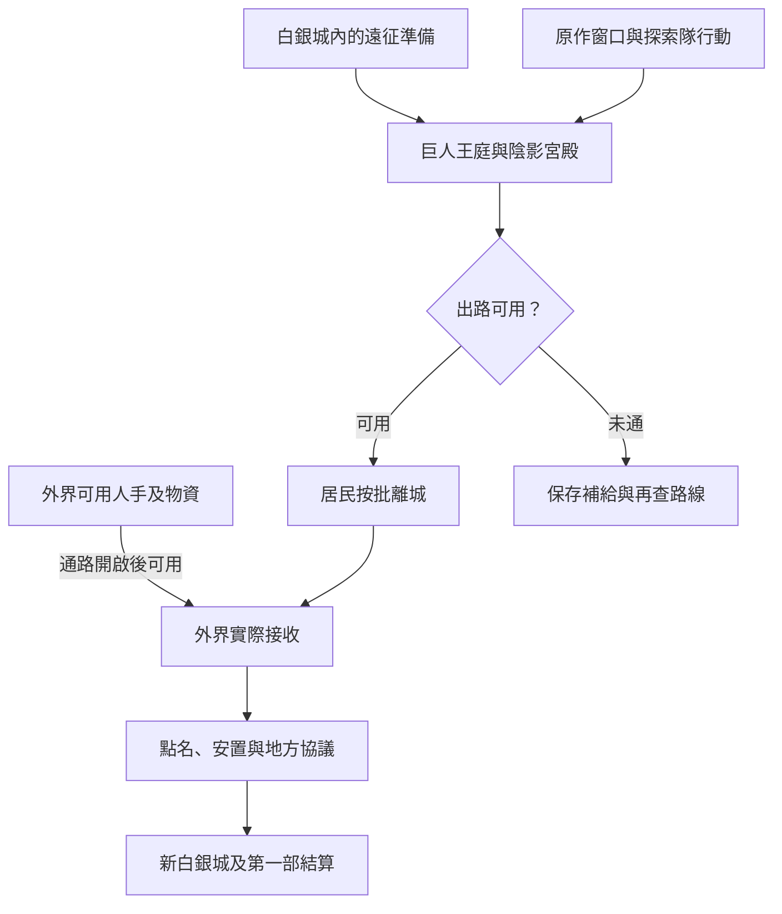

# 白銀城遠征與外界接應｜第一個早晨

11 羅思德海神信仰、12 白銀城與 17 塔羅會的共用正文。承接[白銀城前置](part_one_sidequest_prologues.md)與[拜亞姆的地方接應](bayam_kalvetua_sea_god_story_v1.md)。依[《逐光者》年表](../../lore/history/lightseeker_v1.json)，科林率隊前往巨人王庭，戴里克、洛薇雅同行，隊伍在陰影宮殿與薩斯利爾相關力量交戰。依[《倒吊人》年表](../../lore/history/hanged_man_v1.json)，出路打開後，戴里克帶領居民離開神棄之地。下列住戶、補給回條、接應差事與對話為遊戲原創。

## 第一場｜兩袋種子

有人把戴里克的問題抄在一張買糧用的單子背面。此前若做過存放試驗，玩家可以把原始記錄和留下的種子一併取出。只交過商販說法時，這次可重新做試驗，或如實回覆所知。

「一袋留給走在前面的人，另一袋留在城裡。」信上問，「如果前面的人沒回來，後面的人要等多久才打開？」

身在外界的玩家須有仍能送達戴里克的可信管道。可先確認哪處倉房可用、準備兩批補給，或留一批給原本已有照護承諾的人。送出的消息只有實際抵達才進入議事團的判斷。若玩家有條件在白銀城活動，可在城內核對留守人手與探索隊需要，並讓兩邊知道物資現在由誰保管。

通路開啟前，外界玩家可在港口安排物資、船位與接收人，也可以經獲准的管道傳遞資訊。要進白銀城，須另有能真正跨越阻隔的方式。提早買下的船位依船主承諾及有效時段保留。

## 第二場｜科林留了一盞燈

隊伍出發前，科林請人把提燈分成兩排。他拿起一盞，先問這盞若留在岔路，回來的人能從多遠看見。洛薇雅站在桌子的另一邊，等他問完才指出，守在岔路的人也要能回來。

若玩家在場，可提出已核實的退路，或依自己的能力請求隨隊。須能抵達、取得探索隊信任並具備相應生存能力，才能隨行。只在外界接應的玩家，在這一段只安排可信傳訊、保留回訪時間，或查證自己拿得到的情報。

- **隨隊傳訊。** 可核對退路，並把親見的異常告知能採取行動的人。要進陰影宮殿，還須有實際可達性與能承擔威脅的手段。
- **守住外圍接應。** 能在外圍行動的玩家可確認誰在何處等候、傷員能撤到哪裡。接應須在隊伍需要前實際到位。
- **在城內或外界準備後路。** 可保留物資和可靠人手。外界的準備要等通路打開，才可用於居民接收。

**遠征結算。** 陰影宮殿按原作窗口開啟，讀取科林、洛薇雅、戴里克等人的實際到場與能力。若涉及恩尤尼的歷史投影，依可召喚的過往狀態及當場遭遇處理，與[西拜朗祕偶去向](west_balam_enzo_ince_story_v1.md)各自記錄。零介入時科林與洛薇雅犧牲，戴里克等倖存者完成探索，出路打開。要改變傷亡，須有人及時改變致命環節，並核對當事人的選擇；若有效干預使探索中止或延後，另行判定出路何時可用。可用船位和糧食只在隊伍能聯絡到接應者時派上用場。[科林傳記](../../lore/characters/biographies/colin-iliad.v1.json) · [洛薇雅傳記](../../lore/characters/biographies/lovia-tiffany.v1.json)

**IF｜折返、生還與改港。** [12-A、12-B、12-C](part_one_if_stories_11_17.md#12白銀城的出路)依遠征、通路、載運三個時點處理。科林若因退路封閉而折返，同次遠征略過交鋒、傷亡和開路；外界可保留仍有效的備船，第三場等有人實際抵達再開。科林若由替援救回，留下的人仍須自己開路，議事團依他當時能否履職處理職務。改港先驗接收者同意、床位及運力，再決定哪批先走；阿爾傑或其他聯絡人只讀經實際回報的去向。

## 第三場｜外面也有人在等

抵達接應地的第一批居民站在棚下，仍有人用衣角遮著眼。碼頭的人把三張名冊疊在一起，問你能不能今天就把房間排好。最上面那張只列已出發的人，下面那張已經有兩處被改過。

「他跟我說會來。」有個孩子按住其中一個名字，「可以等他到了再把這行畫掉嗎？」

- **按實際抵達點名。** 將已離開白銀城、已抵達外界及已安置分開記錄。對仍未抵達者留下最後確認位置和可用聯絡。若有兩批名冊，按人核對重複及改船記錄。
- **借用羅思德的船或倉房。** 11 的地方接頭須確實同意，船位沿實際乘客和航次記錄。港口原有的賑濟或護送也會使用同一批資源；只有找到替代班次、人手或落腳處才可兼顧。
- **保留補給給下一批。** 先核對下一批是否真的出發、何時能到。原定物資被調走時，可用其他可信供應補足。向戴里克回報時只交允許轉達的結果，代號和聚會仍有各自知情條件。

**定居結算。** 零介入時戴里克帶領居民離開神棄之地，科林死後由韋特接任首席。若科林的狀態改變，議事團按實際人員重議職務。新白銀城的落腳處依可用的住處、地方協議、照護人手與補給維持。月城的聯絡與遷徙沿自己的事件窗口。保留可用船隻、具體承諾及實際安置的人員，供末卷阿爾傑的教會職務和第一部結算使用。[戴里克傳記](../../lore/characters/biographies/derrick-berg.v1.json) · [韋特傳記](../../lore/characters/biographies/waite-hillmon.v1.json)

## 後期教會供應

太陽、白塔、完美者都可循[既有前期教會入口](church_and_craft_pathway_acquisition_v1.md)。白銀城接應開放後，仍能聯絡供應者的玩家可持實際交件紀錄補接。祈光人、推理學員或考古學家實際服用約三至四個月後，可分別循照護、史料交接或設備鑑定約談太陽神官、守知者、鑑定師。供應與消化仍須查驗。戴里克晉升無暗者照原作年表推進。[第一部晉升時機表](part_one_advancement_schedule.md)

## 遠征與外界接應細圖

| 走法 | 結果 |
| --- | --- |
| 外界已備妥船位，通路未開 | 保留有效的船位和補給。出路另按遠征結算。 |
| 隨隊並在致命環節前送達警訊 | 讀取收到警訊者的實際行動、手段及撤離條件。 |
| 居民已離城，改船後尚未抵達 | 保存最後位置及已確認的航次，等實際接收再更新。 |
| 只協助港口定居 | 記可用房間、物資及已安置居民，另查途徑引介。 |

[第一部劇情總樹](part_one_story_tree.md)
