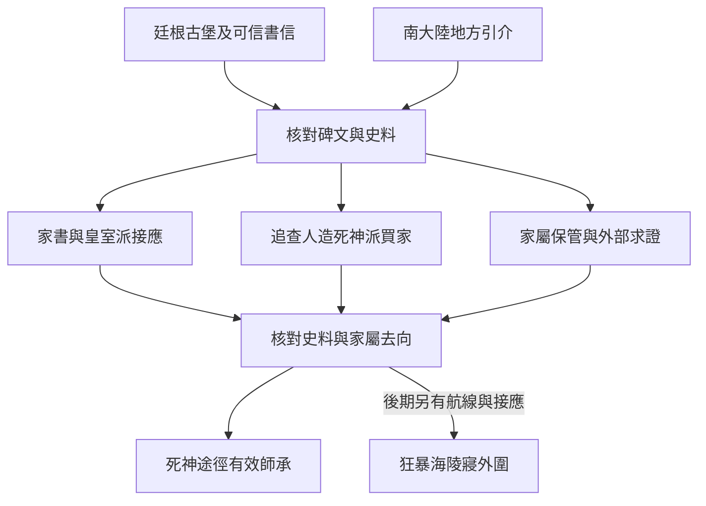

# 阿茲克與拜朗史料｜石碑下面的名字

10 靈教團與南大陸的入口，承接[支線前置](part_one_sidequest_prologues.md)和 04 保存的廷根古堡線索。阿茲克與克萊恩離開廷根後仍保持聯繫，阿茲克後續追查狂暴海陵寢及進入沉睡分別循[阿茲克傳記](../../lore/characters/biographies/azik-eggers.v1.json)、[《不死者》年表](../../lore/history/dantes_undying_v1.json)與[《紅祭司》年表](../../lore/history/red_priest_v1.json)。本章的家書、碑文、接應者與委託是遊戲原創。玩家可以靠本地人脈進線，也可以先留在北大陸查證，再依實際航程到達南大陸。

## 第一場｜少了哪一行

若玩家在廷根保住了拉姆德古堡的拓片，留存的那一張有半個字被摺進背面。黑荊棘只在授權範圍內出示舊卷。若玩家保有阿茲克的可信聯絡，可以把允許查閱的部分寄出。信只有送達後才算轉交，當事人可依所在位置、意願和當期狀態回覆。

在阿茲克願意回信的走法中，玩家會看到他把年代寫在一旁，另外抄了一個很短的姓。

「兩份抄本的年份差得太遠。你若遇到知道這個名字的人，替我問他從哪一代開始這樣寫。」

若玩家未見過古堡，可在南大陸的碑匠鋪查到同一個姓。老闆拿炭筆在廢紙上示範兩種寫法，說其中一種是家屬要他後來添上的。這條獨立來源可以開本地委託。它能證明一種寫法曾出現在這裡，阿茲克的身世與墓的用途仍須另查。

## 第二場｜家書先送到

要找的家屬在一間染坊後院。院門上掛了兩個姓，較早的已被磨掉一角。一名婦人把拓片壓在曬衣的石頭下面，讀了很久才說，前幾年有人來過，答應找到她兄弟葬在哪裡。那人後來只寄回一份問卷，想知道附近還有幾塊一樣的碑。

「你若找到他埋在哪裡，先讓我知道。我想去一次。我的名字，你可以等我點頭再寫。」

- **跟皇室派接應人赴約。** 對方希望收回可證實的拜朗舊名冊。可替家屬送還家書、核對年代，並交回對方同意公開的姓氏和來源。完成後可談史料保全、長期合作或加入。皇室派可用的消息依實際收到的範圍判定。
- **查人造死神派外圍買家。** 買家願意為位置付錢。玩家可交自己確實掌握的標記，也可改以已公開的承運紀錄換一次查訪。前者讓買家有機會先抵達並向家屬追問；後者要多一次查證，對方可依結果決定是否引介。
- **只替家屬收回資料。** 若原件屬於家屬，依其意願交還或請可信的人代存。獲准的節錄可向阿茲克求證，也可交給仍可聯絡的黑荊棘。兩方各讀自己實際收到的內容。家屬若收回許可，可留公開碑刻或交件日期等另有來源的資訊。

## 第三場｜燈往哪邊照

傍晚到墓地，照看人把燈掛在鐵欄裡側。石碑上有一行新刻過的痕跡，泥裡還留著一串鞋印。如果先前給買家的是可用位置，且對方來得及到達，照看人可能已被問過話。若警訊先送到，照看人可以按自己同意的安排轉往安全處。只收到消息時，他可能仍在等接應的人。

玩家可以留在外圍確認來過的人、陪家屬查找舊名冊，或請有能力的人辨認異常。若一處墓地確實有待交接的遺骸，先查歸屬、家屬意願與有權接收的人，再記錄實際移交。只看見新鞋印時，日誌只能記訪客跡象。原件、遺骸、地點與異常來源各有自己的證據。

回到接應處，對方會按實際交件提出下一個約。玩家可承接派系委託、只要求交換已核實的消息、拒絕加入，或留到其他接應重開。已轉交的地址、副本或遺物依實際持有人繼續追蹤。

## 第四場｜下次有船再寄

如果阿茲克仍能回信，他會圈出已核對的日期，將那個姓留在原處。若玩家替家屬守住了住址，可只寄墓碑上獲准使用的稱呼與日期。阿茲克未回覆時，保留送達狀態及當前可用聯絡。等他進入沉睡後，書信按他先前已建立的安排處理。

**本章結算。** 04 與 10 共用廷根原有證物與實際持有人；南大陸另記家屬安全、誰收到墓地位置、誰實際探查、各方可用接應。可在[狂暴海陵寢與阿茲克書信正文](berserk_sea_azik_tomb_story_v1.md)使用已核實的人脈、史料或航路。入陵須在原作窗口取得可用航線，並確實聯絡阿茲克或克萊恩。零介入時兩人依原作行動，玩家只從可核實的消息得知其事。人造死神、黑夜女神及高位處置留待各自事件結算。家屬、史料與可用落腳處留給第一部結算。

## 死神途徑｜交件後的晉升

- **未首服。** 可沿[收屍人供應正文](death_and_hermit_pathway_acquisition_v1.md)循 04、皇室派或人造死神派的有效引介。赴約、配藥及正式加入各自確認。
- **收屍人 → 掘墓人。** 首服約三至四個月後，優先從廷根殯葬回訪或古堡線的事後窗口接續。已離城或導師失聯時，可持經核實的墓地回條，在南大陸另找能接手的導師。
- **掘墓人 → 通靈者。** 上次實際服用後約三至四個月，於拜朗史料與確有遺骸的交接回訪核驗。若家屬拒絕移交，先履行保管約定，另等有適用資料與授權的差事。
- **通靈者 → 死靈導師。** 暫排在通靈者實際服用約四個月後，於兩派調查的後續開窗。依玩家能聯絡的導師、實際消化、配方、材料和適用條件確認；仍有缺項時留到下一次回訪。[第一部晉升時機表](part_one_advancement_schedule.md)

## 史料、派系與阿茲克書信細圖

| 走法 | 結果 |
| --- | --- |
| 未接觸阿茲克，從碑匠入線 | 可接地方委託。阿茲克只依日後實際收到的資料知情。 |
| 給買家可用位置，警訊較晚送達 | 買家有機會先查訪。照看人實際去向另記。 |
| 送還原件，只帶可核實的節錄 | 可從獲准的節錄續查。原件由現持有人管理。 |
| 提早離開南大陸，尚未滿晉升間隔 | 保留已取得的師承和聯絡，到下次可用窗口重約。 |

[第一部劇情總樹](part_one_story_tree.md)
