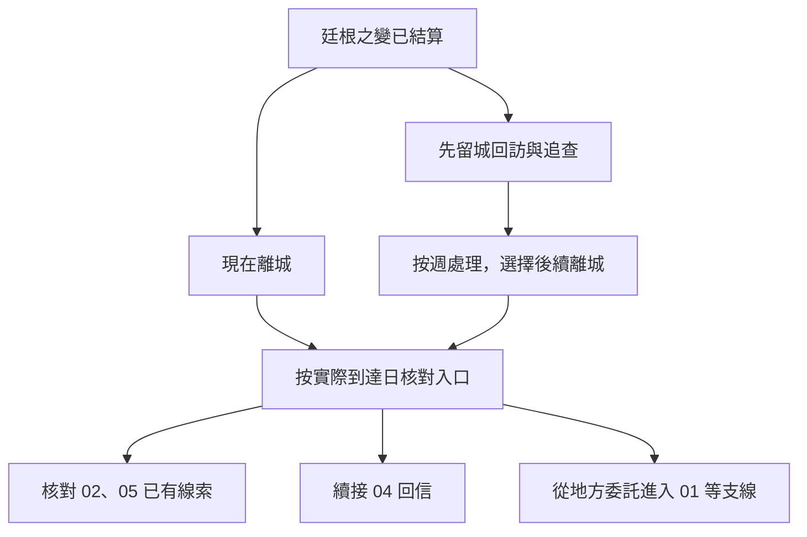

# 廷根事後與貝克蘭德入口｜還有人來取信

接續[廷根之變](tingen_crisis_story_v1.md)，串聯 04 的事後追查、02 的府邸後續、05 的代收商號，以及 01 的本地入口。新增的街坊、票務、轉寄處與台詞皆為遊戲原創。克萊恩的離城與貝克蘭德活動依[廷根年表](../../lore/history/tingen_1349_v1.json)及[夏洛克篇年表](../../lore/history/backlund_sherlock_1349_v1.json)各自推進。玩家的車票和知情狀態獨立記錄。

## 第一場｜有人回來拿外套

**觸發。** 危機已結算，玩家還在廷根，街坊開始尋人或回訪接應處。看過現場者依實際見聞行動；從外地返城者只讀到已傳給自己的消息。

接應處的門還留著一條縫。門內擱著幾件從橋邊撿回來的外套。看門的人把最上頭那件拿起來。

「昨晚有個孩子來問這件。她說左邊口袋縫過。可她沒說衣服是誰的。我叫她白天帶個認得的人回來。」

他從衣架上解下一張領取牌。「你若知道誰在這裡等過，可以幫我核對。也有人說，先把名字全貼出去比較快。」

- **回訪實際抵達接應處的人。** 可把物件交還本人或其同意的家屬。若玩家此前確實護送梅高歐絲的家屬，可回到原安置點；若人沒抵達，只可沿最後確認的位置找，並記錄仍未找到的人。
- **把確定的目擊交給值班人。** 若只有外套或領取牌，紀錄停在「物件被拾獲」。能證明本人出現的才寫進點名。玩家可替願意作證的人安排匿名或具名會面。
- **把公開尋人訊息留在門邊。** 可只寫允許公開的物件特徵或聯絡方式。若擅自張貼受保護的地址，實際看到告示的人才可能循址查訪，保護承諾和後續人脈照此更新。

**寫入。** 確認誰安全抵達、誰還失聯、哪個地址獲准轉交。這場在玩家尚未離城時可延後回訪；當事人已轉移時只保留已知消息。未被尋訪的人也依原先的安置結果生活。

## 第二場｜信封上只寫姓

**觸發。** 玩家有可信的目擊、保存的證物，或經授權的值夜者外勤身分。能否與倫納德見面依其實際行蹤；只有一般消息者可從公開聯絡開始。

黑荊棘的接待員在一只信封上寫了自己的姓，地址留白。

「你可以把親眼看見的留在這裡。別人託你說的，寫另一張，讓我們知道該先去問誰。」

若倫納德能赴約，他先核對證詞的時段和出入口，再問：「你那時還在門邊，還是已經到橋上了？我只想確定，這兩件事中間隔了多久。」

- **留下可複查的紀錄，答應日後回報。** 04 開啟事後追查聯絡。原件若已由黑荊棘保管，就在原案補記來源。玩家日後離城時可帶走獲准的轉寄方式，回覆只在收件人實際能聯絡時送達。
- **先保護證人，交不含地址的副本。** 調查員可從日期、路線和親見範圍追查。需要住址時須另得允許。達克斯特只收到確實轉交的消息，其後續往來依是否仍願意聯絡判定。
- **暫時保留，或只來問公開消息。** 仍可留城或買票離開。骨灰的去向、因斯的身分和克萊恩後續都要有各自的知情來源。正式外勤和一般合作各自結算。

**寫入。** 04 知道的證詞、證物持有人、是否約定回報及可用的回信渠道。擁有聯絡方式時，玩家可以離城後續查；只有一份公開摘要時，下一場仍可從貝克蘭德本地開始。

## 第三場｜改日再來換票

票務員把你拿來的票根放到窗邊。

「今天這張寫得上名字。下回要走，就來換那天的。你要是替別人留位，也請先問他能不能到。」

- **留在廷根。** 每週繼續推進。玩家可以做約定的回訪、跟進黑荊棘的外勤或照顧留下的人。貝克蘭德的事件照自己的時間走，日後到城時只遇得到仍開著的入口。
- **現在離開。** 依實際買票、出發和抵達時間記錄。未完成的廷根委託若已有接手者，可由對方處理；其他情況保存為未完、已錯過或待回信，依各委託條件結算。
- **約好下一次出發。** 可先交還證物、完成安置或寫信給接應人。旅途中若出現值得玩家當天介入的情況，依原有時間規則切入。到達時重新核對地址、供應與窗口。

**晉升交接。** 首服時間與消化沿用原紀錄。車票與離城不另開晉升計時。已到窗口且能透過廷根人脈約到人，才在實際會面地開出引介；人已失聯則可在後續城區另求來源，條件不足時維持目前序列。

## 第四場｜貝克蘭德：門牌上只剩半個字

送貨的人推著車過去，車輪濺起的泥點蓋住了門牌下半行。玩家若帶著從廷根核對過的地址，能先找門牌或確認收件人。沒有舊線索時，搬貨人會問你願不願意替他核對今天的寄存清單。這是本地委託，並可接上舊有[貝克蘭德開局素材](opening_sidequests_v1.md)。

| 玩家帶來什麼 | 實際看見與可選行動 | 接到哪裡 |
| --- | --- | --- |
| **05 代收回條或可查的商號** | 跑腿把回條轉過來，問「你找的是交貨的人，還是蓋這個章的人？」玩家可查值班簿或重新找商號熟客；已過接應日則改查留存紀錄。 | 接《只寫數目》的現地核驗或後續碼頭查訪。只有可辨認的本人證據才更新蘭爾烏斯的行蹤；聚會仍要走既有邀請。 |
| **02 花店證詞或經允許轉交的回條** | 收信人先問你從哪裡拿到的，然後讓你在回條和新印記之間找出重合的部分。玩家可交獲准副本、只問公共收件時間，或先請對方證明身分。 | 有可核實的外圍接應才往後續莊園調查；府邸聯絡已撤時可從本地證人或其後的案件另入線。 |
| **04 外勤回信方式** | 原聯絡人若能收信，可告知回條是否入卷，並提出下一次核驗。玩家也可只寄安置結果。 | 保留廷根事後追查。地方警務權限、私案合作與知情均按貝克蘭德當地實際關係重新判定。 |
| **沒有舊線索，或錯過第一個窗口** | 玩家可先幫承運人核對寄存清單、從東區工友的短薪問題接地方調查，或在酒吧接點出現時循酒箱委託認識當地人。 | 本地重新入線。01 的《酒箱裡的布》只在卡斯帕斯可牽線且追捕仍在窗口時開放；錯過後可循 01 的拜亞姆入口。 |

玩家可以核對多項入口。每一項依實際時段安排，資料轉交沿用本人許可和既有持有狀態。夏洛克的伊恩委託是年表中的另一起案件。玩家若未被委託、未目擊或未取得可靠說法，先只能聽到當時實際傳出的消息。

## 跨城細圖

F、G、H 可並存。留城繼續追查的玩家可在離城前完成部分 04 回訪；跨城後仍只讀取實際留下的承諾和證據。詳見[第一部劇情總樹](part_one_story_tree.md)。

## 推演核對

| 走法 | 接續結果 |
| --- | --- |
| 未介入廷根危機，隨後離城 | 從本地短薪、承運或酒箱委託起步。沿年表發生的案件保持原狀，玩家知情從實際接觸累積。 |
| 安置家屬後留城，再帶證據出發 | 先確認家屬實際抵達與可否透露。離城後依可信回信和既有證據續查，晚到的窗口照時間關閉。 |
| 立刻離城，手上只有商號和時間 | 抵達後只可查帳或問當班者。需要新證據才能定位蘭爾烏斯，未處理的廷根回訪依實際接手判定。 |
| 同時持有回條與值夜者聯絡 | 兩條入口均可查證。若回條原件已入卷，僅用獲准副本或自己親見的內容去找新聯絡人。 |
