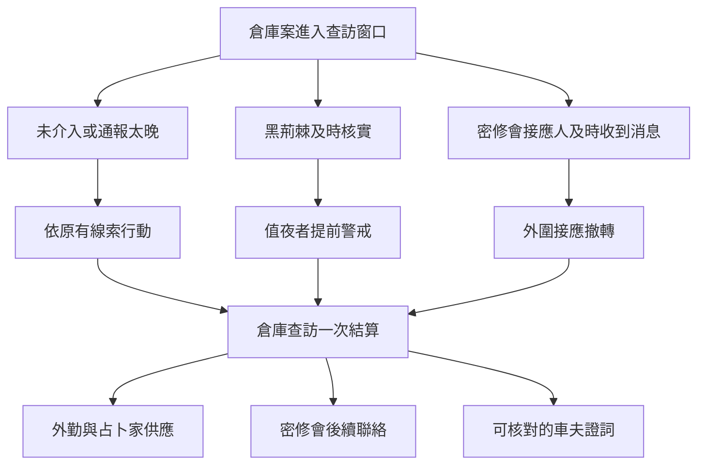
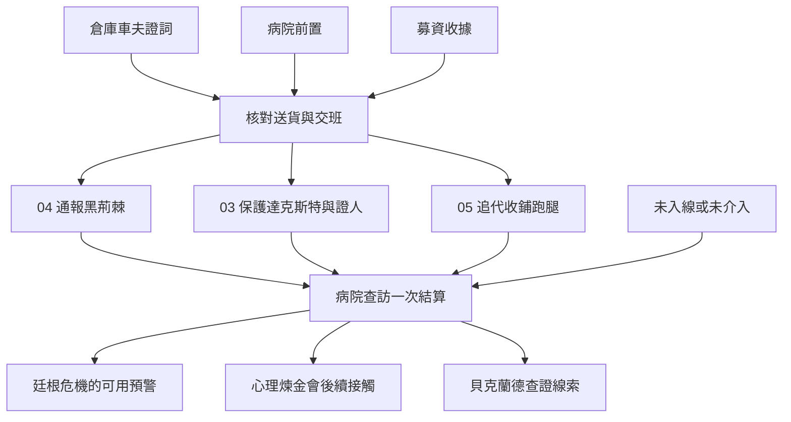
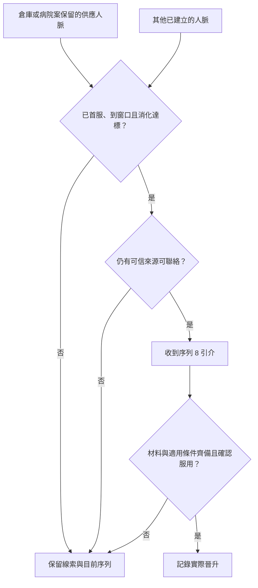
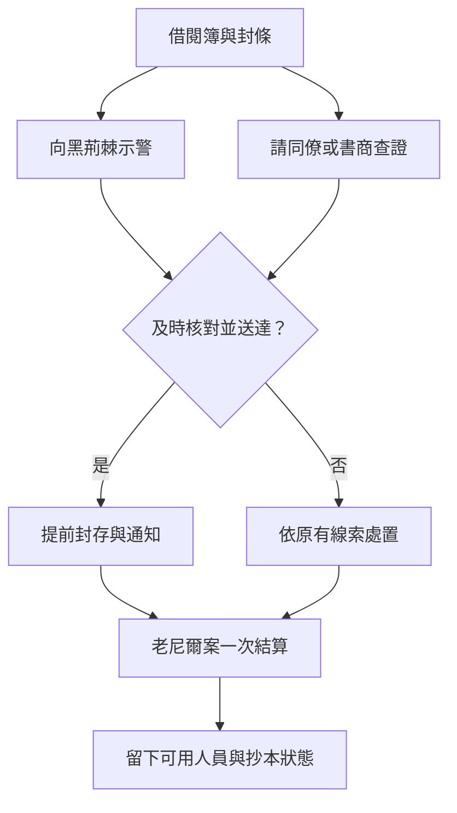
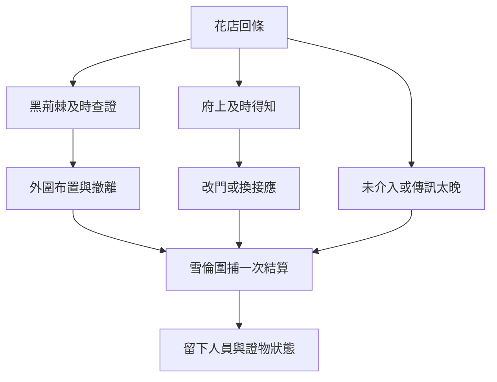

# 廷根｜劇情分支圖

對照[第一部長支線總綱](part_one_sidequest_master_outline.md)、[廷根倉庫案](tingen_warehouse_story_v1.md)與[胡德與蘭爾烏斯](tingen_hood_and_lanevus_story_v1.md)。分叉表示玩家可做的行動或各方得知的資訊，合流表示同一次事件採用當時已成立的結果。箭頭表示事件順序、可用入口或後果承接。是否能兼走，以當日時間、證物權限和接應人能否到場判定。老尼爾與雪倫對照[兩案正文](tingen_neil_and_sharon_story_v1.md)。廷根之變先記接入條件。

## 倉庫案｜兩邊可以先後通知

黑荊棘提前警戒與密修會外圍撤轉可同時成立。兩方需各自取得能行動的內容，並趕在窗口關閉前完成核實。若玩家已把原件交給其中一方，另一方只能使用有權保留的副本或獨立的新證據。車夫是否能接受訪談、願意具名與否，按實際選擇保存。

## 病院案｜先查哪邊，會影響誰來接應

病院當晚，同一角色只能親自在一處。若玩家追跑腿，另一處須事先安排可信接手的人，且對方真的能抵達。追到商號、車次或交接點時，先記為去向線索；有獨立證據能確認蘭爾烏斯本人，才更新他的最後可靠位置。值夜者即使未收到玩家情報，也會依自己的來源查訪。

## 晉升機會｜事件結果會改變找誰

倉庫案接占卜家到小丑，病院案接觀眾到讀心者。首輪窗口約為各自首服後三到四個月。可聯絡的來源能先提供查證、配方或材料；已取得的東西在暫緩時照實保存。

## 老尼爾｜先送到的預警

未介入時，直接依原有線索處置。抄本和人員各記一次，14 讀取仍可使用的目錄與接應。

## 雪倫｜回條何時送達

兩方若都已得知，按收到的範圍與時間各自行動。撤走的是可由玩家接觸的外圍人員，核心交鋒沿本章基準。

## 接到廷根之變前要核對什麼

| 檢查走法 | 必須保留的差異 |
| --- | --- |
| 倉庫原件交黑荊棘，再去找密修會 | 黑荊棘持有原件。密修會只取得獲准副本或新證詞。兩邊各自記收件時間，查訪只結算一次。 |
| 病院先匿名通報，又保護達克斯特 | 可同時提早警戒和保留往來。黑荊棘只知道已收到且可核對的部分。 |
| 病院當晚只追跑腿 | 可取得實際看見的去向。若未安排接應，玩家沒有親自保護走廊人員；既有院方與值夜者仍照其條件行動。 |
| 兩案皆未介入 | 核心事件沿既有年表推進；新場景只讀取玩家後來實際得知的消息。 |
| 接老尼爾、雪倫和廷根之變 | 老尼爾另讀借閱紀錄及示警；雪倫另讀府邸回條與知情人；廷根之變讀取前案預警、值夜者布置和家屬安全。胡德案的車次或證詞只在確實有關且已傳達時能影響其後。 |

**後續更新方式。** 新正文若加入一個選擇，先標出它改變的是哪一個既有結果、誰會知道、何時能讀取。共用結果沿用同一個事件節點。若新增事件確實有自己的觸發與結算，再另開一個節點。
