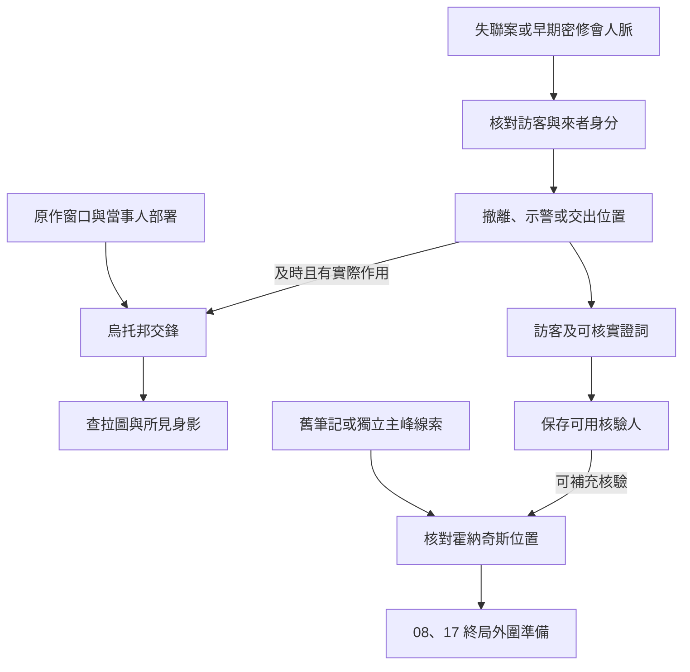

# 查拉圖與烏托邦｜沒有回程的車票

08 密修會與查拉圖、17 塔羅會的後段正文。早期接點沿[廷根倉庫案](tingen_warehouse_story_v1.md)、密修會的人脈和已授權的筆記資料。《倒吊人》與《愚者》年表將烏托邦及查拉圖落幕放在第 1344–1375 章的跨卷區間，與霍納奇斯、伯特利回歸等事件按各自時點判定。下列訪客、旅店與交接為遊戲原創。[《倒吊人》年表](../../lore/history/hanged_man_v1.json) · [《愚者》年表](../../lore/history/fool_v1.json) · [查拉圖傳記](../../lore/characters/biographies/zaratul.v1.json)

## 第一場｜旅店說他已經走了

一名承運人拿著半張回程票來找你。他弟弟本來只打算住一夜。旅店回信說人已離開，衣服也帶走了；但他弟弟每次離開前，都會把票根留在櫃檯的盤子裡。

「他怕自己睡過頭。我想知道，這一次是誰替他把房退了。」

- **從車站查外來訪客。** 核對出發、實際抵達、退房與已核實的返程。只有可信回執或親見者能確認人在哪裡。若玩家以前從未接觸過密修會，可以循這起失聯獨立入線。
- **找仍能聯絡的密修會線人。** 早期保存的借閱、退件或倉庫紀錄，可用於確認中間人。若線人同意接件，他只能從實際收到的日期、名單與路線查起。玩家可以只合作查人，也可以把外來者的行蹤交給查拉圖一方。
- **請可信的人轉達異常。** 玩家可以沿已建立的值夜者、克萊恩或 17 的外部聯絡送出車次和失聯時點。只交得出一張票時，先記待查；持有人是否願意讓其他人看姓名，由本人或有權保管的人決定。

## 第二場｜有人替他答了

玩家若能沿當期路線實際進入烏托邦，會看見旅店櫃檯邊放著一隻還沒喝完的杯子。店員說，住客走得急，只請他替自己帶句話。稍後，你在另一條街上遇到一個自稱替同一位住客帶話的人。他把那句話原樣念了一遍，連停頓也在同一處。

若玩家留在城外，這一段只能從實際回來的訪客或獲准的紀錄得知。

- **核對來者身分。** 可詢問各人獨自見到的時點、查同一段時間的兩處紀錄，或請具備手段的人驗證。長相、筆跡與說話習慣能提供線索；本體、祕偶與歷史投影仍須依實際證據辨認。未能核實時，保留最後確認的身分與時間。
- **帶真正要離開的訪客先走。** 確認本人意願、可走路線與接收人。若已失去原有出口，先循仍成立的接應查替代路線。未抵達的訪客保留最後確認位置。
- **送出已核實的示警。** 克萊恩或其他能行動的人須真正收到消息。若玩家向密修會交出同一份位置，另記對方能否趕到。不同收件人可以同時收到各自版本，依所知部署。

## 第三場｜城外有人點燈

約好的接應人把燈掛到能看見鐵軌的地方。有人說查拉圖已經退走，也有人說他剛從另一條街進去。玩家可先問清楚兩個說法各從哪裡來，再決定要等人，還是把仍在這裡的訪客送走。

**交鋒結算。** 零介入沿克萊恩與查拉圖的原作交鋒及查拉圖在第一部的落幕。玩家可以改變消息抵達時間、外圍接應及訪客去向。要改變交鋒，須在當時作用於有影響的高位行動或部署。確認擊退某個身影時，只更新該身影和目擊者所知；查拉圖本體與其他可用手段另按世界狀態判定。交鋒後，存活的訪客、返程票據及仍願意作證的人可供回訪。

## 第四場｜山名下面還有一行

若玩家保有廷根的筆記線索，可以把抄件交給確有能力解讀的人。只有失聯案證詞時，可從當期可取得的迷霧小鎮資料或可信盟友另行查證。有人在「霍納奇斯」下劃了一道線，旁邊寫了幾個待查的地名。玩家可以把獲准的部分送去核實、安排守住接應，或讓尚未取得許可的資料留在原持有人手上。

**主峰查證。** 舊筆記、烏托邦的身分核驗和主峰的位置各有證據來源。只有足以指向主峰的資料確實送到可用盟友，才可接進 08、17 的外圍準備。安提哥努斯的歷史、當時的封印與高位交鋒分開判定。接觸主峰的高位事件須另有可達性、手段和原作窗口。第一部結算讀取能安全聯絡的訪客、可信核驗人、證物及各方取得的情報。[安提哥努斯傳記](../../lore/characters/biographies/antigonus.v1.json)

## 愚者途徑的回訪

**魔術師 → 無面人。** 暫排上次服藥約三至四個月後，優先循已完成的身分經營與可用師承開窗。**無面人 → 祕偶大師**暫排上次服藥約四個月後，可在海上遺跡線或後續祕偶查證回訪核驗。烏托邦的來者身分可提供後期回訪材料，晉升所需的消化、供應與適用儀式仍依玩家實際條件。**詭法師**以上沿獨立的高序列事件窗查證。[第一部晉升時機表](part_one_advancement_schedule.md)

## 烏托邦與主峰查證細圖

| 走法 | 結果 |
| --- | --- |
| 未進烏托邦，只在城外接到訪客 | 保留實際抵達與獲准證詞。城內經過依可核對來源得知。 |
| 兩個來源都聲稱同一人到場 | 記下矛盾與時間，等適用手段或獨立證據再更新身分。 |
| 保住訪客，示警晚於交鋒 | 撤離有效，消息供後續查證。交鋒照當場條件結算。 |
| 沒有參與烏托邦，另有可信主峰線索 | 可獨立核對主峰位置，再依條件安排終局外圍。 |

[第一部劇情總樹](part_one_story_tree.md)
