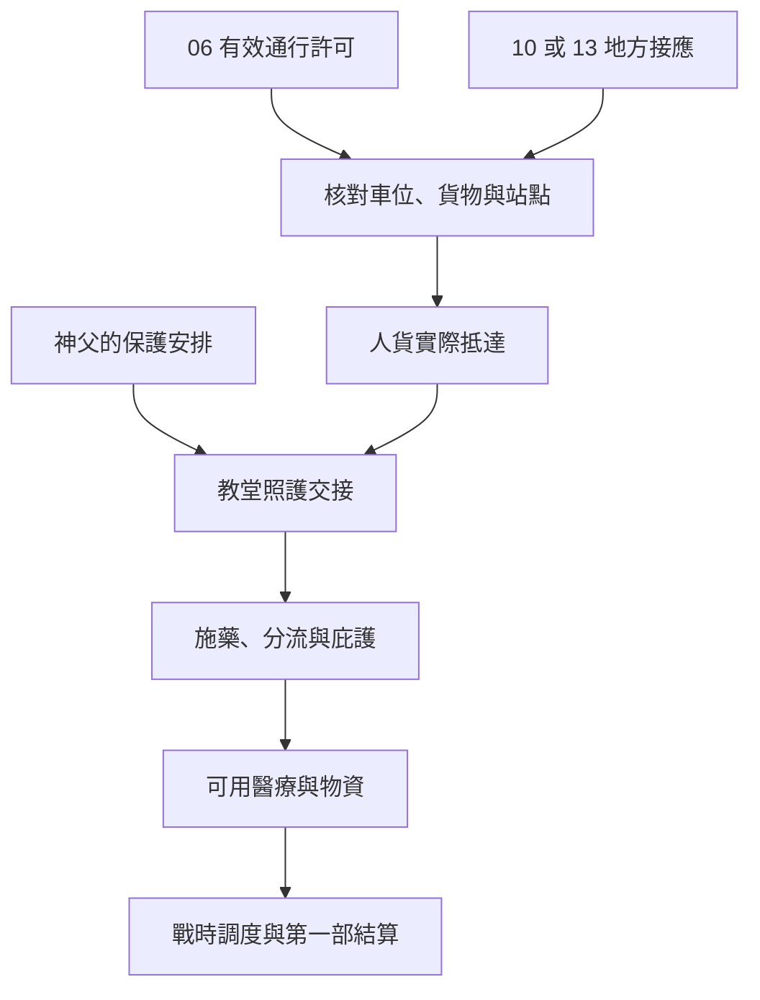

# 戰時通行與豐收教堂｜門還要開

06 王室工程外圍、10 南大陸地方接應、13 豐收教堂的戰時正文。接續[王室工程調查](backlund_negan_and_royal_works_story_v1.md)、[拜朗史料](south_azik_balam_spirit_guide_story_v1.md)及[早期教堂供藥](backlund_fors_emlyn_tarot_contacts_story_v1.md)。原作基準依[烏特拉夫斯基傳記](../../lore/characters/biographies/utralavsky.v1.json)與[13 綱要](long_sidequests_part_one.md)。戰事爆發後，烏特拉夫斯基因弗薩克出身遭到懷疑，倫納德帶人到教堂，神父接受黑夜教會的保護性關押。本稿的通行差事、供藥接手、住戶及對白為遊戲原創。關押與各地戰時調度依各自的事件窗口開啟。

## 第一場｜只有一枚章

檢查站的守衛把通行證翻過來。車後兩箱是藥，一箱是包紮用的布。旁邊一位老人在等同行者替他取水。守衛指著通行證上的兩行字，問你打算在哪裡卸貨。

「這張准你過橋。人要不要下車，得看你有沒有替他報到。」

06 的通行證要查核有效站點、時段和獲准載運的人或貨。10 的地方聯絡可以安排自己熟悉的卸貨處與接頭，但通行條件須向當地確認。只走 13 的玩家可由教堂或相熟住戶提出本地接手安排。

- **先送藥。** 在許可範圍內交貨。能聯絡接應人時，可請他先去找等候的住戶。仍在車上的貨與已簽收的貨分開記。
- **騰出位子載人。** 先核對當事人同意、路線和接收地。卸下的貨只在有人實際接管時記入備用庫存。若載運條件改變，須由站點重新確認。
- **把不符的部分留在原站。** 玩家可改找本地接頭、轉送已准運的部分，或帶當事人改約。證件、原件與已送出的副本依實際持有人記錄。地方接應能否趕上，要等消息真正送到才判定。

## 第二場｜誰來替我開門

豐收教堂裡，烏特拉夫斯基正把幾包分裝好的藥放到靠窗的架上。外頭有腳步聲。他把一張還沒核完的領藥單交給願意接手的人。

「後面那家還沒來。你們若要我走，先讓我把這戶交給能找到他的人。」

若玩家曾協助埃姆林送藥或召回，可以循實際保留的紀錄接手；若此前的住戶名冊已外流，住戶可要求換人或換地點。埃姆林或其他協助者是否在場，按自己的行程與合作承諾判定。倫納德或當時有權執行的教會人員，只接觸實際交到手的證詞。

- **替神父完成照護交接。** 可請他確認哪些藥已備妥、哪些住戶還在等，並找實際能承擔工作的人。原作基準中神父隨教會人員離開，教堂當日由實際留下的人接手。
- **提出替代保護方案。** 要在決定前提出可用處所、負責人及保護時段。須由神父與相關教會同意，且接應實際能到位才改動安排。晚到的證詞可用於事後查核，原定決定照已知情況執行。
- **只替住戶送藥，或另找庇護。** 玩家可在各方能核實的範圍內交接物資，請可信的人帶路，或婉拒繼續參與。當事人可自行選擇是否轉移。

**IF｜替代庇護。** [13-C](part_one_if_stories_11_17.md#13-c神父在約定的住處收藥)須先完成安全驗收與責任交接。神父答應轉往新處所，是為了減少教堂照護者捲入戰時疑懼；若仍有住戶等藥，他先交接藥單和公開領藥時段。護送和簽字由實際在職、受命並到場的人執行。

## 第三場｜晚來的人

天快黑時，一名婦人扶著門框，手裡的紙已被揉成一條細繩。她來過兩次，兩次都撞見有人在門口查問。她想知道明天還有沒有人在這裡。

玩家可告訴她已確認的領藥時段，或與她約可抵達的替代地點。若有一輛車已把藥送到，卻還沒有人簽收，就先找收貨人核對。教堂是否能繼續開門，由實際留下的人、可用藥品、值勤時段和替代落腳處共同決定。缺人時可縮短時段或分流；一張庇護名冊只能依實際容量安排。

埃姆林若仍願意合作，可循自己能聯絡的供藥人補足欠缺。已有 17 外部聯絡的人可以請他代問，須先確定他真的能轉交，也只傳原持有人同意的內容。取得軍情九處或王室外圍管道的玩家，可用合適的許可調度。它的效力依核發方、地點及用途判定。來自南大陸的接應若只掌握彼岸落腳處，仍須等人或物資實際抵達當地。

## 晉升與後續

- **母親途徑。** 耕種者首服後約三至四個月，可循教堂施藥回訪安排醫師；醫師服用約三至四個月後，可從戰時庇護的照護交接約談豐收祭司。若照護導師或供應轉移，持可核實紀錄循仍可聯絡的教會人員重約。後續生物學家留在戰時醫療供應的後段窗口。
- **紅祭司與黃昏巨人。** 未首服者沿[戰時首份魔藥](rose_and_wartime_pathway_acquisition_v1.md)辦理。獵人首服約三至四個月後，可憑補給查路或斥候差事接挑釁者。戰士首服約三至四個月後，可從實際能抵達的戰地分站接格鬥家，分站核准另查。縱火家及武器大師依[晉升時機表](part_one_advancement_schedule.md)接到下一輪護送、偵察或據點防守。兩條路皆須確認消化與供應。

**戰時結算。** 06、10、13 共用實際載運與抵達紀錄，另記證件適用範圍、神父的保護安排、接手的照護者、居民去向及可用物資。零介入沿神父接受關押的基準，照護由仍在場的人按條件接續。王室儀式與戰局的高位結果各自有事件窗口，後續只讀確實可動員的接應。第一部結算可使用仍在運作的庇護與補給管道。

## 戰時通行與庇護細圖

| 走法 | 結果 |
| --- | --- |
| 通行證只准這一批藥通過 | 藥品照實際送達入庫；住戶另約可行路線。 |
| 神父隨倫納德離開，玩家找到接手者 | 關押照基準，教堂按到位的人手和存量維持照護。 |
| 提出替代保護，接應未及時到場 | 本次按原有決定結算，替代處所可供之後另約。 |
| 只做地方補給，未加入任何一方 | 保留到貨與既有合作；組織身分和配藥資格另查。 |

[第一部劇情總樹](part_one_story_tree.md)
