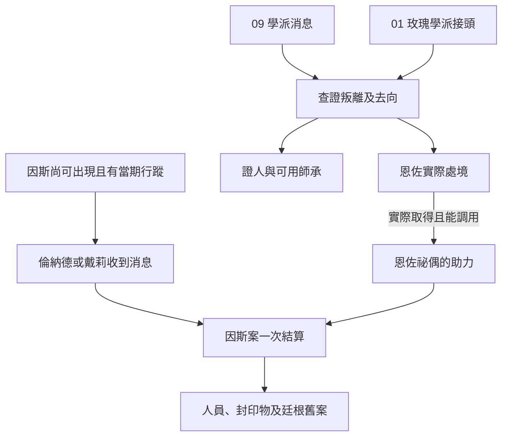

# 西拜朗追查｜還沒送出去的證詞

09 生命學派、01 玫瑰學派與 04 廷根舊案的交會正文。接續[奧拉維交接](bayam_darkwill_probability_dice_story_v1.md)、[玫瑰學派追捕](backlund_rose_pursuit_story_v1.md)及[南大陸地方接應](south_azik_balam_spirit_guide_story_v1.md)。原作基準按[恩佐傳記](../../lore/characters/biographies/enzo.v1.json)和[《不死者》年表](../../lore/history/dantes_undying_v1.json)。序列 5「贏家」恩佐受玫瑰學派引誘，叛離生命學派；克萊恩在南大陸將他製成祕偶，其後用他協助對付因斯。因斯案依自己的原作窗口開啟。下列印記、證人與玩家差事均為遊戲原創。

## 第一場｜只蓋了一半的印

西拜朗的旅店櫃檯上有兩封退信。一封退回原寄件處，另一封把封口掀開，又用同一塊蠟黏上。櫃檯員翻出帳冊，指著領件欄。

「收件人叫我寫『他已搬走』。他只住了一晚，我怎麼知道他往哪裡去了？」

若玩家從 09 進線，可信的學派聯絡人會請你核對恩佐在離開前曾接觸誰。從 01 進線時，可循地方接頭者查證哪一批人收過信。若只走 04，玩家可先核對廷根舊案的最新聯絡地址，待有獨立證據才接上恩佐。沒保住舊人脈時，可以從旅店原始帳冊與仍願意開口的人重新建立來源。

- **先留信，再核對領件人。** 記下可核實的印記、交接時間與證人允許分享的範圍。兩封信出現同一個記號，只能證實它們可能經過同一管道。
- **向玫瑰學派的接頭者交換消息。** 交出自己確實握有的地址或時刻，換取約見或可查證的回條。對方依收到的資訊追查，既有的撤離者或證人可能被找到。節制派和放縱派各自讀取真正傳到自己手上的消息。
- **先把證人安頓好。** 讓他選要不要離開、願讓誰知道新去處。當事人實際抵達才記安置。原始帳冊若在這段時間被取走，可回查已核對的抄件或其他見證人。

## 第二場｜後門沒有關

回到旅店時，櫃檯員已把外套收進紙袋。他說有人趁自己換班時來問退信。樓上那間房已付清，但沒有人來拿行李。

玩家可沿已核實的時間查恩佐的最後位置、把可信消息送給學派，或在有人願意接件時循 04 查其他可疑動向。恩佐的叛離有自身證據，因斯行蹤須從另一條線另行核對。即使兩人出現在同一地區，兩案也只在後續實際有人、情報或祕偶可用時產生連接。

- **保護仍在場的人。** 撤離、傳訊或送交證據可各由可信的接應者承擔，按實際完成時間結算。若人手不足，當下只完成其中一件。
- **警告恩佐或替追蹤者引路。** 一方必須實際收到消息並能改變路線才會生效。恩佐會按自己所知與可用手段行動。玩家嘗試攔截時，另讀雙方能力與準備。
- **查證事後身分。** 零介入時，克萊恩在南大陸把恩佐製成祕偶。若玩家的有效干預改變兩人能否相遇或交鋒條件，依實際結果判定。只有目擊或能核實的人知道他的處境。證人看到相似的身影時，先留下見聞和時間。

**追逃的入口。** 因斯須在當期仍可出現，且收到消息的人得有獨立可查的行蹤。廷根已確認其死亡時，略過第三場；恩佐仍依學派叛離與自己的行程結算。值夜者可回查實際留下的接應者與封存紀錄，無須為已了結的追逃再調派倫納德或戴莉。那場對抗的附身、祕偶助戰、戴莉之死與亞當取得 0-08 都失去前提。

## 第三場｜把地址抄給倫納德

有可信的值夜者管道時，玩家可以請人把封好的案情摘要帶給倫納德或戴莉。兩人各按當時所在、存活狀態、案情與可用接應決定行動。玩家在外地也可以交件，但訊息必須經可驗證的管道到達。若已晚於行動窗口，只供事後核對。

倫納德若親自收下，他會把地址和來源分在兩張紙上，先問你從哪裡得知，又問了一次：

「你上次在廷根見過的那個人，今天還能自己說話嗎？」

- **交行蹤，保留證人去處。** 只交能核實的時間及地點。需要證人出面時，另問其意願並確認能否安全抵達。倫納德或戴莉實際收到的內容，才可用於部署。
- **協助外圍撤離或送訊。** 到場後可封存交班紀錄、引導無關者離開，或在危險來臨前提醒已約好的接應者。涉及 0-08 的細節按教會授權與實際證據揭露。
- **把情報留待事後。** 行動照既有線索與人物安排推進。玩家可在事後核對保住的記錄、失聯者及廷根舊案哪些部分仍待確認。

**因斯案結算。** 零介入時，克萊恩、倫納德與戴莉按原作對抗因斯，因斯覆滅。克萊恩已取得且能調用恩佐祕偶時，才讀取該助力；若祕偶不可用，由實際參與者和其他可用手段判定後續。外圍證詞與撤離可改變當地傷亡和追查進度。要改變高位交鋒或核心人物結果，須有足以作用到當場的行動、戰力及時機。各走法記錄實際存活者、因斯結果、0-08 的已知去向與證詞持有人。第一部後段如使用恩尤尼或歷史投影，另依各自時間與成立條件判定。[因斯傳記](../../lore/characters/biographies/ince-zangwill.v1.json) · [戴莉傳記](../../lore/characters/biographies/daly-simone.v1.json)

## 回訪與晉升

- **機器 → 幸運者。** 上次實際服藥約三至四個月後，可在學派查證叛離的窗口約談。導師可用已獲許可的退信資料或獨立證詞確認玩家完成的委託。消化、配方與供應各自查核。
- **幸運者 → 災禍教士。** 暫排在幸運者服用約四個月後，循南大陸較晚的回訪查證仍可用的師承。原供應者若因叛離案失聯，可找可信替代導師。適用儀式與材料仍按已核實的條件辦理。
- **狼人 → 活屍。** 已走被縛者的玩家可從仍能聯絡的一派安排後續接應。暫排上次服藥約四個月後，按該派實際持有的供應與信任開窗。與恩佐的合作或叛離證據各自記錄。[第一部晉升時機表](part_one_advancement_schedule.md)

## 西拜朗追查與因斯案細圖

| 走法 | 結果 |
| --- | --- |
| 因斯已在廷根死亡 | 關閉西拜朗追逃及該場傷亡、戰利品；照常結算恩佐的獨立行動。 |
| 只收到恩佐的叛離消息 | 可查叛離及學派關係。因斯行蹤仍須另查。 |
| 安置證人，行動前未能送達案情 | 保留證人和事後證詞。當場依參與者實際掌握的線索行動。 |
| 恩佐的遭遇受有效干預改變 | 重判祕偶是否成立及可用；因斯須仍可出現且有當期行蹤，才開追查。 |
| 未介入南大陸兩案 | 各角色沿原作基準行動。玩家依實際收到的回報入線。 |

[第一部劇情總樹](part_one_story_tree.md)
